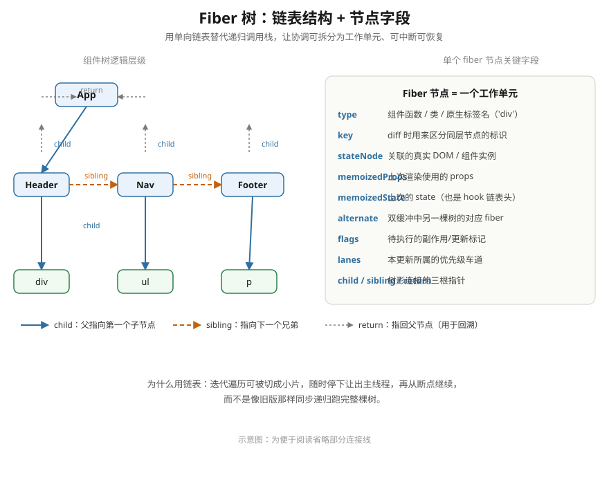
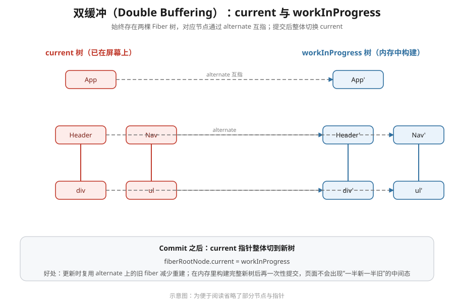
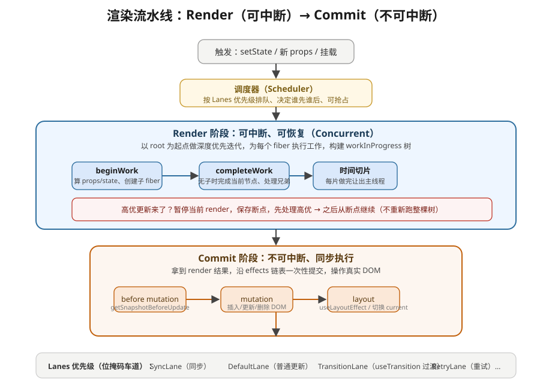
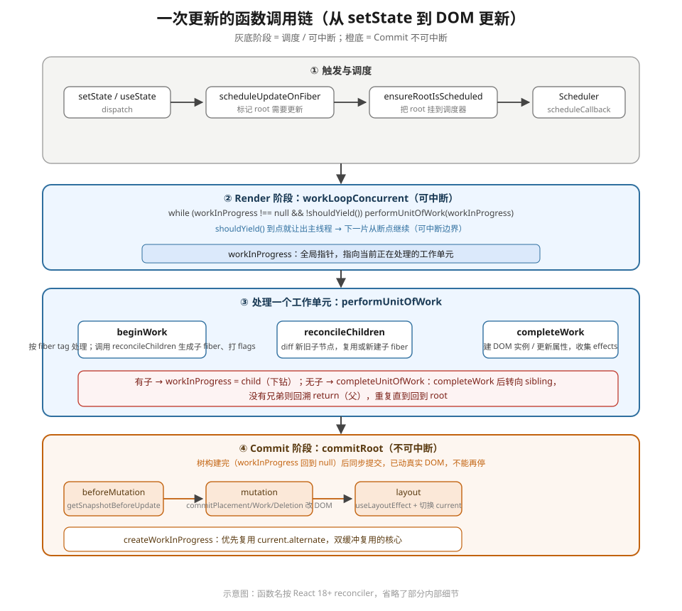

# React Fiber 架构

> 类别：React 底层原理
> 版本基线：React 16+（Fiber 引入），React 18+ 并发特性依赖 Fiber；Fiber 至今仍是协调器核心

## 一、为什么需要 Fiber：旧协调器的痛点

React ≤15 的协调器（reconciler）采用 **Stack reconciler**：渲染时从根节点开始**同步递归**遍历整棵虚拟 DOM 树，一次性把整棵树跑完，期间无法被打断。

两个致命问题：

- **不可中断**：一旦开始渲染，必须同步跑完，中间没法处理用户的点击、输入等更紧急的事。
- **阻塞主线程**：组件树越复杂，单次递归耗时越长。在 60fps 下超过约 16ms 就会掉帧、页面卡顿。

Fiber 架构正是为了解决"渲染必须一次性同步完成"这个根问题而引入的。

### Fiber 针对性解决了什么问题

| 旧版的痛点 | Fiber 的解法 |
| --- | --- |
| **渲染不可中断**：一旦开始渲染必须同步跑完，高优交互（点击、输入）只能排队等 | render 阶段拆成一个个工作单元，**可随时打断**，把控制权让回主线程，再恢复 |
| **同步递归阻塞主线程**：整棵树一次性跑完，组件一复杂就掉帧、卡顿 | 用**链表迭代 + 时间切片**，把一次渲染分摊到多个时间片，主线程有空闲响应输入和动画 |
| **所有更新同一优先级**：无法区分"紧急"（用户输入）与"可延迟"（大列表渲染） | 引入 **Lanes 位掩码优先级**，高优更新可以**抢占**正在进行的低优 render |
| **没有并发能力**：任何更新都可能拖垮整个交互 | 借助**双缓冲 + 可中断恢复**，支撑 `useTransition`、`useDeferredValue`、`Suspense` 等并发特性 |

一句话总结：**Fiber 让 React 从"一次性同步渲染"进化到"可拆分、可暂停、可按优先级调度的并发渲染"，从而不再为一次渲染而牺牲用户交互的流畅性。**

## 二、Fiber 是什么

Fiber 有两个含义要分清：

1. **fiber 节点**：一个普通 JS 对象，描述"某个组件/元素的一次工作单元"。
2. **Fiber 架构**：基于链表 + 迭代遍历的协调模型，取代旧的递归。

### 词源

*fiber* 本义是**纤维**——细长、可拆分、能相互并联成网。React 借这个意象表达：把一次渲染拆成一个个极小的、可独立调度的工作单元，像纤维一样编织成整棵渲染树，从而可以"随时切一根线、换一根线"（中断与恢复）。

### 从递归调用栈 → 单向链表树

- **旧版**：递归天然使用 JavaScript 调用栈，一进一出，无法在中间停下来。
- **Fiber**：用**单向链表**把树串起来，遍历改为**迭代**（work loop）。迭代没有调用栈的约束，可以随时停下、记录断点、之后再从断点继续。

每个 fiber 通过三根指针连接成树：

- `child`：指向**第一个**子节点。
- `sibling`：指向下一个兄弟节点。
- `return`：指回父节点（用于遍历回溯）。



## 三、fiber 节点的关键字段

| 字段 | 含义 |
| --- | --- |
| `type` | 组件函数 / 类 / 原生标签名（如 `'div'`） |
| `key` | diff 时用来区分同层节点的标识 |
| `stateNode` | 关联的真实 DOM / 组件实例 |
| `pendingProps` | 本次将要使用的 props |
| `memoizedProps` | 上次渲染实际使用的 props |
| `memoizedState` | 上次的 state（同时也是 hook 链表的表头） |
| `alternate` | 双缓冲中另一棵树的**对应** fiber |
| `flags` | 待执行的副作用 / 更新标记（React 16.13 前叫 `effectTag`） |
| `lanes` | 本更新所属的优先级车道 |
| `child / sibling / return` | 树形连接的三根指针 |

## 四、双缓冲（Double Buffering）

应用中**始终存在两棵** Fiber 树：

- **current 树**：当前已提交、对应屏幕上正在显示的 UI。
- **workInProgress 树**：在内存中构建、准备下一次提交的新树。

两棵树的对应节点通过 `alternate` 相互引用。工作流程：

1. 更新触发后，React 在 **workInProgress 树**上构建（render 阶段）。
2. 全部完成后进入 commit，**一次性**把 `fiberRootNode.current` 指针切到新树。
3. 旧树变为备用，下次复用它的 fiber 节点（减少重建开销）。

好处：

- **复用**：更新时优先复用 `alternate` 上已有的 fiber，减少对象创建。
- **原子性**：先在内存构建完整新树，再整体切换，页面不会出现"一半新一半旧"的中间态。



## 五、渲染的两个阶段：Render 与 Commit

Fiber 把渲染严格分成两段，这是整个架构的核心设计。

### Render 阶段（可中断、可恢复）

- 从 root 开始**深度优先迭代**遍历 fiber 树，为每个节点执行 `beginWork`（根据 props/state 判断是否要更新、创建子 fiber），子节点处理完后再 `completeWork`（无子时完成当前节点、转向兄弟）。
- 结果：构建出完整的 **workInProgress 树**，并收集需要提交的节点（effects 链表）。
- **可以随时中断**：这一阶段只计算"新的树长什么样"，**不碰真实 DOM**，所以中断没有任何副作用。

### Commit 阶段（不可中断、同步）

- 拿到 render 的结果，沿 effects 链表**一次性同步执行**，真正操作真实 DOM。
- 细分为三个子阶段：
  1. **before mutation**：`getSnapshotBeforeUpdate` 等，在 DOM 变更前读取状态。
  2. **mutation**：插入 / 更新 / 删除 DOM。
  3. **layout**：`useLayoutEffect`、切换 `current` 指针。

Commit 阶段一旦开始就必须跑完——因为已经动到真实 DOM，中断会造成不一致。



## 六、时间切片与调度

既然 render 可中断，怎么"优雅地打断"？靠**时间切片（time slicing）**：

- 把一次大渲染拆成多个小时间片（每片约几 ms）。
- 每片做完就把控制权让回主线程，让它处理输入、动画。
- 下一片再继续，直到整棵树构建完。

React 的调度器（`scheduler` 包）**自己实现**这套机制（基于 `MessageChannel` + `requestAnimationFrame`），而不是直接用 `requestIdleCallback`。

### 为什么不用 requestIdleCallback

`requestIdleCallback` 其实曾是 React 的**早期原型方案**（React 团队参与过该 API 的设计），但最终因三个硬伤被放弃：

1. **兼容性出局**：Safari 至今没有原生实现（Firefox 也曾长期缺失），不能为一个 API 放弃整个浏览器生态。
2. **触发时机不可控**：它只在浏览器"空闲"时才回调，可能迟迟不来，渲染任务会被无限拖延；对需要及时响应的更新不友好。
3. **没有优先级与抢占**：它只做"空闲时执行"，不能按 Lanes 排序、不能让高优更新抢占低优更新——而这是整个并发模型（`useTransition`、`Suspense`）的地基。

React 自研调度器用 **`MessageChannel`** 做调度通道：回调在宏任务里**即时触发**（不依赖浏览器的空闲时机），时序可控；且不受嵌套 `setTimeout` 约 4ms 最小延迟钳制。再配合 `requestAnimationFrame` 处理帧边界。

| 需求 | requestIdleCallback | React 自研调度 |
| --- | --- | --- |
| 跨浏览器可用 | ❌ Safari 不支持 | ✅ 自建 |
| 触发及时 | ❌ 只在空闲，可能拖延 | ✅ MessageChannel 宏任务即时 |
| 时间片精确控制 | ❌ 依赖浏览器 | ✅ 自己控制每片工作量 |
| 优先级 / 抢占 | ❌ 没有 | ✅ Lanes 可抢占 |

## 七、优先级：Lanes

调度器要回答"该先做哪个更新"。React 18 用 **Lanes**（位掩码表示优先级车道）取代了旧的 expirationTime 模型：

- 每个更新被打上一个或多个 lane，lane 的位置越高优先级越高。
- 常见车道：`SyncLane`（同步）、`DefaultLane`（普通更新）、`TransitionLane`（`useTransition` 的过渡更新）、`RetryLane`（Suspense 重试）等。
- **高优先级更新可以打断正在进行的低优先级 render**，处理完再恢复低优的。

## 八、可中断恢复与并发特性

render 被打断后恢复时，**不是从头重建整棵树**，而是借助 workInProgress 树和保存的进度，从**上次中断的位置**继续。

正是这个能力支撑了 React 18+ 的并发特性：

- `useTransition`：把大更新标为过渡，先响应输入，低优渲染可被打断。
- `useDeferredValue`：延迟更新某个值的展示。
- `Suspense`：渲染可挂起、可回退到 fallback。

## 九、Fiber vs Stack：一张表对比

| 维度 | Stack reconciler（≤15） | Fiber（16+） |
| --- | --- | --- |
| 遍历方式 | 同步递归（调用栈） | 迭代 + 单向链表 |
| 可中断 | 否，一次性跑完 | 是（render 阶段） |
| 可恢复 | — | 是，从断点继续 |
| 优先级 | 粗略（expirationTime） | Lanes 位掩码车道 |
| 双缓冲 | — | current / workInProgress + alternate |
| 并发渲染 | 不支持 | 支持（18+） |

## 十、执行过程的内部函数（面试向）

> 函数名按 **React 18+ reconciler** 描述。核心考点就四个：**一次更新的调用链、work loop 怎么做到可中断、beginWork / completeWork 各干什么、commit 为什么不可中断**。



### 一次 setState 的完整调用链

```
setState / useState.dispatch
  → scheduleUpdateOnFiber        // 标记该 fiber 所属的 root 需要更新
  → ensureRootIsScheduled        // 把 root 挂到调度器
  → Scheduler.scheduleCallback   // 调度一个渲染任务（并发时）
  → renderRootConcurrent
      → workLoopConcurrent       // while(workInProgress && !shouldYield()) ...
          → performUnitOfWork    // 处理一个工作单元
              → beginWork        // 按 fiber tag 分发，生成子 fiber、打 flags
                  → reconcileChildren   // diff 新旧子节点，复用或新建子 fiber
              → 有 child ? 下钻 child : completeUnitOfWork
                  → completeWork  // 建 DOM 实例 / 更新属性，收集 effects
                  → 有 sibling ? 转 sibling : 回溯 return
  → 树构建完（workInProgress 回到 null）
  → commitRoot                   // 不可中断，同步提交
      → beforeMutation → mutation → layout   // 三个子阶段，真正改 DOM
```

### 核心函数逐个讲

| 函数 | 阶段 | 职责 |
| --- | --- | --- |
| `scheduleUpdateOnFiber` | 调度 | 从触发更新的 fiber 向上找到 root，标记需要更新 |
| `ensureRootIsScheduled` | 调度 | 确保 root 已被安排到调度器 |
| `workLoopConcurrent` | render | 迭代遍历，`shouldYield()` 判断当前时间片是否到点 |
| `performUnitOfWork` | render | 处理**一个**工作单元：先 beginWork，再决定下钻还是完成 |
| `beginWork` | render | 按 fiber tag 分发处理；函数组件会调 `renderWithHooks`（执行组件体）；用 `reconcileChildren` 生成子 fiber、打 flags |
| `reconcileChildren` | render | diff 新旧子节点（`reconcileChildFibers`），复用或新建子 fiber，标记 Placement / Update / Deletion |
| `completeUnitOfWork` | render | 完成当前节点后：有 sibling 转兄弟，没有就回溯 return 继续完成父 |
| `completeWork` | render | 对原生节点建 DOM 实例 / 更新属性，把 effects 收集成链表（供 commit 用） |
| `createWorkInProgress` | render | 优先复用 `current.alternate` 建 workInProgress——**双缓冲复用的核心** |
| `commitRoot` | commit | 提交入口，**不可中断**，沿 effects 链表同步执行 |
| `commitMutationEffects` | commit | mutation 子阶段：`commitPlacement`（插入）/ `commitWork`（更新）/ `commitDeletion`（删除）真正操作 DOM |
| `commitLayoutEffects` | commit | layout 子阶段：触发 `useLayoutEffect` / 生命周期，并**切换 current 指针** |

### 高频面试问答

**Q1：一次 setState 后，React 内部是怎么走的？**
A：`setState` → `scheduleUpdateOnFiber` 向上定位 root → `ensureRootIsScheduled` 交给调度器 → render 阶段用 `workLoopConcurrent` 迭代 `performUnitOfWork` 构建 workInProgress 树 → 树构建完后 `commitRoot` 同步提交、改真实 DOM、切换 current。

**Q2：work loop 是怎么做到"可中断"的？**
A：关键在两点：一是不再依赖递归调用栈，而是用 `workInProgress` 全局指针 + 链表迭代，天然可以在任意两个工作单元之间停下；二是每个 `performUnitOfWork` 之前先查 `shouldYield()`，时间片到点就把控制权让回主线程，等下一片再从 `workInProgress` 断点继续。

**Q3：beginWork 和 completeWork 分别干什么？**
A：`beginWork` 是"向下走"——按 fiber 的 tag 分发，函数组件里调 `renderWithHooks` 执行组件体，再通过 `reconcileChildren` 生成子 fiber 并打 flags；`completeWork` 是"收尾"——把子树处理完，对原生节点创建 DOM 实例 / 更新属性，并把要提交的 effects 收集成链表。

**Q4：completeUnitOfWork 怎么完成一次回溯？**
A：当前 fiber 没有子节点时，先 `completeWork` 完成它；然后看它的 `sibling`，有就切到兄弟继续；没有兄弟就沿着 `return` 回到父节点，再 `completeWork` 父。这样整棵树以深度优先的顺序全部被完成，最终 `workInProgress` 回到 null，render 阶段结束。

**Q5：commit 阶段为什么不可中断？**
A：render 阶段只算"新树长什么样"，不碰真实 DOM，所以能停；而 commit 阶段已经开始插入 / 更新 / 删除真实 DOM，中途中断会造成页面处于不一致的中间态，所以必须一次性同步跑完。

**Q6：createWorkInProgress 和双缓冲是什么关系？**
A：它就是双缓冲的落地实现：构建 workInProgress 树时，优先复用 `current` 对应节点的 `alternate`，没有才新建。提交后把 `current` 切到新树，旧树变成下一轮的 alternate，实现对象的循环复用，减少每次更新的创建开销。

## 十一、参考

- React 官方文档：Reconciler 与并发特性
- 《React 源码解析》系列（fiber 节点、双缓冲、工作循环）
