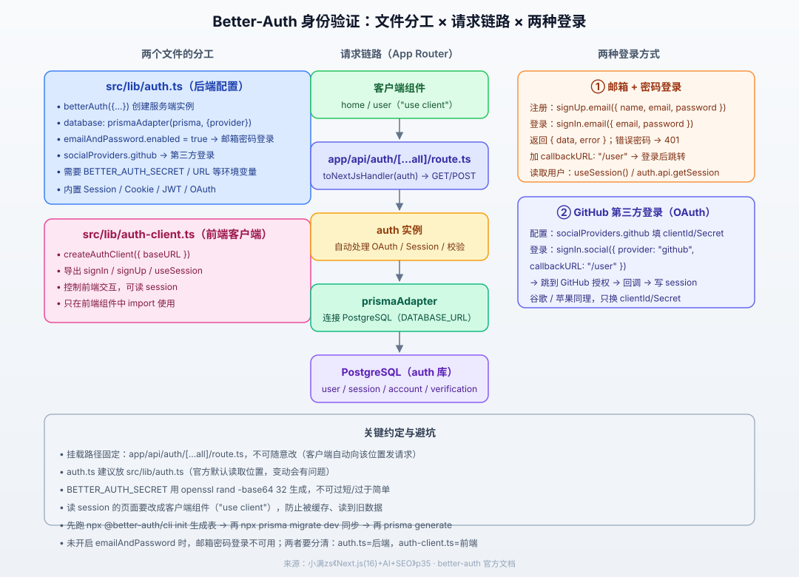

# Next.js 16 Better-Auth 身份验证知识点

> **一句话**：Better-Auth（better-auth）是一个 TypeScript 全栈认证框架，帮你在 Next.js 里直接接入**邮箱密码登录**和**第三方 OAuth 登录**，不用自己造轮子。本文以 **Next.js 16 为基线**，参考小满zs《Next.js(16)+AI+SEO》p35，覆盖：为什么选它、9 步集成流程、`auth.ts` 与 `auth-client.ts` 分工、邮箱密码登录、GitHub 第三方登录、服务端读取 Session、Next.js 16 Proxy 鉴权与避坑清单。

---

## 一、为什么选 Better-Auth

不自己重复造登录/注册轮子，因为框架已经帮你写好了。Better-Auth 的核心优势：

| 能力 | 说明 |
|---|---|
| **第三方登录多** | 内置 Apple、GitHub、Google、微信（Wechat）、Twitter、TikTok 等，只需在官方后台拿到 `clientId` / `secret` 填进去即可用 |
| **框架支持广** | 不止 Next.js，还支持 Nuxt(Vue)、Astro、Electron（桌面）、Hono / Fastify / Express / NestJS（纯后端）、Expo（移动端） |
| **内置能力全** | Session、Cookie、JWT 验证、OAuth 全都内置，基本你能想到的它都有 |

> 相对劣势：**集成步骤较长（官方 9 步）**。但它只需配置一次，后面用起来非常方便。

---

## 二、整体流程（示意）



- **两个文件的分工**：`auth.ts` 管**后端**（创建实例、配数据库、开登录方式）；`auth-client.ts` 管**前端**（导出 signIn / signUp / useSession 等 hook）。
- **挂载点**：`app/api/auth/[...all]/route.ts`，Better-Auth 的客户端会自动向这个位置发请求，路径**不能乱改**。
- **数据库**：通过 `prismaAdapter` 连接 PostgreSQL，自动生成 `user / session / account / verification` 表。

---

## 三、安装与初始化（9 步）

> 前置：需要会新建 Next.js 16 项目（Turbopack 自带），以及已了解 Prisma / PostgreSQL（上一章 ORM 已讲过）。以下命令均在项目根目录执行。

### 第 1 步：安装 better-auth 本体

```bash
npm install better-auth
```

### 第 2 步：安装 Prisma 及配套包

```bash
npm install @prisma/client
npm install @prisma/adapter-pg pg dotenv
```

> 说明：`@prisma/client` 是 Prisma 客户端；`@prisma/adapter-pg` + `pg` 是 PostgreSQL 驱动适配器；`dotenv` 用于读取环境变量。按这个顺序装即可。

### 第 3 步：初始化 Prisma

```bash
npx prisma init
```

执行后会生成 `prisma/` 文件夹（含 `schema.prisma`）、`prisma.config.ts` 和 `.env` 文件。

### 第 4 步：配置环境变量

打开 `.env`，把下面几项粘进去：

```env
# 认证密钥：用于生成 JWT 等，不可过短或过于简单（否则会 warning）
BETTER_AUTH_SECRET=你的密钥

# 当前站点地址：本地开发默认 http://localhost:3000
BETTER_AUTH_URL=http://localhost:3000

# Prisma 连接 PostgreSQL 的地址
DATABASE_URL="postgresql://账号:密码@localhost:5432/auth"
```

- **`BETTER_AUTH_SECRET`**：建议用 OpenSSL 生成随机密钥，避免自己手写太弱：

```bash
# Mac 与 Windows 10/11 高版本自带 openssl
openssl rand -base64 32
```

  把输出复制粘贴到 `BETTER_AUTH_SECRET`。没有 openssl 就自己安装一个。
- **`DATABASE_URL`**：`auth` 是你要连接的库名。**必须先手动在数据库里创建这个库**（如 pgAdmin 里右键 `Databases → 新建 auth`），否则连不上。

### 第 5 步：创建后端配置 `auth.ts`

> 路径建议固定为 `src/lib/auth.ts`（Better-Auth 默认在此位置读取，变动容易出问题）。这个文件**管后端**，配置它要干什么。

```ts
// src/lib/auth.ts
import { betterAuth } from "better-auth";
import { prismaAdapter } from "better-auth/adapters/prisma";
import { prisma } from "./prisma"; // 或你导出的 Prisma 客户端

export const auth = betterAuth({
  database: prismaAdapter(prisma, {
    provider: "postgresql", // 指定数据库类型
  }),
  emailAndPassword: {
    enabled: true, // 开启邮箱 + 密码登录（不开则此功能用不了）
  },
  socialProviders: {
    // 第三方登录配置，见第六节
    github: {
      clientId: process.env.GITHUB_CLIENT_ID as string,
      clientSecret: process.env.GITHUB_CLIENT_SECRET as string,
    },
  },
});
```

### 第 6 步：生成 Prisma 客户端

```bash
npx prisma generate
```

> 因为 `auth.ts` 引用了 `@/lib/prisma`（客户端文件），要先 `generate` 生成 `client.ts` 才能连接 Prisma。这一步生成的表声明是空的（现在还没有表）。

### 第 7 步：用 Better-Auth CLI 生成表

```bash
npx @better-auth/cli init
```

- 该命令会**自动识别你当前用的 ORM**（Prisma / Drizzle / 原生等）。
- 它会自动往 `prisma/schema.prisma` 里追加 `user / session / account / verification` 等表的定义。中途出现“是否修改文件”的选项，**选 Y**。

### 第 8 步：迁移表到数据库

```bash
npx prisma migrate dev
```

把表结构同步到 PostgreSQL。同步后可刷新数据库看到这些表。

### 第 9 步：重新生成 Prisma 客户端

```bash
npx prisma generate
```

> 因为表定义已经写进 schema 了，需要**再 generate 一次**，让客户端文件里的类型声明也带上这些表。

---

## 四、挂载 API 路由（路径固定）

创建固定路径 `app/api/auth/[...all]/route.ts`（**不可随意改**，客户端会自动向该位置发请求）：

```ts
// app/api/auth/[...all]/route.ts
import { toNextJsHandler } from "better-auth/next-js";
import { auth } from "@/lib/auth";

export const { GET, POST } = toNextJsHandler(auth);
```

> 它把第三方认证、Session、校验等全部封装进 `GET` / `POST` 方法，你不需要关心内部细节，客户端自动调用。

---

## 五、创建前端客户端 `auth-client.ts`

文件名可随便起，这里放 `src/lib/auth-client.ts`。它**管前端**，导出登录、注册、读取 Session 的方法：

```ts
// src/lib/auth-client.ts
import { createAuthClient } from "better-auth/react"; // 注意从 better-auth/react 导入

export const authClient = createAuthClient({
  baseURL: "http://localhost:3000", // 你的站点地址
});

export const { signIn, signUp, useSession } = authClient;
```

> 注意：**不要**混淆 `auth.ts`（后端，`betterAuth()`）和 `auth-client.ts`（前端，`createAuthClient()`）。一个控制后端服务，一个控制前端 hook。

---

## 六、邮箱 + 密码登录

> 前提：`auth.ts` 里 `emailAndPassword.enabled = true` 必须打开。

在 `app/home/page.tsx`（登录/注册页）演示：

```tsx
"use client"; // 有交互，必须是客户端组件
import { useState } from "react";
import { signIn, signUp } from "@/lib/auth-client";

export default function Home() {
  const [name, setName] = useState("");
  const [email, setEmail] = useState("");
  const [password, setPassword] = useState("");
  const [loginEmail, setLoginEmail] = useState("");
  const [loginPassword, setLoginPassword] = useState("");

  // 注册：需要 name / email / password 三个参数
  const handleSignUp = async () => {
    const { data, error } = await signUp.email({ name, email, password });
    if (error) return console.error("注册失败", error);
    console.log("注册成功", data); // 返回当前注册成功的用户及其 Token
  };

  // 登录：只需要 email / password
  const handleSignIn = async () => {
    const { data, error } = await signIn.email({
      email: loginEmail,
      password: loginPassword,
      callbackURL: "/user", // 登录成功后跳转到 /user
    });
    if (error) return console.error("登录失败", error);
  };

  return (
    <div>
      <h2>注册</h2>
      <input placeholder="用户名" value={name} onChange={(e) => setName(e.target.value)} />
      <input placeholder="邮箱" value={email} onChange={(e) => setEmail(e.target.value)} />
      <input placeholder="密码" value={password} onChange={(e) => setPassword(e.target.value)} />
      <button onClick={handleSignUp}>注册</button>

      <hr />

      <h2>登录</h2>
      <input placeholder="邮箱" value={loginEmail} onChange={(e) => setLoginEmail(e.target.value)} />
      <input placeholder="密码" value={loginPassword} onChange={(e) => setLoginPassword(e.target.value)} />
      <button onClick={handleSignIn}>登录</button>
    </div>
  );
}
```

**关键点**：
- `signUp.email()` / `signIn.email()` 都是**异步**的，返回 `{ data, error }`：`error` 是失败情况，`data` 是成功情况。
- 注册成功 → 返回 **200** 与用户对象、Token；登录密码错误 → 返回 **401**（如 "密码错误"）。
- 加 `callbackURL` 配置项可登录成功后自动跳转（如上例跳 `/user`）。

### 读取登录用户信息

在 `app/user/page.tsx` 用 `useSession()`：

```tsx
"use client"; // 必须客户端组件：session 信息会变，防止被缓存
import { useSession } from "@/lib/auth-client";

export default function User() {
  const { data: session, isPending } = useSession();
  if (isPending) return <div>加载中…</div>;
  if (!session) return <div>未登录</div>;

  return (
    <div>
      用户名：{session.user.name}
      <br />
      邮箱：{session.user.email}
    </div>
  );
}
```

> **为什么必须是客户端组件**：session 里的信息会变化，若用服务端组件缓存可能读到旧数据，所以要 `"use client"`。

---

## 七、GitHub 第三方登录（OAuth）

> 学会这一个，Google / Apple 等**同理**：只要搞到它们的 `clientId` / `clientSecret` 即可。

### 7.1 在 GitHub 创建 OAuth App

1. 登录 GitHub → 点头像 → `Settings`。
2. 拉到底部 → `Developer settings` → `OAuth Apps` → 新建一个。
3. 填：`Application name`（随意，如 nextjs）、`Homepage URL`（本地开发填 `http://localhost:3000`）、`Callback URL`（回调地址，本地填 `http://localhost:3000/api/auth/callback/github`）。
4. `Register` 创建后，复制 `Client ID`。
5. 点 `Generate a new client secret`（需验证），复制生成的 `Client Secret`。

> 生产环境记得把 Homepage / Callback 换成你的正式域名。

### 7.2 在 `auth.ts` 配置 socialProviders

```ts
// src/lib/auth.ts
socialProviders: {
  github: {
    clientId: process.env.GITHUB_CLIENT_ID as string,
    clientSecret: process.env.GITHUB_CLIENT_SECRET as string,
  },
  // 谷歌、苹果同理：google: {...}, apple: {...}
}
```

> 演示可先硬编码写进去，正常应放环境变量（`.env`）读取。

### 7.3 前端一键登录

```tsx
"use client";
import { signIn } from "@/lib/auth-client";

const handleGithub = async () => {
  const { error } = await signIn.social({
    provider: "github", // 对应 socialProviders 里的 key
    callbackURL: "/user",
  });
  if (error) return console.error(error);
};
// <button onClick={handleGithub}>GitHub 登录</button>
```

**流程**：点击 → 跳到 GitHub 授权页 → 用户允许 → 重定向回回调地址 → Better-Auth 写入 session → 通过 `useSession()` 读到绑定的邮箱 / 用户名等信息。

---

## 八、服务端读取 Session（RSC / Server Action）

不只前端能读，服务端组件 / Server Action 里也能拿 session：

```tsx
// RSC：服务端组件
import { auth } from "@/lib/auth";
import { headers } from "next/headers";

export default async function Page() {
  const session = await auth.api.getSession({
    headers: await headers(),
  });
  if (!session) return <div>未登录</div>;
  return <h1>欢迎 {session.user.name}</h1>;
}
```

```ts
// Server Action
"use server";
import { auth } from "@/lib/auth";
import { headers } from "next/headers";

const someAction = async () => {
  const session = await auth.api.getSession({ headers: await headers() });
  if (!session?.user) return; // 未登录直接拦截
  // ... 执行受保护的逻辑
};
```

> 服务端组件**不能设置 cookie**，cookie cache 不会自动刷新；若需在 Server Action 里登录/设置 cookie，可加 `nextCookies()` 插件：`plugins: [nextCookies()]`（放插件数组最后）。

---

## 九、Next.js 16 路由保护（Proxy，替代 middleware）

> **Next.js 16 把 `middleware` 改名为 `proxy`**，`middleware.ts` → `proxy.ts`，函数名 `middleware` → `proxy`。

### 9.1 完整 session 校验（Node.js runtime，走数据库）

```ts
// proxy.ts
import { NextRequest, NextResponse } from "next/server";
import { headers } from "next/headers";
import { auth } from "@/lib/auth";

export async function proxy(request: NextRequest) {
  const session = await auth.api.getSession({ headers: await headers() });
  if (!session) {
    return NextResponse.redirect(new URL("/sign-in", request.url));
  }
  return NextResponse.next();
}

export const config = {
  matcher: ["/dashboard"], // 应用该代理的路径
};
```

### 9.2 仅查 cookie（更快，但**不安全**，只做乐观跳转）

```ts
// proxy.ts
import { NextRequest, NextResponse } from "next/server";
import { getSessionCookie } from "better-auth/cookies";

export async function proxy(request: NextRequest) {
  const sessionCookie = getSessionCookie(request);
  // 仅判断"有没有 cookie"，不校验真伪，安全边界要在每个受保护页面/action 里做
  if (!sessionCookie) {
    return NextResponse.redirect(new URL("/", request.url));
  }
  return NextResponse.next();
}

export const config = {
  matcher: ["/dashboard"],
};
```

> **安全警告**：`getSessionCookie` 只检查 session cookie 是否存在，**不验证其有效性**——任何人都能伪造 cookie 绕过。真正的安全校验必须在服务端（`auth.api.getSession`）做。

---

## 十、避坑速记清单

1. **两个文件别搞混**：`auth.ts`=后端配置（`betterAuth()`），`auth-client.ts`=前端客户端（`createAuthClient()`）。
2. **挂载路径固定**：`app/api/auth/[...all]/route.ts`，不能乱改，否则客户端请求发不过去。
3. **`auth.ts` 放 `src/lib/auth.ts`**：官方默认读取位置，变动易出问题。
4. **`BETTER_AUTH_SECRET` 用 `openssl rand -base64 32` 生成**：过短/过简单会 warning。
5. **先建数据库再配 `DATABASE_URL`**：`auth` 库不存在会连不上。
6. **顺序别乱**：`npx @better-auth/cli init`（生成表定义）→ `npx prisma migrate dev`（同步表）→ `npx prisma generate`（更新客户端类型）。
7. **邮箱密码登录必须开 `emailAndPassword.enabled = true`**，否则该功能不可用。
8. **`signUp.email()` / `signIn.email()` 是异步**，返回 `{ data, error }`；密码错误是 401。
9. **读 session 的页面要 `"use client"`**，防止缓存读到旧数据。
10. **第三方登录只需一行** `signIn.social({ provider, callbackURL })`，其余 OAuth 流程框架代管。
11. **Next.js 16 用 `proxy.ts` 而不是 `middleware.ts`**。
12. **`getSessionCookie` 不安全**：只做乐观跳转，真鉴权用 `auth.api.getSession`。

---

## 十一、自测题

1. `auth.ts` 和 `auth-client.ts` 各自管什么？分别用什么函数创建实例？
2. Better-Auth 为什么说“集成步骤长但值得”？它内置了哪些能力？
3. 挂载 API 路由的**固定路径**是什么？用什么函数导出 `GET/POST`？
4. `BETTER_AUTH_SECRET` 为什么要用 openssl 生成？`DATABASE_URL` 里的库需要提前建吗？
5. 生成表的正确命令顺序是什么？三句命令分别做了什么？
6. 邮箱密码登录的前提是什么？`signUp.email` 和 `signIn.email` 各自需要哪些参数？返回值结构？
7. 登录密码错误时返回什么状态码？如何让登录成功自动跳转？
8. 为什么读 session 的页面要用客户端组件？
9. 配置 GitHub 登录需要哪两个字段？登录代码怎么写？
10. Next.js 16 里 `middleware` 改成了什么？`getSessionCookie` 为什么不安全？

---

## 附：参考来源

- Better Auth 官方《Installation》：https://better-auth.com/docs/installation
- Better Auth 官方《Next.js Integration》：https://better-auth.com/docs/integrations/next
- Better Auth 官方《Email & Password》：https://better-auth.com/docs/authentication/email-password
- Better Auth 官方《GitHub》：https://better-auth.com/docs/authentication/github
- Prisma 官方《Better Auth + Next.js》：https://www.prisma.io/docs/guides/authentication/better-auth/nextjs
- 视频参考：小满zs《Next.js(16)+AI+SEO》第 35 期《Better-Auth(身份验证)》：https://www.bilibili.com/video/BV1P9CxBsEUA/?p=35
