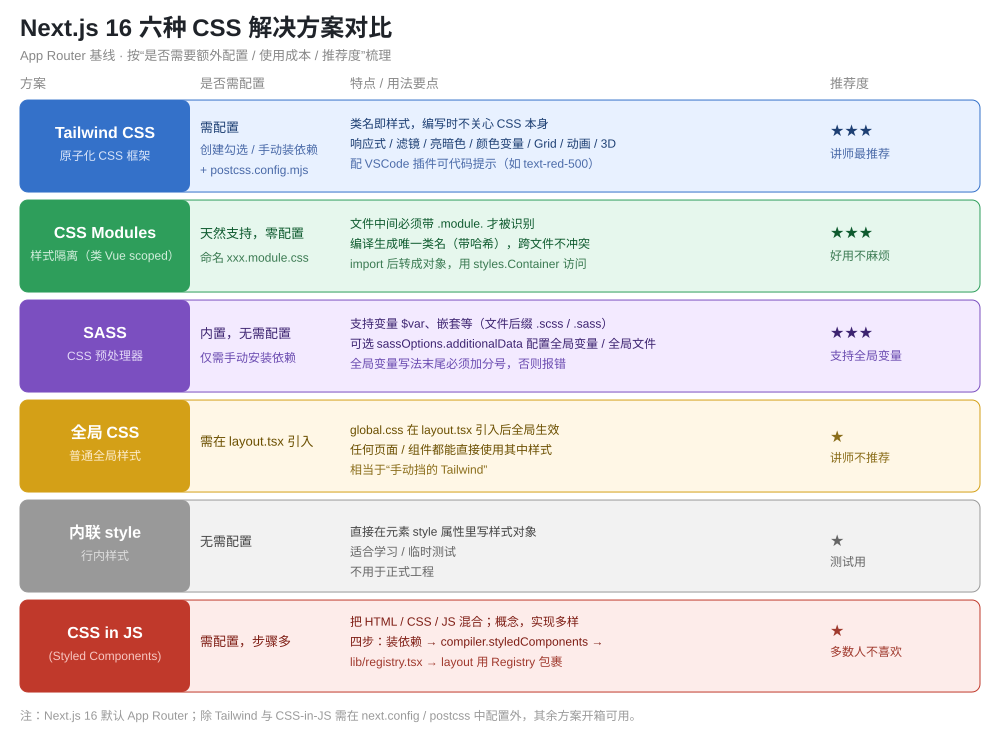

# Next.js CSS 知识点

> Next.js（App Router）下六种主流 CSS 解决方案的梳理与取舍：**Tailwind CSS、CSS Modules、SASS、全局 CSS、内联 style、CSS in JS（Styled Components）**。核心是分清“哪种开箱可用、哪种要额外配置、各自做样式隔离还是全局生效”，并结合 SSR/RSC 理解 CSS 如何进入最终 HTML。附避坑速记清单与自测题。

## 版本说明

- **本文以 Next.js 16 为基线**（App Router）。
- 与 CSS 直接相关的版本要点：
  1. **Turbopack 为默认打包器**（`next dev` / `next build`），PostCSS / SASS / CSS Modules 均由 Turbopack 统一处理，多数方案无需手工 loader 配置。
  2. **Tailwind 默认引导到 v4**：`create-next-app` 时勾选即可，v4 的 PostCSS 插件名是 `@tailwindcss/postcss`（不再是 v3 的 `tailwindcss` + `autoprefixer`）。
  3. **next.config 已用 `.ts`（next.config.ts）**：`sassOptions.additionalData`、`compiler.styledComponents` 都在这里写。
  4. **CSS-in-JS 与 RSC 的约束仍在**：styled-components 这类运行时样式不能直接在 Server Component 里用，需要“注册表（registry）+ `'use client'`”配合，否则 SSR 样式丢失、水合不一致。
- 旧版 Pages Router 的 `_app.tsx` / `_document.tsx` 写法仅作对比，非实践基线。

---

## 一、六种方案总览



| 方案 | 类型 | 是否需额外配置 | 样式隔离 | 适用场景 |
|---|---|---|---|---|
| Tailwind CSS | 原子化 CSS 框架 | 需（创建时勾选或手动装依赖+PostCSS） | 类名全局但有约定 | 规模化工程，讲师最推荐 |
| CSS Modules | 模块化 CSS | 天然支持，零配置 | ✅ 编译哈希隔离 | 组件级样式，好用不麻烦 |
| SASS | CSS 预处理器 | 内置，仅需装 `sass` 依赖 | 需配合 CSS Modules / 手动控制 | 需要变量、嵌套的工程 |
| 全局 CSS | 普通 CSS | 需在 layout 引入 | ❌ 全局作用 | 全局基础样式（reset、主题变量） |
| 内联 style | 行内样式 | 无需 | — | 学习 / 临时测试 |
| CSS in JS | 运行时样式（Styled Components 等） | 需（依赖+compiler+registry+layout） | ✅ 组件级 | 团队偏好 CSS-in-JS 时 |

> **结论**：日常工程首选 **Tailwind**（原子化、响应式开箱即用）或 **CSS Modules**（组件隔离零配置）；需要预处理器能力再加 **SASS**；**全局 CSS** 只放全站基础样式；**内联 style** 和 **CSS in JS** 仅在特定偏好或测试场景使用。

---

## 二、Tailwind CSS（原子化 CSS）

### 2.1 它是什么

Tailwind 属于**原子化（utility-first）CSS 框架**：每一条**类名对应一条样式规则**，你编写时只需要拼类名，不用再手写 CSS 文件。

```tsx
// 直接用类名，背后对应的样式由 Tailwind 生成
<div className="flex items-center justify-between text-red-500 bg-blue-100 p-4">
  标题
</div>
```

### 2.2 核心能力（视频要点）

- **响应式**：不同分辨率展示不同布局。如小屏文字下压、大屏内容居左，靠 `sm:` / `md:` / `lg:` 前缀断点切换。
- **滤镜**：`grayscale`、`blur`、`brightness` 等，现代网站常见的灰阶 / 模糊效果。
- **亮暗色**：`dark:` 前缀类名切换暗色模式。
- **CSS 颜色变量 / Grid / 动画过渡曲线 / 层级 / 逻辑处理 / 容器布局 / 3D 转换**：均有对应工具类，且可自定义。
- **性能高**：构建时只生成用到的类名（Tree-shaking）。

### 2.3 安装方式

**方式 A（推荐）**：`create-next-app` 时选择自定义选项，交互里问是否安装 Tailwind → 选 `Yes`，Next.js 自动生成 `postcss.config.mjs`、`app/globals.css`。

**方式 B（补装）**：没勾选时手动补：

```bash
npm install tailwindcss @tailwindcss/postcss
```

因为 Tailwind 是 **PostCSS 插件**，所以必须有一个 `postcss.config.mjs` 来挂载它：

```js
// postcss.config.mjs
const config = {
  plugins: {
    "@tailwindcss/postcss": {},   // Tailwind v4 的插件名
  },
};
export default config;
```

在 `app/` 下创建（或已有）`globals.css`，引入 Tailwind：

```css
/* app/globals.css */
@import "tailwindcss";
```

最后在 `app/layout.tsx` 里引入 `globals.css`，之后**所有页面与组件都能直接用 Tailwind 类名**：

```tsx
// app/layout.tsx
import "./globals.css";

export default function RootLayout({ children }: { children: React.ReactNode }) {
  return (
    <html lang="zh-CN">
      <body>{children}</body>
    </html>
  );
}
```

### 2.4 开发体验

- 类名大量使用**缩写**：`background` → `bg`、`text` → `text` 等，用到时查官方文档即可，不必死记。
- 安装 **VSCode 插件 “Tailwind CSS IntelliSense”** 获得代码提示：如输入 `text-red-` 会提示 `text-red-500` 等，选中即生效。

> **补充（Next 16 / Tailwind v4 口径）**：旧教程的 v3 写法是 `plugins: { tailwindcss: {}, autoprefixer: {} }` + `@tailwind base; components; utilities;`。Next.js 16 引导的 v4 用 `@tailwindcss/postcss` + `@import "tailwindcss"`，两者不要混用。

---

## 三、CSS Modules（样式隔离）

类似 Vue 单文件组件里的 `scoped`，做**样式隔离**。Next.js **天然支持，零配置**。

### 3.1 文件命名规范

文件中间**必须带 `.module.`** 才被识别为 CSS Module，前后名字可随意：

```
app/
└── components/
    ├── Card.tsx
    └── Card.module.css   ← 中间固定 .module.，前后可自定义
```

```css
/* Card.module.css */
.container { padding: 16px; border: 1px solid #ddd; }
```

### 3.2 使用方式

编译时 CSS Module 会生成**唯一的类名（带哈希）**，即使不同文件用了同名类也不会冲突。`import` 后它变成一个对象，用 `styles.类名` 访问：

```tsx
// Card.tsx
import styles from "./Card.module.css";

export default function Card() {
  return <div className={styles.container}>卡片内容</div>;
}
```

页面效果里能看到编译后的类名类似 `_container_xxxxxx`，全局唯一，这正是隔离的来源。

> **要点**：CSS Module 的 `import` 是**对象**（`styles.container`），不是字符串（`"container"`）；类名变哈希后不能靠字符串猜。

---

## 四、SASS（CSS 预处理器）

Next.js **内置支持，无需配置**，但**依赖需要手动安装**（用的时候再装）：

```bash
npm install sass
```

安装后 `.scss` / `.sass` 文件即可直接用，支持变量、嵌套等：

```scss
/* app/styles/main.scss */
$primary: #0ea5e9;

.button {
  background: $primary;
  &:hover { opacity: 0.8; }
}
```

### 4.1 配置全局变量 / 全局 SASS 文件

在 `next.config.ts` 的 `sassOptions.additionalData` 里配置，支持两种方式：

```ts
// next.config.ts
const nextConfig = {
  sassOptions: {
    // 方式一：引入一个全局 scss 文件（会被注入到每个 scss 文件头部）
    additionalData: `@import "./app/styles/_variables.scss";`,
    // 方式二：直接声明全局变量（等价于在每个 scss 里预置 $color）
    // additionalData: `$color: #0ea5e9;`,
  },
};

export default nextConfig;
```

**关键坑**：`additionalData` 注入的代码最终会合并进每个 sass 文件，**末尾必须加分号 `;`**，否则编译报错。

配置后，`$color` 这类变量就全局可用，任何一个 sass 文件都能直接读，无需再在文件里重复声明。

> **注意**：全局 SASS 变量与“全局样式生效”是两回事——`additionalData` 只是把变量/文件**注入到每个 sass 文件**，不会污染其他非 sass 作用域。

---

## 五、全局 CSS

编写一个全局样式文件（如 `app/globals.css`），并在 **`app/layout.tsx` 引入**，之后所有页面和组件都能直接使用其中样式：

```css
/* app/globals.css */
body { margin: 0; font-family: system-ui; }
```

```tsx
// app/layout.tsx
import "./globals.css";
```

- **特点**：全局作用，无隔离，适合 reset、主题变量、全站基础样式。
- **定位**：相当于“手动挡的 Tailwind”，视频中讲师**不建议用它做业务样式**（容易互相污染），个人测试可以。

---

## 六、内联 style

直接在元素的 `style` 属性里写样式对象（JSX 语法，驼峰命名）：

```tsx
<div style={{ backgroundColor: "#0ea5e9", padding: "16px" }}>内联样式</div>
```

- **无需任何配置**，适合学习 / 临时测试，不适合规模化工程（无复用、无隔离、难维护）。

---

## 七、CSS in JS（Styled Components）

CSS in JS 是一个**概念**（把 HTML / CSS / JS 三者真正混合），实现方式多样，这里以最经典的 **Styled Components** 为例。

### 7.1 使用四步

**第一步：安装依赖**

```bash
npm install styled-components
```

**第二步：开启编译**

在 `next.config.ts` 打开 `compiler.styledComponents`：

```ts
// next.config.ts
const nextConfig = {
  compiler: { styledComponents: true },
};
export default nextConfig;
```

**第三步：创建注册表（registry）**

官方固定写法，作用是识别 styled-components 的样式并**注入到服务端输出的 `<head>`**，保证 SSR 时样式不丢。放在 `app/lib/registry.tsx`：

```tsx
// app/lib/registry.tsx
"use client";
import { useServerInsertedHTML } from "next/navigation";
import { ServerStyleSheet, StyleSheetManager } from "styled-components";

export default function StyledComponentsRegistry({ children }: { children: React.ReactNode }) {
  const [sheet] = React.useState(() => new ServerStyleSheet());

  useServerInsertedHTML(() => {
    const styles = sheet.getStyleElement();
    sheet.instance.clearTag();
    return <>{styles}</>;
  });

  if (typeof window !== "undefined") return <>{children}</>;

  return <StyleSheetManager sheet={sheet.instance}>{children}</StyleSheetManager>;
}
```

**第四步：在 layout 包裹 children**

```tsx
// app/layout.tsx
import StyledComponentsRegistry from "./lib/registry";

export default function RootLayout({ children }: { children: React.ReactNode }) {
  return (
    <html lang="zh-CN">
      <body><StyledComponentsRegistry>{children}</StyledComponentsRegistry></body>
    </html>
  );
}
```

### 7.2 使用方式

样式写在**模板字符串**里，组件带样式，HTML / CSS 全部混在一起：

```tsx
"use client";
import styled from "styled-components";

const Button = styled.button`
  color: #fff;
  background: #0ea5e9;
  padding: 8px 16px;
`;

export default function Page() {
  return <Button>点我</Button>;
}
```

> **RSC 约束**：styled-components 需要 `"use client"`（有运行时），不能直接在 Server Component 里使用；若想在不同组件中复用，把 styled 组件定义在独立的客户端组件文件里。详细完整用法见 React 部分关于 Styled Components 的讲解。

### 7.3 评价

- **优点**：组件级样式隔离、JS 驱动样式逻辑（条件 / 主题）、SSR 可注入 head。
- **缺点**：配置步骤多（依赖 + compiler + registry + layout 包裹）、写法把三种语言混在一起，**多数人排斥**。视频中讲师明确提到“百分之八九十的人不喜欢这种写法”。

---

## 八、避坑速记清单

1. **Tailwind 是 PostCSS 插件**：不建 `postcss.config.mjs` 并挂载插件，Tailwind 类名不生效。
2. **Tailwind 版本别混用**：Next 16 引导的 v4 用 `@tailwindcss/postcss` + `@import "tailwindcss"`；v3 的 `tailwindcss` + `autoprefixer` + 三段 `@tailwind` 指令写法不要套到 v4。
3. **CSS Modules 文件名必须有 `.module.` 中间段**：写成 `index.css` 会被当成全局 CSS，失去隔离。
4. **CSS Modules 的 import 是对象**：`styles.container`，不是字符串 `"container"`；类名是带哈希的唯一值。
5. **SASS 只是“内置支持”不等于“自带依赖”**：必须手动 `npm install sass` 才能用 `.scss`。
6. **`sassOptions.additionalData` 注入内容末尾必须加分号**：否则合并到文件后编译报错。
7. **全局 CSS 无隔离**：只放 reset / 主题变量，别用业务样式；且必须在 `layout.tsx` 引入才全局生效。
8. **styled-components 需要四步全套**：装依赖 + `compiler.styledComponents` + `lib/registry.tsx` + layout 用 `StyledComponentsRegistry` 包裹 children，缺一步 SSR 样式就会丢失或水合不一致。
9. **CSS-in-JS 不能直接在 Server Component 用**：styled-components 带运行时，需 `"use client"`，否则 RSC 场景报错或样式不注入。
10. **选型看是否需要“配置 + 隔离”**：开箱即隔离用 CSS Modules；要原子化 + 响应式选 Tailwind；仅需变量 / 嵌套再叠加 SASS；内联 style 与全局 CSS 只用于测试和全局基础样式。

---

## 九、自测题（互动式考核）

1. 为什么 Tailwind 必须在 `postcss.config.mjs` 里挂载？它在技术层面属于什么插件？
2. 一个文件叫 `Button.css`，要让它变成 CSS Module 该怎么改名？改名后 `import styles` 拿到的 `styles` 是什么类型？
3. SASS 在 Next.js 里“内置”指的是什么？要真正用 `.scss` 还差哪一步？
4. 想让 `$primary` 这个变量在所有 sass 文件里都能直接用，该在哪个配置的哪个字段配置？有什么易错点？
5. `app/globals.css` 要全局生效，必须在哪个文件、用什么方式引入？
6. 用 styled-components 需要哪四步配置？为什么必须有 `lib/registry.tsx` 这一步？
7. 为什么 styled-components 组件要加 `"use client"`？在 Server Component 里直接用它会出现什么问题？
8. 结合本文，日常业务组件样式你会优先选哪种方案？理由是什么？
