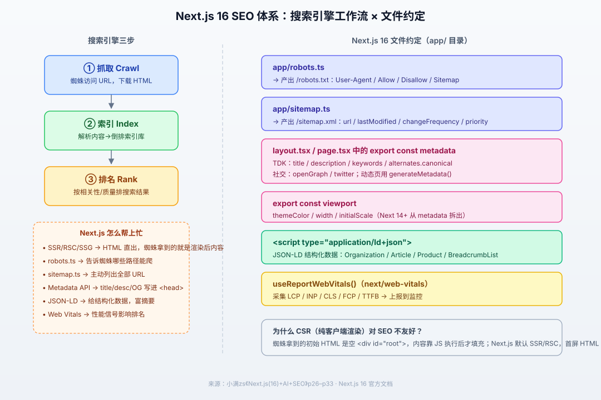

# Next.js SEO 优化知识点

> 参考视频：小满zs《Next.js(16)+AI+SEO》p26–p33（SEO 引言 / 搜索引擎原理 / robots.txt / sitemap.xml / TDK / JSON-LD / Open Graph / Web Vitals）。本文以 **Next.js 16（App Router）为基线**，统一用 16 写法。覆盖：搜索引擎工作原理、Next.js 为什么对 SEO 友好、`robots.ts`、`sitemap.ts`、Metadata API（TDK / canonical / OG / Twitter）、`viewport`、JSON-LD 结构化数据、Core Web Vitals 采集，附避坑清单与自测题。

## 版本说明

- **本文以 Next.js 16 为基线**（App Router）。所有代码按 16 写法。
- 16 起 `middleware.ts` 已更名 `proxy.ts`（见本目录《nextjs 中间件middleware知识点.md》），与 SEO 无直接关系，但会影响路由重写时的 URL 规范。
- App Router 的 SEO 全部靠**文件约定** + **Metadata API**：不需要像旧版 Pages Router 那样在 `_document.tsx` 里手写 `<head>`。
- 一句话理解：**SEO = 让搜索引擎能爬到（crawl）→ 能索引到（index）→ 能排上去（rank）**。Next.js 在每一步都有对应工具。



---

## 一、SEO 是什么 & 为什么 Next.js 天然友好

### 1.1 SEO 定义

SEO（Search Engine Optimization，搜索引擎优化）：在不花钱投广告的前提下，让网站在 Google / 百度等搜索引擎的自然结果里排名靠前。

- 视频里老师强调：**会 SSR + SEO 的人不多，是个人竞争力**。
- SEO 不是作弊，是"把网站做成搜索引擎喜欢的样子"：内容可被抓取、结构清晰、加载快、有权威外链。

### 1.2 为什么纯 CSR（React SPA）对 SEO 不友好

| 渲染方式 | 蜘蛛拿到的初始 HTML | 能否看到内容 |
|---|---|---|
| 纯 CSR（`create-react-app` 那种） | 空壳：`<div id="root"></div>` | ❌ 内容要等 JS 下载、执行、请求数据后才填充，早期蜘蛛/低成本蜘蛛拿不到 |
| SSR（服务端渲染） | 完整 HTML，含全部内容 | ✅ |
| SSG（静态生成） | 构建时就生成完整 HTML | ✅ 最快 |
| RSC（React Server Components） | 服务端直接把组件渲染成 HTML 流 | ✅ 默认首屏即完整内容 |

> Next.js App Router **默认就是 SSR/RSC**，不需要额外配置；这就是它"天生对 SEO 友好"的原因。

---

## 二、搜索引擎工作原理：Crawl → Index → Rank

视频 p27 讲了搜索引擎内部三步，理解这三步才知道后面每个 API 是在解决哪一步的问题。

```
URL 种子 → 爬虫蜘蛛(Spider) → 下载 HTML → 解析并提取链接 → 入索引库 → 用户搜索时排序
```

### 2.1 三步

| 步骤 | 做什么 | Next.js 对应工具 |
|---|---|---|
| **① 抓取 Crawl** | 蜘蛛按队列访问 URL，下载页面内容 | `robots.ts`（放行/禁爬）、`sitemap.ts`（喂 URL）、URL 结构清晰 |
| **② 索引 Index** | 解析 HTML、提取文字/关键词、建立倒排索引 | SSR/RSC 直出 HTML、语义化标签、TDK |
| **③ 排名 Rank** | 用户搜索时按相关性、权威性、体验打分排序 | 内容质量、外链、Web Vitals 性能信号、结构化数据 |

### 2.2 蜘蛛不一定会爬所有链接

- 蜘蛛有**抓取预算（crawl budget）**：不是你有 1 万个 URL 它就爬 1 万个。
- 所以要：① `robots.txt` 告诉它别爬无意义路径；② `sitemap.xml` 主动告诉它"这些才是重要页面"。
- 死链、重复内容、过深的 URL 层级都会浪费预算。

---

## 三、`app/robots.ts`：告诉蜘蛛能爬什么

视频 p28。对应产出物是 `/robots.txt`。

### 3.1 两种写法

**静态写法**（直接放 `app/robots.txt`）：

```txt title="app/robots.txt"
User-Agent: *
Allow: /
Disallow: /private/
Disallow: /api/

Sitemap: https://your-site.com/sitemap.xml
```

**动态写法（推荐，用 TS 生成）**：

```ts title="app/robots.ts"
import type { MetadataRoute } from 'next';

export default function robots(): MetadataRoute.Robots {
  return {
    rules: {
      userAgent: '*',
      allow: '/',
      disallow: ['/private/', '/api/'],
    },
    sitemap: 'https://your-site.com/sitemap.xml',
    host: 'https://your-site.com',
  };
}
```

产出（访问 `/robots.txt`）：

```txt
User-Agent: *
Allow: /
Disallow: /private/
Disallow: /api/

Sitemap: https://your-site.com/sitemap.xml
```

### 3.2 针对特定 UA 单独放行

```ts
export default function robots(): MetadataRoute.Robots {
  return {
    rules: [
      { userAgent: '*', allow: '/', disallow: '/private/' },
      { userAgent: 'Googlebot', allow: '/', disallow: ['/private/', '/admin/'] },
      { userAgent: 'Googlebot-Image', disallow: '/images/private/' },
    ],
  };
}
```

### 3.3 关键注意点

- `robots.ts` 是**服务端文件**，构建时/请求时执行，默认被缓存。
- `Disallow` 只是"建议"，君子协议；恶意爬虫无视它。真正私密的内容要靠登录鉴权，不要靠 robots。
- **不要 Disallow `/`** 整站（除非真的不想被收录）。
- `sitemap` 字段写在这里，等于主动告诉蜘蛛 sitemap 在哪。

---

## 四、`app/sitemap.ts`：主动喂 URL 给蜘蛛

视频 p29。对应产出物是 `/sitemap.xml`。

### 4.1 基础写法

```ts title="app/sitemap.ts"
import type { MetadataRoute } from 'next';

export default function sitemap(): MetadataRoute.Sitemap {
  return [
    {
      url: 'https://your-site.com',
      lastModified: new Date(),
      changeFrequency: 'daily',
      priority: 1,
    },
    {
      url: 'https://your-site.com/about',
      lastModified: new Date('2026-10-01'),
      changeFrequency: 'monthly',
      priority: 0.8,
    },
    {
      url: 'https://your-site.com/blog/nextjs-seo',
      lastModified: new Date(),
      changeFrequency: 'weekly',
      priority: 0.7,
    },
  ];
}
```

产出 `/sitemap.xml`（标准 XML 格式）。

### 4.2 动态生成（从数据库拉文章列表）

```ts title="app/sitemap.ts"
import type { MetadataRoute } from 'next';
import { posts } from '@/lib/db';   // 你的数据源

export default async function sitemap(): Promise<MetadataRoute.Sitemap> {
  const staticPages: MetadataRoute.Sitemap = [
    { url: 'https://your-site.com', priority: 1 },
    { url: 'https://your-site.com/about', priority: 0.8 },
  ];

  const blogPages: MetadataRoute.Sitemap = (await posts.list()).map((p) => ({
    url: `https://your-site.com/blog/${p.slug}`,
    lastModified: p.updatedAt,
    changeFrequency: 'weekly',
    priority: 0.7,
  }));

  return [...staticPages, ...blogPages];
}
```

### 4.3 字段说明

| 字段 | 含义 |
|---|---|
| `url` | 页面完整地址（必须带域名） |
| `lastModified` | 最后更新时间，蜘蛛会重点看变化 |
| `changeFrequency` | `always/hourly/daily/weekly/monthly/yearly/never`（提示性质，蜘蛛不严格遵守） |
| `priority` | 0.0–1.0，相对优先级，首页一般 1.0 |

> 站点 URL 很多时（几千+），用 **sitemap index**（拆成多个 sitemap 文件）。Next.js 也支持 `app/sitemap.ts` 里返回数组即可，文件多了再考虑拆分。

---

## 五、Metadata API：TDK（Title / Description / Keywords）

视频 p30。这是 Next.js SEO 的**核心**：在 `layout.tsx` 或 `page.tsx` 里 `export const metadata`，Next 会自动把对应标签写进 `<head>`。

### 5.1 根布局：全站默认

```tsx title="app/layout.tsx"
import type { Metadata } from 'next';

export const metadata: Metadata = {
  metadataBase: new URL('https://your-site.com'),  // 关键：让相对路径的 OG 图能拼绝对 URL
  title: {
    default: '小满的博客 | Next.js 16 实战',
    template: '%s | 小满的博客',     // 子页面 title 自动套模板
  },
  description: 'Next.js 16 实战教程，覆盖 App Router、RSC、缓存、SEO、AI SDK 全套内容。',
  keywords: ['Next.js 16', 'React SSR', 'SEO', '前端框架'],
};

export default function RootLayout({ children }: { children: React.ReactNode }) {
  return (
    <html lang="zh-CN">
      <body>{children}</body>
    </html>
  );
}
```

- `title.template: '%s | 小满的博客'`：子页面只要写 `title: '关于我'`，最终渲染成 `关于我 | 小满的博客`。
- `title.default`：子页面没写 title 时兜底。
- `<html lang="zh-CN">` 也很重要：告诉蜘蛛页面语言。

### 5.2 子页面：覆盖/补充

```tsx title="app/about/page.tsx"
import type { Metadata } from 'next';

export const metadata: Metadata = {
  title: '关于我',                       // 自动套模板 → "关于我 | 小满的博客"
  description: '一个写 Next.js 的前端工程师。',
};

export default function AboutPage() {
  return <h1>关于我</h1>;
}
```

### 5.3 动态路由：`generateMetadata()`

列表页/详情页的 metadata 依赖数据（如博客文章），用异步函数：

```tsx title="app/blog/[slug]/page.tsx"
import type { Metadata } from 'next';
import { getPost } from '@/lib/db';

type Props = { params: Promise<{ slug: string }> };

export async function generateMetadata({ params }: Props): Promise<Metadata> {
  const { slug } = await params;            // Next 16 params 必须 await
  const post = await getPost(slug);

  return {
    title: post.title,
    description: post.excerpt,
    alternates: { canonical: `/blog/${slug}` },   // 规范 URL
    openGraph: {
      title: post.title,
      description: post.excerpt,
      type: 'article',
      publishedTime: post.createdAt,
      url: `/blog/${slug}`,
    },
  };
}

export default async function BlogPostPage({ params }: Props) {
  const { slug } = await params;
  const post = await getPost(slug);
  return <article>{post.content}</article>;
}
```

### 5.4 Metadata 继承与合并规则

- 同一个路由里，**父 layout → 子 layout → page** 的 metadata 会**浅合并**（shallow merge）。
- 后写的覆盖先写的；**嵌套对象（如 `openGraph`、`robots`）整体被覆盖**，不是深合并。
- 所以：根 layout 放默认值，子页面放自己的差异化值即可。

### 5.5 常用字段速查

| 字段 | 产出标签 | 用途 |
|---|---|---|
| `title` | `<title>` | 浏览器标签页 + 搜索结果蓝链标题 |
| `description` | `<meta name="description">` | 搜索结果摘要文字（重要） |
| `keywords` | `<meta name="keywords">` | 搜索引擎基本不看重了，但留着无害 |
| `alternates.canonical` | `<link rel="canonical">` | 规范 URL，解决重复内容 |
| `openGraph.*` | `og:*` meta | 微信/Telegram/FB 分享卡片 |
| `twitter.*` | `twitter:*` meta | Twitter/X 卡片 |
| `robots` | `<meta name="robots">` | `index/noindex/follow/nofollow` |
| `metadataBase` | — | 拼相对路径的绝对 URL（OG 图必备） |

---

## 六、`viewport` 导出：从 metadata 拆出来

Next 14 起，`viewport`、`themeColor` 从 `metadata` 里**拆出来**，单独导出：

```tsx title="app/layout.tsx"
import type { Metadata, Viewport } from 'next';

export const metadata: Metadata = {
  title: '...',
};

export const viewport: Viewport = {
  width: 'device-width',
  initialScale: 1,
  themeColor: '#ffffff',
};
```

产出 `<meta name="viewport" content="width=device-width, initial-scale=1">` 和 `<meta name="theme-color">`。

> 不要再把 `viewport` 写进 `metadata` 对象里，16 会警告。

---

## 七、JSON-LD：结构化数据（富摘要）

视频 p31。让搜索引擎理解页面"这是什么"，有机会出**富摘要**（星级评分、面包屑、FAQ 手风琴、商品价格等）。

### 7.1 写法：在页面里插 `<script type="application/ld+json">`

```tsx title="app/blog/[slug]/page.tsx"
export default async function BlogPostPage({ params }: { params: Promise<{ slug: string }> }) {
  const { slug } = await params;
  const post = await getPost(slug);

  const jsonLd = {
    '@context': 'https://schema.org',
    '@type': 'BlogPosting',
    headline: post.title,
    description: post.excerpt,
    datePublished: post.createdAt,
    dateModified: post.updatedAt,
    author: { '@type': 'Person', name: '小满' },
  };

  return (
    <article>
      <script
        type="application/ld+json"
        dangerouslySetInnerHTML={{ __html: JSON.stringify(jsonLd) }}
      />
      <h1>{post.title}</h1>
      <div dangerouslySetInnerHTML={{ __html: post.html }} />
    </article>
  );
}
```

### 7.2 常用 Schema 类型

| 类型 | 适用页面 |
|---|---|
| `Organization` | 网站首页/关于页 |
| `WebSite` | 全站（带 `SearchAction` 可出站内搜索框） |
| `Article` / `BlogPosting` | 博客文章 |
| `Product` | 商品详情（价格/评分/库存） |
| `BreadcrumbList` | 面包屑导航（搜索结果里出层级） |
| `FAQPage` | 问答页（可出手风琴富摘要） |
| `Course` / `VideoObject` | 课程/视频页 |

### 7.3 验证

写完用 Google 官方 **Rich Results Test**（search.google.com/test/rich-results）测，能看到是否被识别。

---

## 八、Open Graph & Twitter Card（社交分享卡片）

视频 p32。不是给蜘蛛排名用的，是给**分享到社交平台**用的——微信/电报/X 分享链接时显示的封面图+标题+描述。

### 8.1 在 metadata 里配置

```tsx
export const metadata: Metadata = {
  title: 'Next.js 16 SEO 实战',
  description: '从 robots 到 JSON-LD 全套',
  openGraph: {
    type: 'website',
    url: 'https://your-site.com/blog/nextjs-seo',
    title: 'Next.js 16 SEO 实战',
    description: '从 robots 到 JSON-LD 全套',
    siteName: '小满的博客',
    images: [
      {
        url: '/og/nextjs-seo.png',   // 配合 metadataBase 会拼成绝对 URL
        width: 1200,
        height: 630,
        alt: 'Next.js 16 SEO',
      },
    ],
  },
  twitter: {
    card: 'summary_large_image',
    title: 'Next.js 16 SEO 实战',
    description: '从 robots 到 JSON-LD 全套',
    images: ['/og/nextjs-seo.png'],
  },
};
```

### 8.2 注意点

- **OG 图建议 1200×630**，太大加载慢，太小会被裁切。
- `metadataBase` 必须配，否则相对路径的 `/og/xx.png` 拼不出绝对 URL，社交平台抓不到图。
- OG 图可以用 Next.js 的 `Image` 组件配合动态生成，或直接放静态图。

---

## 九、Web Vitals（Core Web Vitals）

视频 p33。Google 把页面体验作为排名信号，三个核心指标：

| 指标 | 全称 | 含义 | 目标 |
|---|---|---|---|
| **LCP** | Largest Contentful Paint | 最大内容绘制时间（首屏主元素加载完） | < 2.5s |
| **INP** | Interaction to Next Paint | 交互响应延迟（取代老的 FID） | < 200ms |
| **CLS** | Cumulative Layout Shift | 累积布局偏移（内容不乱跳） | < 0.1 |

辅助指标：FCP（首次内容绘制）、TTFB（首字节时间）。

### 9.1 在 Next.js 里采集

```tsx title="app/components/WebVitals.ts"
'use client';

import { useReportWebVitals } from 'next/web-vitals';

export function WebVitals() {
  useReportWebVitals((metric) => {
    // 上报到你的监控（Vercel Analytics / 自建 / Google Analytics）
    console.log(metric);
    // 示例：fetch('/api/web-vitals', { body: JSON.stringify(metric) })
  });
  return null;
}
```

在根布局里挂上：

```tsx title="app/layout.tsx"
import { WebVitals } from './components/WebVitals';

export default function RootLayout({ children }: { children: React.ReactNode }) {
  return (
    <html lang="zh-CN">
      <body>
        {children}
        <WebVitals />
      </body>
    </html>
  );
}
```

### 9.2 优化手段（配合其他笔记）

- **LCP**：用 `next/image` 组件自动优化图、字体用 `next/font` 自托管、SSR/SSG 直出、避免大 JS bundle。
- **CLS**：图片/视频必须写 `width`/`height`（或用 `next/image`），广告位预留尺寸，不用 `display:none` 后突然显示。
- **INP**：拆分大客户端组件、减少 effect 里的重计算。

---

## 十、避坑速记清单

1. **忘了 `metadataBase`**：OG 图相对路径拼不出绝对 URL，社交平台分享抓不到图。根布局必须配 `metadataBase: new URL('https://你的域名')`。
2. **`params` 当同步对象用**：Next 16 里 `params` / `searchParams` 是 Promise，必须 `await`，否则 `generateMetadata` 拿不到 slug。
3. **把 `viewport` 写进 `metadata`**：14+ 要单独 `export const viewport`。
4. **靠 `Disallow: /` 藏私密页面**：robots 只是君子协议，私密内容要靠登录鉴权；而且 Disallow 了蜘蛛连 HTML 都不存，反而可能浪费收录机会。
5. **重复内容不加 canonical**：同一篇文章同时能通过 `/blog/1`、`/blog/1?ref=x`、`/post/1` 访问，蜘蛛不知道哪个是正本，用 `alternates.canonical` 指定唯一 URL。
6. **SSR 页面里做了客户端才能做的事**：`generateMetadata` 里不要写浏览器 API（`window`/`document`），它跑在服务端。
7. **sitemap 里写 localhost**：生产环境必须用真实域名，`url` 字段要写完整 `https://your-site.com/...`。
8. **OG 图尺寸不对**：1200×630 是标准，太小被裁切，太大加载慢。
9. **JS 里塞重要内容**：虽然 Next.js 是 SSR，但如果正文内容靠客户端 `useEffect` 拉取后才渲染，首屏 HTML 里就没有，蜘蛛可能拿不到。重要内容尽量在服务端组件里直接 await 出来。
10. **改完 metadata 不验证**：用浏览器"查看网页源代码"看 `<head>` 里是否真的有对应标签；Google Search Console 提交 sitemap 后看收录情况。

---

## 十一、目录结构一览

```
app/
├── layout.tsx              ← 根布局：export const metadata（全站默认 TDK/OG/viewport）
├── page.tsx                ← 首页
├── robots.ts               ← 产出 /robots.txt
├── sitemap.ts              ← 产出 /sitemap.xml
├── about/
│   └── page.tsx            ← export const metadata = { title: '关于我' }
└── blog/
    └── [slug]/
        └── page.tsx        ← export async function generateMetadata()
```

---

## 十二、自测题

1. 为什么纯 CSR 的 React SPA 对 SEO 不友好？Next.js 默认怎么解决？
2. `app/robots.ts` 和 `app/sitemap.ts` 分别解决搜索引擎三步里的哪一步？
3. 根 layout 里 `title.template` 是干什么的？子页面怎么用？
4. `metadataBase` 不配会出什么问题？
5. `generateMetadata` 和 `export const metadata` 分别用在什么场景？
6. Next 16 里 `params` 为什么必须 `await`？
7. JSON-LD 是干什么的？写出一个 `BlogPosting` 的最小结构。
8. Core Web Vitals 三个指标是什么？各自目标值？
9. canonical URL 解决什么问题？在 Next.js 里怎么配？
10. OG 图建议尺寸？为什么 `metadataBase` 对它重要？

---

## 十三、视频 p27 详解：Google 搜索引擎原理

> 本集完整转写整理。老师以 **Google** 为例讲原理——因为 Google 官方承诺**不靠收费提高排名**，排名全靠 SEO 实力。面试常问"Google 排名三大标准"。

### 13.1 Google 工作三阶段

```
① 抓取 Crawl → ② 索引编制 Index → ③ 呈现搜索结果 Rank
```

### 13.2 ① 抓取：Googlebot 怎么找到你的网页

Googlebot（谷歌机器人 / 蜘蛛 / 漫游器）通过 **7 条途径**发现 URL：

| # | 途径 | 说明 |
|---|---|---|
| 1 | **链接** | 从 `<a href>` 提取 URL，存入数据库。站内链接 + 外链都是入口 |
| 2 | **robots.txt** | 告诉蜘蛛哪些页面能爬、哪些不能爬（同时也会顺带读取该文件） |
| 3 | **sitemap.xml** | 主动列出网站所有网页/文件/视频 URL，方便蜘蛛批量抓取 |
| 4 | **手动提交 Google Search Console** | 新站没友链、没被收录时，手动提交，Google 也会来收 |
| 5 | **RSS 订阅** | 如果你订阅了 RSS（如掘金等平台），蜘蛛会抓 RSS 里的内容 |
| 6 | **重定向** | 蜘蛛会跟随 301 / 302 重定向，最终落到目标 URL |
| 7 | **JavaScript 动态链接** | 现代 Google 已能识别 JS 动态生成的链接（如 `document.createElement('a')`），不只是写死在 HTML 里的 `<a>` |

> 第 7 点是个重要更新：早期 Google 不执行 JS，所以 CSR 页面的链接它抓不到；现在能抓了，但**抓到链接 ≠ 抓到渲染后的内容**，所以 SSR/RSC 仍然更稳。

### 13.3 ② 索引编制 + 索引信号

**索引编制（Indexing）**：Google 把抓回来的网页"拆成零件、贴上标签、塞进巨大数据库"。

- **关键认知**：用户搜索时 Google **不是全网实时搜**，而是从这个数据库里按算法返回结果。
- **后果**：你改了网页内容，一般要 **2–3 周**才会被同步到数据库、反映到搜索结果。改完别慌，等蜘蛛下次重新抓取。

**索引信号（Indexing Signals）**：Google 分析网页内容用于排名：
- TDK（title / description / keywords）
- HTML 语义化标签
- Web Vitals 性能指标
- 图片的 `alt` 属性
- 内容质量与原创度

**两个注意点**：

1. **被抓取 ≠ 被索引**。即使蜘蛛抓到了你的页面，只要代码里写了 `noindex`，它就不会进数据库、不会出现在搜索结果里。
2. **以下行为会被降权**：伪装真实内容（cloaking）、垃圾外链、机器刷流量、隐藏文字/隐藏链接、关键词堆砌（keyword stuffing）。

### 13.4 ③ 呈现搜索结果：排名三大标准（面试必背）

用户敲下回车后约 **0.2 秒**内，Google 从数据库里排序返回。**排名不靠收钱，靠三大标准**：

| 标准 | 英文 | 含义 | 举例 |
|---|---|---|---|
| **相关性** | Relevance | 用户搜索词和你网站内容的匹配程度 | 搜"如何制造原子弹"，你直接给公式，就是高相关 |
| **权威性** | Authority | 域名权重（domain authority） | 买东西去官网 vs 去不知名小平台，你信谁？高权重域名天然有优势 |
| **用户体验** | UX | 页面性能与交互体验 | LCP < 2.5s 算优，后面 p33 详细讲 |

> 这三条是面试高频题。相关性靠内容和 TDK；权威性靠域名年限、外链、品牌词搜索量；用户体验靠 Web Vitals。

---

## 十四、视频 p28 详解：robots.txt 实战

> 本集完整转写整理。老师现场对比了掘金、B站、百度的真实 robots.txt，讲清参数含义和 Next.js 写法。

### 14.1 robots.txt 是什么

- 作用：告诉爬虫机器人**爬取网站时要遵守的规则**。
- 位置：网站根目录 `/robots.txt`。
- **任何网站都应该提供这个文件**——掘金、B站、百度打开 `https://站点/robots.txt` 都能看到。

### 14.2 核心参数

| 参数 | 含义 | 备注 |
|---|---|---|
| `User-agent` | 爬虫机器人名字 | `*` = 所有爬虫；也可具名（`Googlebot`、`Baiduspider`、字节的爬虫等） |
| `Disallow` | 不允许访问的路由 | 不写就是允许 |
| `Allow` | 允许访问的路由 | `/` 表示全站允许 |
| `Crawl-delay` | 抓取间隔（秒） | 防止爬虫把服务器打挂；**但 Googlebot 不支持**，只有百度等部分爬虫支持，所以很少人写 |
| `Sitemap` | 网站地图 URL | 下一章 p29 讲 |
| `Host` | 网站域名 | 无技术含量 |

### 14.3 关键易错点：`*` 和具名规则同时出现时怎么匹配

> **不是从上往下顺序匹配！** 查找规则是：

1. 先找**有没有具名匹配**的（比如当前爬虫是 Googlebot，就找 `User-agent: Googlebot` 那一段）。
2. **有具名 → 用具名规则，`*` 那段直接跳过**。
3. **没有具名 → 才用 `*` 兜底**。

举例：你的 robots.txt 里同时写了 `*` 和 `Googlebot` 两段，Googlebot 来爬时只走 `Googlebot` 那段，不会叠加 `*` 那段。

### 14.4 Next.js 里怎么写

App Router 下**不要直接建 `.txt` 文件**，而是在 `app/` 目录建 `robots.ts`（TS 有类型提示，不容易写错）：

```ts title="app/robots.ts"
import type { MetadataRoute } from 'next';

export default function robots(): MetadataRoute.Robots {
  return {
    rules: {
      userAgent: '*',
      allow: '/',
      disallow: ['/api/'],
    },
    sitemap: 'https://your-site.com/sitemap.xml',
    host: 'https://your-site.com',
  };
}
```

保存后 Next.js 自动在根路径产出 `/robots.txt`。

> 其他框架（Vue、React SPA）才需要在静态根目录手建 `robots.txt`；Next.js 用 `.ts` 写会自动转换。

### 14.5 两种写法：通用 vs 具名

**写法一：通用 `*`**（像掘金）——所有爬虫一套规则：

```ts
rules: { userAgent: '*', allow: '/', disallow: ['/api/'] }
```

**写法二：具名数组**（像 B站）——给每个爬虫单独定制：

```ts
rules: [
  { userAgent: 'Googlebot', allow: '/', disallow: ['/api/', '/admin/'] },
  { userAgent: 'Baiduspider', allow: '/', disallow: ['/admin/'] },
  // 甚至可以给社交媒体爬虫单独放行/限制
  { userAgent: 'facebookexternalhit', allow: '/' },
  { userAgent: 'Twitterbot', allow: '/' },
]
```

### 14.6 多个 sitemap

`sitemap` 字段也支持数组，站点多时可以列多个：

```ts
sitemap: [
  'https://your-site.com/sitemap.xml',
  'https://your-site.com/sitemap-blog.xml',
  'https://your-site.com/sitemap-product.xml',
]
```

---

## 十五、视频 p29 详解：sitemap.xml 实战

> 本集完整转写整理。老师现场打开了 apple.com 和掘金的真实 sitemap，讲了字段含义、分片技术和 Next.js 实现。

### 15.1 sitemap.xml 是什么 / 为什么需要

- **作用**：网站地图，向搜索引擎爬虫**主动提供希望被收录的页面 URL**。
- 位置：一般放根目录，但**不强制**；正常做法是在 `robots.txt` 里声明 sitemap 地址。
- **新站痛点**：新上线的网站爬虫很难发现深层路由（三级、四级），有了 sitemap 直接喂全部 URL。
- **真实案例**：apple.com 的 sitemap 收录了一/二/三级路由；掘金把文章、博主信息**分模块**放进不同 sitemap，所以 Google 搜博主名字也能命中。

### 15.2 为什么要分片

- **单个 XML 文件最多存 5 万条链接**（硬上限）。
- 掘金文章几十万甚至几百万，一个 XML 放不下，所以按模块拆成多个 sitemap（posts、user 等），再用索引串起来。
- 打开大 sitemap 时浏览器可能会卡/崩，别轻易滚动。

### 15.3 XML 核心字段

| 字段 | 全称 | 含义 | 注意点 |
|---|---|---|---|
| `loc` | location | 页面完整 URL | 建议 HTTPS，HTTP 也能用 |
| `lastmod` | last modify | 最后修改时间 | |
| `changefreq` | change freq | 更新频率 | **枚举值**：`always/hourly/daily/weekly/monthly/yearly/never`，爬虫参考用 |
| `priority` | — | 优先级 0.0–1.0 | **和搜索排名无关！** 只决定爬虫收录/抓取的先后顺序 |

**扩展字段**：

- 可写 `image`（图片）和 `video`（视频）字段。
- **video 有 3 个必填项**，缺了 XML 直接报错。
- 写了图片/视频不代表 100% 被收录——搜索引擎会筛掉低俗、低质内容，**收录最终取决于内容质量**。

### 15.4 Next.js 基础写法

App Router 下在 `app/` 建 `sitemap.ts`，自动产出 `/sitemap.xml`：

```ts title="app/sitemap.ts"
import type { MetadataRoute } from 'next';

export default function sitemap(): MetadataRoute.Sitemap {
  return [
    {
      url: 'https://your-site.com',          // 注意：代码里写 url，不是 loc
      lastModified: new Date(),
      changeFrequency: 'daily',               // 枚举值
      priority: 1,
    },
    {
      url: 'https://your-site.com/about',
      lastModified: new Date('2026-10-01'),
      changeFrequency: 'monthly',
      priority: 0.8,
    },
  ];
}
```

**易错点**：
- 代码里字段名写 `url`（不是 XML 里的 `loc`），Next 自动转成 XML 标准标签。
- `changefreq` 在 TS 里写全称，产出 XML 才是标准简写法。

### 15.5 分片实现（重点，面试/实战常考）

单文件超 5 万条时要分片。思路：

1. 先调接口拿**总条数**（比如 15 万）。
2. 按 5 万/片算分片数：`150000 / 50000 = 3 片`。
3. 导出一个**固定名字**的 `generateSitemaps` 函数，返回分片 ID 列表。
4. 主 `sitemap` 函数改成 `async`，根据传入的分片 ID 调对应分页接口拿数据。

```ts title="app/sitemap.ts"
import type { MetadataRoute } from 'next';

// 第一步：告诉 Next 要切几片
export async function generateSitemaps() {
  const total = await fetchTotalCount();        // 比如 150000
  const chunkSize = 50000;
  const chunks = Math.ceil(total / chunkSize); // 3 片
  return Array.from({ length: chunks }, (_, i) => ({ id: String(i) }));
}

// 第二步：按分片 ID 拉数据，Next 16 里 props 是 Promise 必须 await
export default async function sitemap({
  params,
}: {
  params: Promise<{ id: string }>;
}): Promise<MetadataRoute.Sitemap> {
  const { id } = await params;                 // Next 16 异步读参数
  const page = Number(id) + 1;
  const pageSize = 50000;

  const list = await fetchPosts({ page, pageSize });  // 你的业务接口
  return list.map((post) => ({
    url: `https://your-site.com/blog/${post.slug}`,
    lastModified: post.updatedAt,
    changeFrequency: 'weekly',
    priority: 0.7,
  }));
}
```

**分片后的访问路径**：不再是 `/sitemap.xml`，而是 `/sitemap/0`、`/sitemap/1`、`/sitemap/2`；不存在的分片返回 404。

---

## 十六、视频 p30 详解：TDK（Title / Description / Keywords）

> 本集完整转写整理。TDK 是 SEO 里占比最重的一块，面试常问。

### 16.1 TDK 是什么

- **TDK = Title / Description / Keywords** 三个 HTML 标签的缩写。
- 对应 HTML：
  - `<title>页面标题</title>`
  - `<meta name="keywords" content="关键词1,关键词2">`
  - `<meta name="description" content="页面摘要">`
- 内容一般由**产品经理提供**，开发者不关心文案，但要负责按规范写进代码。
- **description 摘要控制在 150 字以内**，超过部分浏览器/搜索引擎会截断——这个约束要告诉 PM。

### 16.2 基础写法：根 layout 全站默认

在 `app/layout.tsx` 里导出 `metadata`（**变量名必须叫 metadata**）：

```tsx title="app/layout.tsx"
import type { Metadata } from 'next';

export const metadata: Metadata = {
  title: '小满优选',
  description: '小满优选商城',
  keywords: ['Next.js', 'React', '商城'],   // 数组，可以多个
};
```

保存后**全站所有路由自动生效**，右键"查看网页源代码"能看到 `<head>` 里的三个标签。

### 16.3 进阶：子页面覆盖父级

子页面（如 `app/about/page.tsx`）再导出一个 `metadata`：

```tsx title="app/about/page.tsx"
export const metadata: Metadata = {
  title: 'About',
  description: '关于小满',
  // 不写 keywords → 继承父级 layout 的
};
```

规则：**写了哪个字段就覆盖哪个，没写的继承父级**。

### 16.4 高级：title 模板（template / default / absolute）

根 layout 里把 `title` 写成对象：

```tsx title="app/layout.tsx"
export const metadata: Metadata = {
  title: {
    default: '小满优选',           // 子页面没写 title 时兜底
    template: '%s | 小满优选',      // 子页面 title 自动套这个模板
  },
};
```

效果：

| 子页面写的 title | 最终渲染 |
|---|---|
| `title: 'About'` | `About | 小满优选` |
| 不写 title | `小满优选`（用 default） |
| `title: { absolute: 'About' }` | `About`（**强制不用模板**，不拼后缀） |

> 想让某个页面完全独立、不带品牌后缀，就用 `absolute`。

### 16.5 动态写法：`generateMetadata()`

TDK 内容来自接口（博客文章详情、商品详情）时，导出异步函数：

```tsx title="app/blog/[id]/page.tsx"
import type { Metadata, ResolvingMetadata } from 'next';

type Props = {
  params: Promise<{ id: string }>;
  searchParams: Promise<{ [key: string]: string }>;
};

export async function generateMetadata(
  { params, searchParams }: Props,
  parent: ResolvingMetadata   // 第二参数：读父级 metadata
): Promise<Metadata> {
  const { id } = await params;          // 动态路由参数 /blog/[id]
  const sp = await searchParams;        // query string ?a=1
  const parentMeta = await parent;      // 父级 layout 的 metadata

  const post = await fetchPost(id);      // 调接口拿数据

  return {
    title: post.title,
    description: post.excerpt,
  };
}
```

**关键注意点**：

- **只有服务端组件能用**——文件里写了 `'use client'` 就用不了 `generateMetadata`。
- 函数名**必须叫 `generateMetadata`**。
- 三个参数：`params`（动态路由段）、`searchParams`（query）、`parent`（父级 metadata，可选）。
- **Next 16 里所有参数都是 Promise，必须 `await`**。

---

## 十七、视频 p31 详解：JSON-LD 结构化数据

> 本集完整转写整理。

### 17.1 JSON-LD 是什么

- 全称 **JSON for Linked Data**，用 JSON 格式表达**结构化数据**。
- 本质就是一个 JSON 对象，所有语言都支持，格式不难。
- **作用**：帮助**搜索引擎和 AI** 更准确理解页面内容。
  - 对 SEO：让搜索引擎知道你页面是个什么类型（Blog / Product / Organization）。
  - 对 AI：豆包、DeepSeek 等开"联网搜索"搜到你网页时，会读 JSON-LD，立刻知道你网站是做什么的——现代网站基本都要做。
- **schema.org 由 Google、Bing、Yahoo、Yandex 联合发起**，所以利于 Google SEO。国内搜索引擎只部分支持。

### 17.2 真实案例：Apple 官网

打开 apple.com 查看网页源代码搜 `ld+json`，会看到**多个** `<script type="application/ld+json">`：
- 第一个是 `Organization`——告诉 Google "Apple 是一家公司/产品"，而不是一种水果。
- 第二个是 `WebSite`——介绍网站本身。
- 第三个是 `WebPage`——介绍当前页面。

> 一个页面可以写多个 JSON-LD，各司其职。

### 17.3 Next.js 里怎么写

在页面组件（服务端组件）里直接渲染 `<script>`：

```tsx title="app/layout.tsx"
export default function RootLayout({ children }: { children: React.ReactNode }) {
  const jsonLd = {
    '@context': 'https://schema.org',
    '@type': 'Organization',          // 告诉蜘蛛你是公司/博客/商品
    '@id': 'https://your-site.com',   // 实体唯一 ID
    name: '小满的博客',
    url: 'https://your-site.com',
  };

  return (
    <html lang="zh-CN">
      <body>
        {children}
        <script
          type="application/ld+json"
          dangerouslySetInnerHTML={{ __html: JSON.stringify(jsonLd) }}
        />
      </body>
    </html>
  );
}
```

**注意点**：
- `type` 必须是 `application/ld+json`，别写错。
- 用 `dangerouslySetInnerHTML` 塞 JSON 字符串——这是官方推荐写法，比直接写 `{...jsonLd}` 更安全（防 XSS）。
- 不要用 `${}` 字符串拼接，用 `JSON.stringify(obj)`。

### 17.4 核心字段

| 字段 | 值 | 说明 |
|---|---|---|
| `@context` | `https://schema.org` | **固定值**，所有页面都一样 |
| `@type` | 如 `Blog`/`Organization`/`Product` | 网站/页面类型，**不能乱写**，去 schema.org 查 |
| `@id` | 如 `https://your-site.com/about` | 实体唯一 ID，一般是域名 + 路由；换页面要换路由 |
| `name` / `url` / `description` | 业务数据 | 通用属性，所有类型都能用 |

### 17.5 怎么查合法的 @type 和属性

- 去 [schema.org](https://schema.org) → Docs 里找。
- **建议用子类型，别用太宽泛的父类型**：
  - ❌ `CreativeWork`（创意作品，太宽泛，搜索引擎不知道你具体是啥）
  - ✅ `Blog` / `Article` / `Product` / `Event`（更精确）
- 点进某个类型后，页面会列出该类型**专属的 properties**（比如 `Blog` 有 `blogPost`），以及继承自父类的通用属性（`name`、`url`、`owner` 等）。
- **字段不能乱写**，所有合法字段都在 schema.org 对应类型文档里列着。

---

## 十八、视频 p32 详解：Open Graph（OG 社交分享卡片）

> 本集完整转写整理。

### 18.1 OG 是什么

- **Open Graph protocol**，简称 **OG**，由原 Facebook（现 Meta）提出的一套页面元数据协议。
- **作用**：专注**社交媒体分享**——把网站分享到微信、Discord、Telegram 等平台时，自动渲染成一张卡片（左图 + 标题 + 描述），而不是一坨裸链接。
- **生效场景**：主要在**移动端**（PC 端大家习惯复制链接直接发；移动端有分享按钮，会读 OG 渲染卡片）。
- 验证方式：查看网页源代码搜 `og:`，apple.com 就是这么做的。

### 18.2 Next.js 里怎么写

和 TDK 一样，还是 `export const metadata`，里面多一个 `openGraph` 对象：

```tsx title="app/page.tsx"
import type { Metadata } from 'next';

export const metadata: Metadata = {
  title: 'Home',
  openGraph: {
    title: 'Home',
    type: 'website',               // 必填，枚举值
    url: 'https://your-site.com',  // 必填：分享内容来自哪个路由
    images: ['https://your-site.com/cover.png'],  // 必填：卡片左侧图
    description: '首页描述',       // 可选
    siteName: '小满的博客',        // 可选
  },
};
```

### 18.3 四个必填基础属性（ogp.me）

去 [ogp.me](https://ogp.me) 查完整文档。**基础元数据四个必填**：

| 字段 | 说明 |
|---|---|
| `title` | 分享卡片标题 |
| `type` | 分享类型，枚举值：`website`/`article`/`book`/`music`/`video`/`profile` 等；不知道写啥就用 `website` 兜底 |
| `image` | 卡片封面图，数组可多张；可写 HTTP 地址也可写本地绝对路径 |
| `url` | 分享内容来源 URL，一般写当前路由的完整地址 |

### 18.4 Twitter / X 卡片（Next.js 自动兼容）

- Twitter（现 X）有**自己的一套** `twitter:*` 格式，其他平台（微信、Discord）都遵守 OG。
- **Next.js 会自动从 `openGraph` 生成 `twitter:*` 标签**，不用手动配。
- 想单独定制 Twitter 卡片，再加一个 `twitter` 对象：

```tsx
twitter: {
  title: '只给 X 看的标题',
  card: 'summary_large_image',
  images: ['https://your-site.com/x-cover.png'],
}
```

- **优先级**：有 `twitter` 就读 `twitter`，没有就降级读 `openGraph`。
- 虽然 Twitter 改名叫 X 了，但 Next.js 字段名仍叫 `twitter`，官方说兼容 X，放心用。

### 18.5 可选属性 & 富媒体

ogp.me 下面的 optional metadata 都可选：

- `description` / `locale` / `siteName`
- `audio` / `video` ：分享音视频
- `image` / `audio` / `video` 可以写成**对象**，带 `url` / `width` / `height` / `alt`：

```tsx
openGraph: {
  images: [{ url: '/cover.png', width: 1200, height: 630, alt: '封面' }],
}
```

### 18.6 动态写法

和 TDK 一样，数据来自接口时用 `generateMetadata()`：

```tsx
export async function generateMetadata(): Promise<Metadata> {
  const data = await fetchPost(slug);
  return {
    title: data.title,
    openGraph: {
      title: data.title,
      description: data.excerpt,
      images: [data.cover],
    },
    twitter: { title: data.title },
  };
}
```

> 老规矩：`generateMetadata` 只能在**服务端组件**里用，`'use client'` 文件用不了。

---

## 十九、视频 p33 详解：Web Vitals

> 本集完整转写整理。SEO 章节收官。

### 19.1 Web Vitals 是什么

- 谷歌推出的**衡量用户体验和网页性能**的指标体系。
- **2026 年核心三指标**：**LCP / INP / CLS**。
  - 以前是 FCP（首次内容绘制），2026 年换成 INP——因为 FCP 和 LCP 数值太接近，谷歌改用更能反映交互体验的 INP。
- 性能优化不是嘴上说"减小体积"，而是**从 Lighthouse 报告里找具体问题**。

### 19.2 三大指标 & 评分标准

| 指标      | 全称                        | 衡量什么                              | 优       | 中         | 差       |
| ------- | ------------------------- | --------------------------------- | ------- | --------- | ------- |
| **LCP** | Largest Contentful Paint  | 可视区内**最大内容**（图片/视频封面/大段文本块）绘制完成时间 | ≤ 2.5s  | 2.5–4s    | > 4s    |
| **INP** | Interaction to Next Paint | 用户交互（点击/输入/键盘/鼠标）到浏览器响应下次绘制的延迟    | ≤ 200ms | 200–500ms | > 500ms |
| **CLS** | Cumulative Layout Shift   | 累积布局偏移——页面加载中突然插入元素导致已有内容跳动       | ≤ 0.1   | 0.1–0.25  | > 0.25  |

**CLS 经典翻车场景**（谷歌官方演示视频）：用户正要点"返回"按钮，突然弹出广告/推荐条把按钮往下顶，用户点错了点成"立即下单"——这种**突然插入导致的布局跳动**就计入 CLS。

### 19.3 怎么测：Lighthouse

Chrome DevTools → Lighthouse → 选桌面/移动 → 勾"性能"和"SEO" → 分析网页加载情况。
- 报告会列出 LCP/INP/CLS/FCP 等具体数值和评分（good / needs improvement / poor）。
- 下面还会给出**具体优化建议**——面试被问"性能优化做了什么"，就从这些建议里找答案，不要空谈"减小体积"。

### 19.4 在代码里埋点：`web-vitals` 库

安装：

```bash
npm install web-vitals
```

客户端组件里监听（谷歌官方推荐**页面隐藏时**上报，更准确）：

```tsx title="app/web-vitals.tsx"
'use client';

import { useEffect } from 'react';
import { onCLS, onINP, onLCP } from 'web-vitals';

export default function WebVitals() {
  useEffect(() => {
    const onVisibilityChange = () => {
      if (document.visibilityState === 'hidden') {
        onCLS((metric) => console.log('CLS', metric));
        onINP((metric) => console.log('INP', metric));
        onLCP((metric) => console.log('LCP', metric));
      }
    };
    document.addEventListener('visibilitychange', onVisibilityChange);
    return () => document.removeEventListener('visibilitychange', onVisibilityChange);
  }, []);

  return null;
}
```

然后在根 layout 里挂上去。

**关键点**：
- 所有方法都是 `on*` 开头：`onCLS` / `onINP` / `onLCP`（还有 onFCP/onTTFB 等）。
- `metric.value` 单位：LCP/INP 是毫秒，CLS 是无单位小数。
- `metric.rating` 是 `good` / `needs-improvement` / `poor`。
- LCP 的 `metric.entries[0].element` 能拿到具体是哪个 DOM 元素触发的（比如某个 H1 或某张大图）。
- 把这些值 `fetch` 上报给后端，就是真实用户监控（RUM）。

### 19.5 实测观察

- **不交互就没有 INP**：页面加载完不点任何东西，控制台只打 LCP（比如 156ms，good）。点一下按钮后 INP 才有值。
- **故意卡 1 秒**：`onClick` 里 `await sleep(1000)` → INP 测出 ~1000ms，rating 变 `poor`。说明 INP 就是用来抓"交互卡住"的。
- **突然插入元素**：1 秒后用 `appendChild` 往页面塞一个 100×100 的红方块 → CLS 测出一个小值。元素越大、顶走的内容越多，CLS 越大。

### 19.6 CLS 分数怎么算

公式：**CLS = 撞击分数 × 距离分数**

以谷歌官方示意图为例：

1. **撞击分数（Impact Fraction）**：视口内受布局偏移影响的区域占比。
   - 原本文本占视口 50%。
   - 突然插入一个占视口 25% 的不稳定元素，把文本顶下去。
   - 受影响区域 = 新插入的 25% + 被顶动的原内容区域 = **75% = 0.75**。

2. **距离分数（Distance Fraction）**：不稳定元素**位移距离** ÷ 视口**最大尺寸**。
   - 手机视口：高度 > 宽度，所以拿高度做分母。
   - 元素向下顶了视口高度的 25% → **0.25**。

3. **结果**：`0.75 × 0.25 = 0.1875`（中等，0.1–0.25 之间）。

> 优化思路：图片/视频**必须写死 width/height**（让浏览器提前留位置）；广告位、字体加载、异步组件不要在已有内容上方突然插入。

---

## 参考

- 视频：[小满zs《Next.js(16)+AI+SEO》](https://www.bilibili.com/video/BV1P9CxBsEUA/) p26–p33（p27–p33 已完整转写整理，SEO 章节完结）
- Next.js 官方文档：Metadata / robots.txt / sitemap.xml / generateMetadata / viewport / Web Vitals
- 结构化数据标准：[schema.org](https://schema.org)
- Open Graph 协议：[ogp.me](https://ogp.me)
- Web Vitals 官方：[web-vitals.js.org](https://github.com/GoogleChrome/web-vitals)
