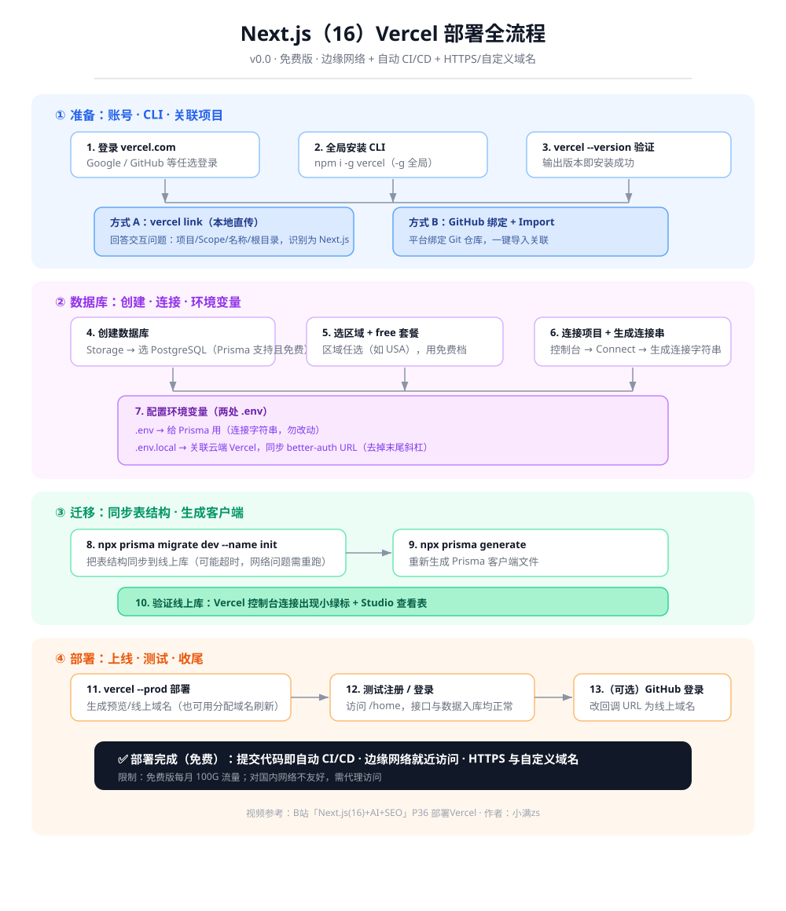

# Next.js Vercel 部署知识点

> 本文以 **Next.js 16 为基线**，参照 B 站「小满zs」《Next.js(16)+AI+SEO》第 36 集「部署 Vercel」整理。覆盖：为什么选 Vercel、免费版注意事项、部署全流程（登录 → 安装 CLI → 关联项目 → 创建/连接 PostgreSQL → 配置环境变量 → Prisma 迁移 → 部署与验证）、避坑速记清单与自测题。



---

## 一、为什么选 Vercel

| 优势 | 说明 |
|---|---|
| **官方亲儿子，支持最好** | Vercel 是 Next.js 的创作者，对 Next.js 的适配与支持天然最优 |
| **边缘网络（Edge Network）** | CDN 就近分配：如北京访问时就近分配天津的服务器，路由跳数少、访问更快 |
| **HTTPS 与域名** | 默认分配域名并自带 HTTPS；有自己域名也可换绑，非常方便 |
| **Git 工作流（CI/CD）** | 提交代码即自动完成构建与部署，无需手动操作 |

> 一句话理解：**Vercel 是一个"提交即部署"的托管平台，专门为 Next.js 优化，自带边缘网络、免费 HTTPS 和自定义域名。**

---

## 二、注意事项（免费版）

| 事项 | 内容 |
|---|---|
| **免费可用** | 免费用户每月 **100G 流量**，对个人开发与测试足够；企业可选其他付费套餐 |
| **对国内网络不友好** | 国内访问通常进不去，需要开代理才能访问 |

---

## 三、部署全流程

### 3.1 登录官网

打开 [vercel.com](https://vercel.com)（右键在新标签打开），用 Google / GitHub 等任选方式登录；没有账号先注册。登录后进入 Dashboard（仪表盘），会显示当前套餐与已用流量。

### 3.2 全局安装 CLI

```bash
# 全局安装，避免每个项目都装一遍（-g 很重要）
npm i -g vercel

# 验证是否安装成功
vercel --version
```

> 因为后续要用 `vercel` 系列 CLI 命令（`vercel link`、`vercel --prod`），所以**建议全局安装**。

### 3.3 关联项目（两种方式）

执行 `vercel link` 把本地项目关联到 Vercel 平台：

```bash
vercel link
```

交互问答要点：

| 问题 | 本例回答 | 说明 |
|---|---|---|
| 是否为该项目？（确认本地路径） | `Y` | 确认要上传的是当前项目 |
| 选择项目所属范围（Scope） | 选你的账号 | 对应 Vercel 账号 |
| 是否关联已有项目？ | `N` | 没有已有项目就选 N |
| 项目名称 | 随便起（默认即可） | — |
| 项目根目录 | `./` | — |
| 已识别为 Next.js，是否修改默认配置？ | `N` | 构建命令等都是默认的 |
| 是否关联 git 仓库？ | `N` | 只想当本地仓库测试可不关联 |

**方式 A（本例，本地直传）**：`vercel link` 直接上传本地代码，不与 Git 绑定。
**方式 B（Git 关联）**：在平台绑定自己的 Git 仓库，平台自动读取并点 Import 导入。

配置完成后刷新仪表盘，即可看到项目并自动分配了一个域名（此时还没内容，访问不了；后续用它访问）。

### 3.4 创建数据库

1. 点开 **Storage** 页签。
2. 选择数据库供应商：注意看是否支持 **PostgreSQL**。本例用 **Prisma**（支持 PostgreSQL 且可免费使用）→ 点 **Create**。
3. 选择服务器区域（任选，如 USA）→ 选 **free** 套餐 → 确认创建。

### 3.5 连接数据库到项目

- 创建完成后，在左侧选择项目（本例为 next-auth 项目）→ **Connect** 连接。
- 打开数据库控制台 → 点 **Connect** 生成连接字符串 → 打开开关等待连接。

### 3.6 配置环境变量（关键）

这里有两份 `.env` 文件，作用不同，**不要混淆**：

| 文件 | 用途 | 说明 |
|---|---|---|
| `.env` | 给 **Prisma** 用 | 由 `prisma init` 生成，填数据库连接字符串 |
| `.env.local` | 关联 **云端 Vercel** | 里面的配置会上传到云端，也要填数据库连接 |

操作步骤：
1. 打开 Prisma 生成的 `.env`，把连接字符串**复制过来（千万不要改 Prisma 里那份**），把分隔出来的几段都写成一致。
2. 改本地的 `.env` / `.env.local`，把 `better-auth`（AUTH）相关的 URL 改成线上地址。
3. **记得把 URL 末尾的斜杠删掉**。

### 3.7 执行迁移与生成客户端

```bash
# 把表结构同步到线上数据库（better-auth 之前生成的表结构）
npx prisma migrate dev --name init

# 重新生成 Prisma 客户端文件
npx prisma generate
```

> `migrate dev` 可能超时，超时通常是网络问题，需要重新执行一次。

### 3.8 验证线上数据库

切回 Vercel 控制台，看到连接状态出现**小绿标**即表示连上且创建成功；打开 **Studio** 可以看到创建出来的表，有数据会展示出来。

### 3.9 部署上线

```bash
vercel --prod
```

执行完成会提供一个预览地址；也可以直接用分配好的域名刷新访问。访问 `/home`（上一章代码）测试注册、登录：
- 注册：用户名/邮箱随意，密码设置后点击注册，接口能通。
- 登录后用户信息能返回，数据已写入线上数据库（可在数据库 Studio 刷新确认）。

> **GitHub 登录说明**：默认 GitHub OAuth 绑定的回调是 `localhost:3000`，所以线上 GitHub 登录暂时用不了；需要在 GitHub 的 OAuth 设置里把回调 URL 改成线上域名即可。

---

## 四、避坑速记清单

1. **CLI 建议全局安装**（`npm i -g vercel`），否则每个项目都要装一遍。
2. **国内访问 Vercel 需要代理**，否则一般进不去；免费版每月 100G 流量。
3. **`vercel link` 关联本地**：不关联 Git 也能本地直传（本例选 N）；想关联 Git 选 Y 即可。
4. **两份 `.env` 别搞混**：`.env` 给 Prisma、`.env.local` 关联云端，都要填数据库连接字符串。
5. **连接字符串"不要改"**：Prisma 那份连接串要原样复制，别手改。
6. **better-auth URL 要去掉末尾斜杠**，否则可能拼接出错。
7. **`prisma migrate dev` 可能超时**：通常是网络问题，重新执行即可。
8. **线上 GitHub 登录用不了**：去 GitHub OAuth 把回调 URL 从 `localhost:3000` 改成线上域名。
9. **数据是否入库**：用 Vercel 控制台连接绿标 + 数据库 Studio 验证。

---

## 五、自测题

**Q1.** 选择 Vercel 部署 Next.js 的核心优势有哪些（至少 3 点）？

**Q2.** 免费版 Vercel 的每月流量限制是多少？对国内访问有何影响？

**Q3.** `vercel link` 关联项目有哪两种方式？本例选择了哪种？

**Q4.** 配置环境变量时，`.env` 和 `.env.local` 分别给谁用？连接字符串要注意什么？

**Q5.** 部署后需要执行哪两条 Prisma 命令？各自的目的是什么？

**Q6.** 线上部署后 GitHub 登录用不了，原因是什么？怎么解决？

<details>
<summary>参考答案（点击展开）</summary>

**A1.** ① Vercel 是 Next.js 官方平台，支持最好；② 边缘网络（CDN 就近访问，更快）；③ 自带 HTTPS 与域名（可换绑自定义域名）；④ Git 工作流，提交代码即自动 CI/CD 部署。

**A2.** 免费用户每月 **100G 流量**；对国内网络不友好，国内访问一般需要开代理。

**A3.** 方式 A：`vercel link` 本地直传（不关联 Git）；方式 B：在平台绑定 Git 仓库后 Import 导入。本例选了方式 A（本地直传，不关联 git）。

**A4.** `.env` 给 Prisma 用（`prisma init` 生成）；`.env.local` 关联云端 Vercel，配置会上传云端。连接字符串要**原样复制不要改**，同时把 better-auth URL 改成线上地址并**去掉末尾斜杠**。

**A5.** `npx prisma migrate dev --name init`（同步表结构到线上数据库）、`npx prisma generate`（重新生成 Prisma 客户端文件）。

**A6.** 因为 GitHub OAuth 的回调 URL 还绑定在 `localhost:3000`。解决：到 GitHub 的 OAuth 设置里把回调 URL 改成线上域名即可。
</details>

---

## 参考

- B 站视频：Next.js(16)+AI+SEO · P36 部署Vercel — https://www.bilibili.com/video/BV1P9CxBsEUA/?p=36
- Vercel 官网（登录/部署入口）— https://vercel.com
