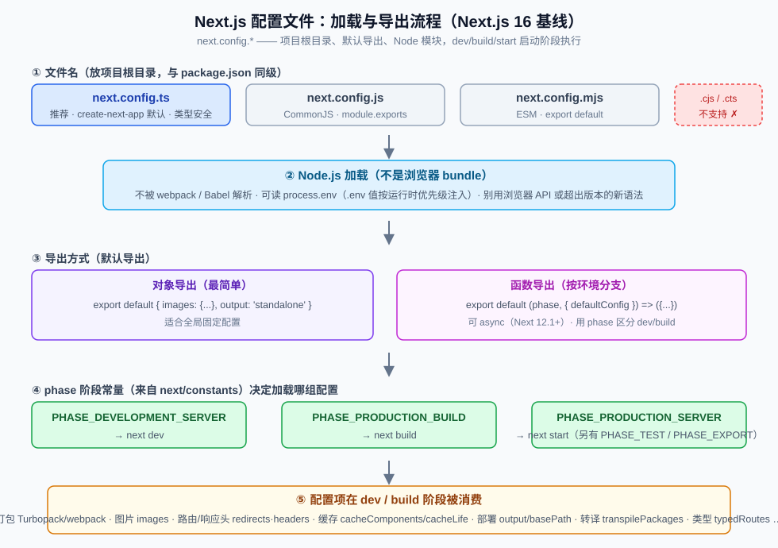

# Next.js 配置文件知识点

> 本文以 **Next.js 16 为基线**（官方配置文档 version 16，最后更新 2025-11）。覆盖：`next.config.*` 文件名与模块格式、加载时机、三种导出方式、`phase` 阶段常量、常用配置项分类速查（Turbopack/webpack、图片、路由、缓存、部署、转译等）、配置里读环境变量、类型安全，附避坑速记清单与自测题。

## 版本说明

- **Next.js 16 起 Turbopack 是默认打包器**（`next dev` / `next build` 默认都走 Turbopack）。自定义 webpack 配置会让构建失败，需用 `next build --webpack` / `next dev --webpack` 退避（见下文）。
- **`create-next-app` 默认生成 TypeScript 配置 `next.config.ts`**（"TypeScript-first configuration"），并默认 App Router + Tailwind + ESLint。
- **`experimental.ppr` 已移除** → 改用 `cacheComponents`（官方升级指南明确）。
- **`reactCompiler` 从 experimental 提升为 stable**（Next 16 起，默认关闭）。
- **`middleware.ts` 改名 `proxy.ts`**，对应配置 flag 也更名，如 `skipMiddlewareUrlNormalize` → `skipProxyUrlNormalize`。
- 一句话理解：**`next.config.*` 是项目"构建/启动期"的中央配置对象，不是运行在浏览器里的代码；它决定 Next 怎么打包、怎么处理图片/路由/缓存、怎么产出部署产物。**



---

## 一、配置文件是谁、叫什么名字

Next.js 通过**项目根目录**下的配置文件来配置（与 `package.json` 同级，不能放进 `src/` 或 `app/` 里）。

| 文件名 | 模块格式 | 说明 |
|---|---|---|
| `next.config.ts` | TypeScript | **推荐**，create-next-app 默认生成，可做类型检查 |
| `next.config.js` | CommonJS（`module.exports`） | 经典写法 |
| `next.config.mjs` | ESM（`export default`） | 需要 ES Modules 时用 |
| `next.config.cjs` / `.cts` | — | **不支持**（官方明确） |

- 配置文件是**一个 Node.js 模块，不是 JSON 文件**。
- 它在 **服务端和构建阶段**被使用，**不会被打进浏览器 bundle**。
- 也**不会被 webpack 或 Babel 解析**——所以别在里面用浏览器专用 API，也避免使用超出目标 Node.js 版本的新语法特性。

```ts title="next.config.ts（默认骨架）"
import type { NextConfig } from "next";

const nextConfig: NextConfig = {
  /* 配置选项写在这里 */
};

export default nextConfig;
```

---

## 二、三种导出方式

配置文件必须**默认导出**。根据是否需要"按环境区分配置"，选对象或函数。

### 1. 直接导出对象（最简单）

```ts title="next.config.ts"
import type { NextConfig } from "next";

const nextConfig: NextConfig = {
  output: "standalone",
  images: { unoptimized: true },
};

export default nextConfig;
```

### 2. 导出函数 `(phase, { defaultConfig })`

需要针对 `dev` / `build` / `start` 等**不同阶段给不同配置**时使用：

```ts title="next.config.ts"
import type { NextConfig } from "next";
import { PHASE_DEVELOPMENT_SERVER } from "next/constants";

export default (phase: string, { defaultConfig }: { defaultConfig: NextConfig }) => {
  if (phase === PHASE_DEVELOPMENT_SERVER) {
    return { ...defaultConfig, /* 仅开发时生效的配置 */ };
  }
  return { ...defaultConfig, /* 其余阶段的配置 */ };
};
```

### 3. 导出 async 函数（Next 12.1+）

函数可以写成 `async`，便于在返回配置前做异步读取（如读取远端配置）：

```ts title="next.config.ts"
export default async (phase: string, { defaultConfig }: { defaultConfig: any }) => {
  const remote = await fetchConfig(); // 示例
  return { ...defaultConfig, ...remote };
};
```

---

## 三、phase 阶段常量（`next/constants`）

`phase` 是配置加载时的**上下文标识**，常量可从 `next/constants` 导入，用于分支：

| 常量 | 对应命令 | 说明 |
|---|---|---|
| `PHASE_DEVELOPMENT_SERVER` | `next dev` | 开发服务器 |
| `PHASE_PRODUCTION_BUILD` | `next build` | 生产构建 |
| `PHASE_PRODUCTION_SERVER` | `next start` | 以生产模式运行已构建产物 |
| `PHASE_TEST` | 测试工具（jest/cypress 等） | 测试阶段 |
| `PHASE_EXPORT` | `next export` | 静态导出 |

> 典型用法：`dev` 时多开 `onDemandEntries` 之类调试配置，`build` 时开 `typedRoutes`、`output` 等生产配置。

---

## 四、常用配置项分类速查（重点）

下面按用途分组列出高频配置项；标注了 Next 16 的注意事项。未列的项可查官方 `next.config.js` 参考文档。

### 4.1 打包器：Turbopack / webpack

| 配置项 | 作用 | Next 16 注意 |
|---|---|---|
| `webpack(config, { isServer })` | 自定义 webpack 配置（webpack 字段本身已废弃为直接 `webpack` 函数） | **Turbopack 默认**；自定义 webpack 会让 `build` 报错，须用 `next build --webpack` 退避 |
| `turbopack: { rules, resolveAlias, ... }` | 配置 Turbopack 专属选项（追加 loader 规则、路径别名等） | Turbopack 已成为默认，多数 webpack loader 需改为其规则形式 |
| `experimental.turbopackFileSystemCacheForDev/Build` | 启用 Turbopack 文件系统缓存（beta），跨重启加速编译 | 官方建议大项目开启 |

### 4.2 路径与部署

| 配置项 | 作用 |
|---|---|
| `basePath: '/sub'` | 把应用部署到域名子路径下，如 `example.com/sub` |
| `assetPrefix: 'https://cdn...'` | 静态资源（JS/CSS）走 CDN 前缀 |
| `trailingSlash: true/false` | 路由是否带尾斜杠（默认 false） |
| `distDir: 'build'` | 自定义构建输出目录（默认 `.next`） |
| `output: 'standalone' \| 'export'` | `standalone`：独立部署（只带必需文件）；`export`：纯静态导出（需配 `output: 'export'`） |

### 4.3 转译与依赖

| 配置项 | 作用 |
|---|---|
| `transpilePackages: ['pkg']` | 把 monorepo workspace 包 / `node_modules` 里含 TS、JSX、新语法的库转译打包 |
| `serverExternalPackages: ['pkg']` | 让某些依赖不参与 Server Components 打包，改用 Node 原生 `require` |
| `optimizePackageImports: ['lib']` | 对大体积库做导入优化（只打包用到的子模块） |

### 4.4 类型 / 质量

| 配置项 | 作用 | 注意 |
|---|---|---|
| `typescript.ignoreBuildErrors: true` | 构建时跳过 TS 类型错误（不推荐） | 只在紧急时用 |
| `eslint.ignoreDuringBuilds: true` | 构建时跳过 ESLint | 同上 |
| `typedRoutes: true` | 开启类型化路由，`<Link href>` 等做类型检查 | 需先跑 `npx next typegen` 生成类型 |
| `reactStrictMode: true` | React 严格模式，开发期 double-invoke 暴露副作用 | 模板默认开 |
| `reactCompiler: true` | 启用 React Compiler，自动记忆化减少多余渲染 | **Next 16 起 stable**（默认关闭，开启会提高编译耗时） |

### 4.5 图片（next/image）

| 配置项 | 作用 |
|---|---|
| `images.remotePatterns: [{ protocol, hostname, port, pathname }]` | 声明允许优化的**外部域名**图片 |
| `images.unoptimized: true` | 关闭图片优化（如纯静态导出时） |
| `images.deviceSizes / imageSizes` | 自定义响应式断点尺寸 |
| `images.formats` | 允许的现代格式（webp/avif） |

> 详细行为见本目录《nextjs Image与Font组件知识点.md》。

### 4.6 路由与 HTTP

| 配置项 | 作用 |
|---|---|
| `redirects()` / `rewrites()` / `headers()` | 返回数组，添加重定向 / 重写 / 自定义响应头（均需 async 函数） |
| `proxyClientMaxBodySize` | proxy（原 middleware）请求体大小上限 |
| `skipProxyUrlNormalize` | 让 proxy 看到原始请求而非 Next 归一化后的（原 `skipMiddlewareUrlNormalize`） |

### 4.7 缓存

| 配置项 | 作用 | Next 16 注意 |
|---|---|---|
| `cacheComponents: true` | 开启 Cache Components（`"use cache"` 显式缓存） | **取代 `experimental.ppr`**；配合 `partialPrefetching` 提示更佳 |
| `cacheLife: { profile: { seconds } }` | 自定义缓存生命周期 profile | 与 `revalidateTag(tag, profile)` 搭配 |
| `cacheMaxMemorySize` | 每实例内存缓存上限 | — |
| `staleTimes` | 覆盖客户端缓存失效时间 | — |
| `cacheHandler` | 自定义缓存存储（Redis/Memcached 等） | — |

### 4.8 服务器与响应

| 配置项 | 作用 |
|---|---|
| `compress: true` | gzip 压缩渲染内容与静态文件（默认开，仅 server target） |
| `poweredByHeader: false` | 关闭 `x-powered-by` 响应头（默认会加） |
| `httpAgentOptions: { keepAlive }` | 是否开启 HTTP Keep-Alive（默认开） |
| `onDemandEntries` | 配置开发模式下页面的内存缓存/淘汰策略 |

### 4.9 环境变量（配置内联）

| 配置项 | 作用 |
|---|---|
| `env: { API: 'xxx' }` | 在**构建时**把值内联进 bundle（等同 `NEXT_PUBLIC_` 效果的一部分），运行时不可改 |

> 业务运行时的环境变量优先用 `.env*` + `NEXT_PUBLIC_`（见本目录《nextjs 环境变量知识点.md》），`env` 配置项主要用于把构建期常量写死进代码。

### 4.10 页面扩展名

| 配置项 | 作用 |
|---|---|
| `pageExtensions: ['mdx', 'tsx', 'ts']` | 自定义 Pages Router 解析的页面扩展名（App Router 约定文件名不受此影响） |

---

## 五、配置文件里读取环境变量

因为 `next.config.*` 是 **Node 模块、在 dev/build/start 启动阶段执行**，所以可以直接 `process.env.X`：

```ts title="next.config.ts"
import type { NextConfig } from "next";

const nextConfig: NextConfig = {
  basePath: process.env.BASE_PATH ?? "",
};
```

- 加载时机：Next 会先通过 `@next/env` 把 `.env*` 注入 `process.env`（遵循与运行时相同的优先级），再执行配置文件，所以配置里通常也能读到 `.env` 文件里的值。
- 注意区分：**`process.env`（此处的读取，进程/环境层面）** 与 **`env` 配置项 / `NEXT_PUBLIC_`（构建期内联给浏览器）** 是两回事。

---

## 六、类型安全：`NextConfig` 类型

用 TypeScript 配置时可给整个对象标注类型，获得拼写与字段校验：

```ts title="next.config.ts"
import type { NextConfig } from "next";

const nextConfig: NextConfig = {
  output: "standalone", // 写错字段名 / 类型会直接报错
};
export default nextConfig;
```

- 配合 `typedRoutes: true` 还能让 `<Link href>`、`router.push()` 等做静态路由类型检查（需 `npx next typegen` 生成类型）。

---

## 七、避坑速记清单

1. **文件名必须精确**：只支持 `next.config.js` / `.mjs` / `.ts`；`.cjs` / `.cts` 会直接不被识别。
2. **必须放项目根目录**（与 `package.json` 同级），放进 `src/` 或 `app/` 无效。
3. **必须默认导出**；要按环境区分用函数导出 `(phase, { defaultConfig })`，可写成 `async`。
4. **配置文件不是浏览器代码**：不被 webpack/Babel 解析，别用浏览器 API，也别用超出版本的新语法。
5. **Next 16 里 Turbopack 是默认**：自定义 webpack 配置会让 `build` 报错，须用 `next build --webpack`（或 `next dev --webpack`）退避。
6. **`experimental.ppr` 已移除**（Next 16）：要 PPR 式缓存改开 `cacheComponents`。
7. **改配置文件必须重启**：配置只在 `next dev` 启动 / `next build` 构建时读取一次，改完要重启才生效。
8. **外部域名图片必须配 `images.remotePatterns`**，否则 `next/image` 不优化该域名的图（甚至报错）。
9. **`typedRoutes` 需要 `npx next typegen`** 生成类型后才会生效。
10. **`env` 配置项是构建期内联**，运行时改不了；要运行时值走 `.env*` + `connection()`。

---

## 八、自测题

**Q1.** 项目里同时出现 `next.config.js`、`next.config.ts`，Next 会加载哪个？`.cjs` 会被识别吗？

**Q2.** 想让"开发环境下日志更详细、生产构建时开启 `typedRoutes`"，应该用哪种导出方式？为什么对象导出不行？

**Q3.** `phase` 从哪导入？`PHASE_PRODUCTION_BUILD` 对应哪条命令？

**Q4.** Next 16 里我自定义了 `webpack` 配置，执行 `next build` 报错，原因是什么？怎么处理？

**Q5.** 想在配置文件里读一个 `.env` 里的值来设置 `basePath`，可行吗？和 `env` 配置项有什么区别？

<details>
<summary>参考答案（点击展开）</summary>

**A1.** 官方支持 `.js` / `.mjs` / `.ts`，若存在 `.ts` 一般优先（create-next-app 默认生成它）；`.cjs` / `.cts` **不支持**，不会被识别。

**A2.** 用**函数导出** `(phase, { defaultConfig }) => {...}`，内部按 `phase === PHASE_DEVELOPMENT_SERVER` 等分支返回不同对象；对象导出是固定一套，无法按阶段区分。

**A3.** 从 `next/constants` 导入（如 `PHASE_DEVELOPMENT_SERVER`）；`PHASE_PRODUCTION_BUILD` 对应 `next build`。

**A4.** 因为 Next 16 默认打包器是 Turbopack，自定义 webpack 配置与其冲突导致构建失败。处理：改用 Turbopack 对应配置（`turbopack` 字段），或显式用 `next build --webpack` 退回 webpack。

**A5.** 可行。配置文件是启动阶段执行的 Node 模块，`.env*` 会先被 `@next/env` 注入 `process.env`，所以能 `process.env.X` 读取。区别：配置里 `process.env` 是"服务端/进程层"读取；`env` 配置项是**构建期**把常量内联进发给浏览器的 bundle，运行后不可改。
</details>

---

## 参考

- Next.js 官方文档 · next.config.js（version 16，最后更新 2025-11）— https://nextjs.org/docs/app/api-reference/config/next-config-js
- Next.js 16 发布说明（Turbopack 默认、cacheComponents、reactCompiler、proxy.ts 等）— https://nextjs.org/blog/next-16
