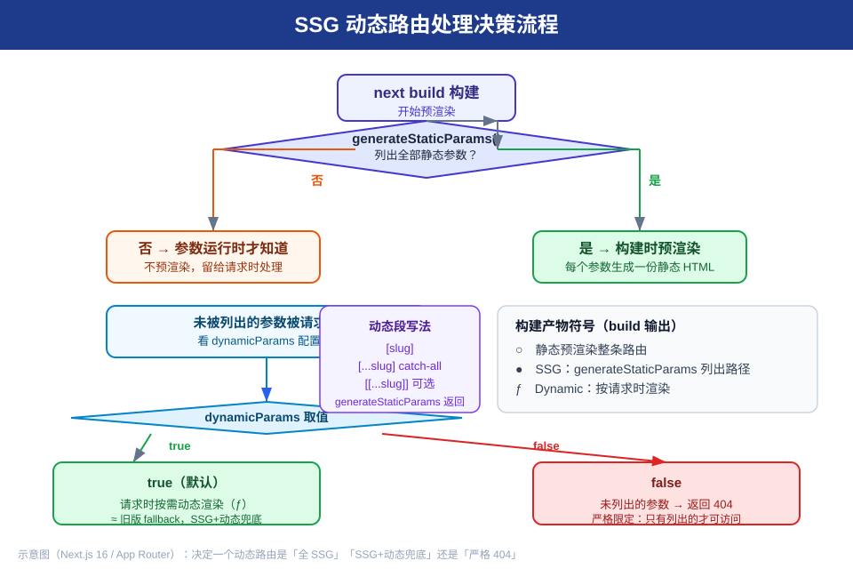
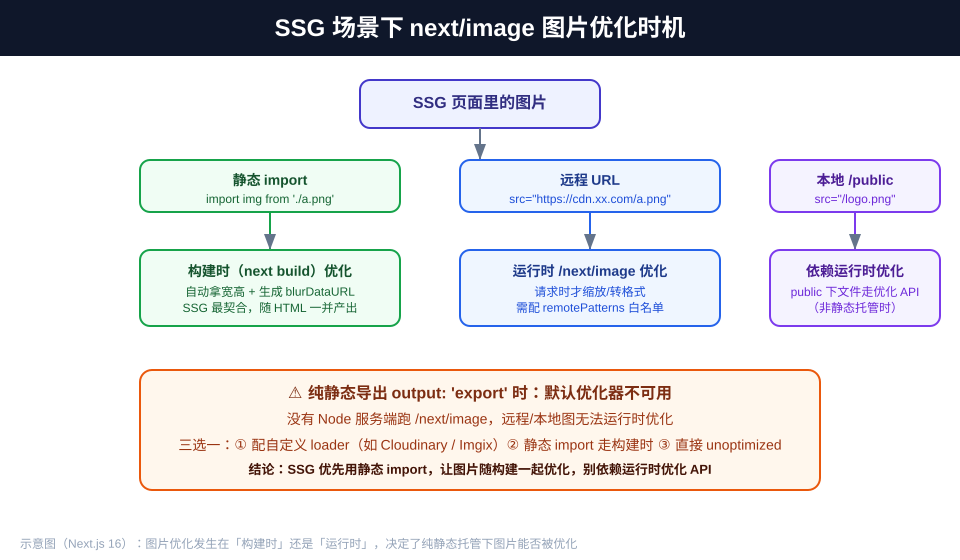

# Next.js SSG 补充：图片优化与动态路由处理

> App Router（Next.js 16）下，围绕 **SSG（静态站点生成）** 的两个高频深水区补充：**动态路由的预渲染与回退策略**、**图片优化在 SSG 场景下的时机与方案**。本文是《csr-ssr-ssg-rsc 渲染模式知识点》的 SSG 进阶篇。



## 版本说明

- **本文以 Next.js 16 为基线**（App Router，React 19），所有代码按 16 写法。
- 前置阅读：《csr-ssr-ssg-rsc 渲染模式知识点》《nextjs Image与Font组件知识点》。
- 核心心智：**SSG = 构建时（next build）把 HTML 预先生成好**；一旦生成，页面在服务端/静态托管直接吐完整 HTML，最快、零服务端压力。真正的难点在"动态路由怎么兜底"和"图片怎么在纯静态下也被优化"。

---

## 一、动态路由的 SSG：generateStaticParams 深水区

### 1.1 基础写法回顾

动态段 `app/blog/[slug]/page.tsx` 要变成 SSG，必须导出 `generateStaticParams` 列出**全部**要预生成的参数：

```tsx
// app/blog/[slug]/page.tsx
export async function generateStaticParams() {
  const posts = await getAllPosts();           // 构建时可访问 DB / fetch
  return posts.map((p) => ({ slug: p.slug })); // 每个元素 = 一份静态 HTML
}

export default async function BlogPost({
  params,
}: {
  params: Promise<{ slug: string }>;
}) {
  const { slug } = await params;
  const post = await getPost(slug);
  return <article>{post.title}</article>;
}
```

- `params` / `searchParams` / `cookies` / `headers` 在 **16 全是 Promise**，必须 `await`。
- `generateStaticParams` 只在**构建时**执行；运行时不跑。

### 1.2 关键：generateStaticParams 只是"白名单"，不是"锁定"——dynamicParams

列出的参数会被预渲染成 SSG；**没列出的参数被请求时怎么办**，由 `dynamicParams` 决定：

```tsx
// app/blog/[slug]/page.tsx
export const dynamicParams = true;  // 默认值
// export const dynamicParams = false;
```

| dynamicParams | 未列出的参数被请求时 | 适合场景 |
|---|---|---|
| `true`（默认） | **按需动态渲染**（ƒ）——请求时才生成这份 HTML，相当于旧版的 `fallback` | 内容新增很快、想"先静态热门 + 新内容即时可访问" |
| `false` | **返回 404**——只有 generateStaticParams 列出的路径可访问 | 内容完全可控、绝不希望出现未知路径（如内部系统） |

> **最常踩的坑**：以为写了 `generateStaticParams` 就"所有参数都静态"，结果新发布的文章（未预生成）被当成动态渲染，TTFB 变慢；或反过来——设了 `dynamicParams=false` 后新内容全 404。**先想清楚"未知参数要不要能访问"再选值。**

### 1.3 三种动态段写法与 generateStaticParams 的返回

| 段写法 | 匹配 | generateStaticParams 返回 |
|---|---|---|
| `[slug]` | 单层一个参数 | `{ slug: 'a' }` |
| `[...slug]`（catch-all） | 一个或多个段 | `{ slug: ['a', 'b'] }`（数组） |
| `[[...slug]]`（optional catch-all） | 零个或多个段 | `{ slug: ['a'] }` 或 `{}`（空=匹配到段） |

```tsx
// app/blog/[...slug]/page.tsx —— catch-all
export async function generateStaticParams() {
  return [
    { slug: ['a'] },            // /blog/a
    { slug: ['a', 'b'] },       // /blog/a/b
  ];
}
```

### 1.4 与 ISR（revalidate）组合：静态为主 + 到期再生成

```tsx
// app/products/[id]/page.tsx —— 预生成 + 每 60s 后台重生成（ISR）
export async function generateStaticParams() {
  const ids = await getAllProductIds();
  return ids.map((id) => ({ id }));
}
export const revalidate = 60;
```

- 构建时生成全部静态页；60 秒后首次访问触发**后台重新生成**，期间仍返回旧静态版（stale-while-revalidate）。
- 注意：`revalidate` 生效需要一个能后台重建的运行时（自托管/Serverless）；**纯静态导出 `output:'export'` 不支持 revalidate**。

### 1.5 构建产物怎么核对（你拿到的是不是 SSG）

构建输出（`next build`）尾部会列出每个路由的渲染标记：

- `○`　静态预渲染整条路由（无需动态参数）
- `●`　SSG：generateStaticParams 列出了路径，预渲染成 HTML
- `ƒ`　Dynamic：按请求时渲染（含 dynamicParams=true 兜底的未知参数）

> 自查：某个 `/blog/abc` 显示 `ƒ`，说明它没被 generateStaticParams 覆盖，在走动态兜底；想让它变 `●` 就去检查有没有漏列参数。

---

## 二、SSG 场景下的图片优化



### 2.1 核心结论：图片优化发生在"构建时"还是"运行时"，决定了纯静态能不能优化

| 图片来源 | 优化时机 | 说明 |
|---|---|---|
| **静态 import**（`import img from './a.png'`） | **构建时** | 自动拿宽高 + 生成 `blurDataURL`；随构建产出，**SSG 最契合** |
| **远程 URL**（`src="https://cdn.x.com/a.png"`） | **运行时** `/next/image` | 请求时才缩放/转格式；需配 `remotePatterns` |
| **本地 `/public`** | **运行时** | public 下文件走优化 API |

**判定**：SSG 部署在静态托管（无 Node 服务端跑优化 API）时，**优先用静态 import**，让图片随构建一起优化好；远程/本地图若无法运行时优化，需额外方案（见 2.3）。

### 2.2 静态 import 是 SSG 图片的首选

```tsx
import heroImg from './hero.png';   // 构建时自动优化 + blurDataURL

<Image src={heroImg} alt="主视觉" />
// 无需手写 width/height —— import 已带固有尺寸；自动生成 placeholder
```

- 好处：图片在构建时优化完成，部署到任何静态托管都能直接提供优化后的图，不需要运行时服务。
- 静态 jpg/png/webp/avif 会自动生成 `placeholder="blur"`，减少 CLS 和首屏跳动。

### 2.3 远程 / public 图：运行时优化不可用时的三选一

纯静态导出（`output: 'export'`）时**没有 Node 服务端跑 `/next/image`**，远程/本地图默认无法优化。三选一：

```tsx
// 方案① 自定义 loader（把优化交给 CDN 服务，如 Cloudinary / Imgix）
// next.config.ts
const nextConfig = {
  images: {
    loader: 'cloudinary',
    path: 'https://res.cloudinary.com/<cloud-name>/image/fetch/',
  },
};
```

```tsx
// 方案② 静态 import —— 只对本地能打包的图有效
// 方案③ 直接关闭优化（适合已压缩好、体积可控的图）
<Image src="/logo.png" width={120} height={40} alt="logo" unoptimized />
```

### 2.4 SSG 页面里多图（图集 / 相册 / 商品列表）的处理

SSG 页常一次性渲染大量图片，重点防"下载过大图"和"阻塞 LCP"：

```tsx
// 图集页：fill + sizes 按视口选档，避免下载远超实际宽度的图
<div style={{ position: 'relative', width: '100%', height: 240 }}>
  <Image
    fill
    src={item.cover}
    sizes="(max-width: 768px) 100vw, 33vw"   // 关键：给出各断点宽度
    placeholder="blur"
    blurDataURL={item.blurDataURL}
    alt={item.title}
  />
</div>
```

- **`sizes` 缺失 = 浏览器假设 100vw**，可能下载远大于实际需要的图。图集页务必给 `sizes`。
- 只有 **LCP / 首屏 hero** 才 `preload`（16 替代已弃用的 `priority`）；图集里**不要**给每张图 preload，否则首屏阻塞。其余图保持默认 `lazy`。
- 大量图建议预生成 `blurDataURL`（SSG 构建时算好，客户端不额外请求）。

### 2.5 远程图在 SSG 中的安全配置

```ts
// next.config.ts —— 只放行确实要用的主机
const nextConfig = {
  images: {
    remotePatterns: [
      { protocol: 'https', hostname: 'cdn.example.com', pathname: '/img/**' },
    ],
  },
};
```

- `remotePatterns` 用 `*`（单段）/ `**`（多段）限定 hostname / pathname；只开你需要的主机，别通配放行。
- 远程图在 SSG 页仍走**运行时优化**；若静态托管无优化服务，要么自定义 loader（交 CDN），要么 `unoptimized`。

---

## 三、避坑速记清单

**动态路由**
1. `generateStaticParams` 只是**白名单**，不是"全静态锁定"；没列出的参数由 `dynamicParams` 决定（true→动态兜底 / false→404）。
2. `dynamicParams=false` 后新内容会 404；`true` 后新内容变动态（ƒ）。先想清"未知参数要不要能访问"。
3. `params` / `searchParams` / `cookies` / `headers` 在 16 全是 Promise，必须 `await`。
4. catch-all 用数组返回：`[...slug]` → `{ slug: ['a','b'] }`；optional catch-all `[[...slug]]` 可返回 `{}`。
5. 靠构建产物核对：`●`=SSG 已预渲染，`ƒ`=动态（含兜底）；想转 `●` 就补 generateStaticParams。
6. **纯静态导出 `output:'export'` 不支持 `revalidate`（ISR）**，别指望静态托管能后台重建。

**图片优化**
7. **SSG 优先静态 import**——图片构建时优化好，任何静态托管都能直接提供优化图；别依赖运行时优化 API。
8. `output:'export'` 无 Node 服务端 → 远程/本地图默认无法优化：自定义 loader / 静态 import / `unoptimized` 三选一。
9. 图集页务必给 `sizes`（缺省=假设 100vw 下载大图）；只有 LCP hero 才 `preload`，其余 `lazy`。
10. 静态 import 自动带固有尺寸 + blurDataURL；远程图须配 `remotePatterns` 白名单。

---

## 四、自测题

**Q1**：写了 `generateStaticParams` 后，一个新发布的文章路径没在里面，访问它会发生什么？取决于哪个配置？

<details><summary>答案</summary>取决于 `dynamicParams`：默认 `true` → 该路径按请求时动态渲染（ƒ，相当于旧版 fallback）；设为 `false` → 返回 404。</details>

**Q2**：怎么在构建输出里确认一个 `/blog/abc` 到底是不是 SSG？

<details><summary>答案</summary>看 `next build` 尾部路由标记：`●` = SSG（generateStaticParams 预渲染），`ƒ` = 动态（含 dynamicParams 兜底），`○` = 整条路由静态。</details>

**Q3**：SSG 部署到纯静态托管（无 Node 服务），页面上用了 `<Image src="https://cdn.x.com/a.png">`，会怎样？怎么解决？

<details><summary>答案</summary>远程图默认走运行时 `/next/image` 优化，纯静态托管没有该服务，图片无法被优化（甚至报错）。解决：① 配自定义 loader（如 Cloudinary/Imgix）② 能本地打包就用静态 import ③ 对已压缩的图直接 `unoptimized`。</details>

**Q4**：图集页每张图都加 `preload`，会有什么问题？正确做法是什么？

<details><summary>答案</summary>会让所有图都抢首屏带宽、阻塞 LCP。正确做法：只有 LCP/首屏 hero 才 `preload`，其余保持默认 `lazy`，并用 `sizes` 控制各断点加载档位。</details>

**Q5**：`output:'export'` 静态导出下，能用 `revalidate`（ISR）吗？

<details><summary>答案</summary>不能。ISR 的后台重建需要一个能运行的运行时（自托管/Serverless）；纯静态导出只产出构建时的 HTML，不支持 revalidate。</details>

---

## 参考来源

- Next.js 官方《generateStaticParams》（`nextjs.org/docs/app/api-reference/functions/generate-static-params`，`dynamicParams` 行为）
- Next.js 官方《Route Segment Config: dynamicParams》（`dynamicParams` true 默认 / false 404）
- Next.js 官方《Dynamic Route Segments》（`[...slug]` / `[[...slug]]` 写法）
- Next.js 官方《How to create a static export》（`output:'export'` 图片需自定义 loader）
- Next.js 官方《Image Optimization》与《Image Component》（静态 import 构建时优化、`sizes`、`preload`、`remotePatterns`）
- Next.js 官方《Building your application》（构建产物符号 ○ / ● / ƒ）
