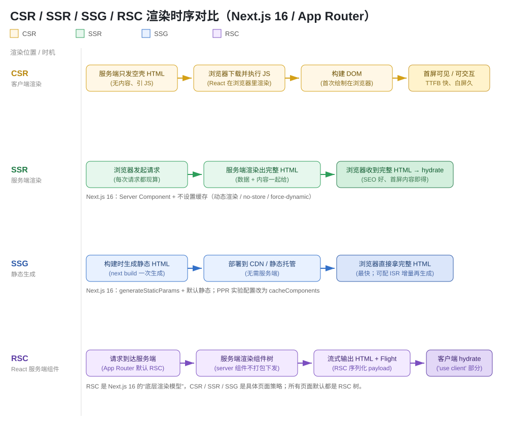

# Next.js 渲染模式：CSR / SSR / SSG / RSC 知识点

> App Router（Next.js 16）下的四种渲染/取数形态：**CSR、SSR、SSG、RSC** 的概念、区别、代码示例与避坑清单；末尾附**早期版本重要漏洞 CVE-2025-29927 及修复方式**。

## 版本说明

- **本文以 Next.js 16 为基线**（App Router，React 19）。所有代码均按 16 写法。
- 核心心智：**RSC（React Server Components）是 Next.js 16 的底层渲染模型**，所有页面默认都是一棵 RSC 树；CSR / SSR / SSG 是在这棵树上采用的**具体页面策略**。
- 旧版 Pages Router（12 及更早）靠 `getServerSideProps` / `getStaticProps` / `getInitialProps` 实现 SSR/SSG，本文仅作对比，**不是实践基线**。

---

## 一、四个概念是什么

### CSR（Client-Side Rendering，客户端渲染）

服务端只返回一个**空壳 HTML**（`<div id="root">` + 引 JS），React 在**浏览器里**下载 JS、执行并构建 DOM。

- 优点：TTFB 快、后续导航丝滑、天然 SPA。
- 缺点：**首屏白屏久**、SEO 差（爬虫拿到的是空壳）、首次 JS 体积大。

```tsx
// app/dashboard/page.tsx —— 用 'use client' 强制纯客户端渲染
'use client';
export default function DashboardPage() {
  // 数据靠浏览器端 useEffect / fetch 拉取
  return <div>仪表盘</div>;
}
```

### SSR（Server-Side Rendering，服务端渲染）

**每次请求都在服务端**现算，渲染出**完整的 HTML**（含数据）返回浏览器，再由 React hydrate 成可交互页面。

- 优点：首屏内容即得、SEO 好、TTFB 后内容立即可见。
- 缺点：**每个请求都重新计算**，服务端压力大、响应时间（TTFB）偏长；不适用变化极快的个性化页。

Next.js 16 中，Server Component 默认走**静态缓存**；要强制每次请求都现渲染（真 SSR），需关闭缓存：

```tsx
// app/products/[id]/page.tsx —— 每次请求现算（强制 SSR 动态渲染）
export const dynamic = 'force-dynamic'; // 或 fetch 里加 { cache: 'no-store' }

export default async function ProductPage({
  params,
}: {
  params: Promise<{ id: string }>;
}) {
  const { id } = await params;
  const data = await getProduct(id); // 每次都现查
  return <div>商品：{data.name}</div>;
}
```

### SSG（Static Site Generation，静态站点生成）

**构建时（`next build`）一次性生成静态 HTML**，部署到 CDN / 静态托管，浏览器直接拿完整 HTML，无需服务端。

- 优点：**最快**、零服务端压力、可全局缓存。
- 缺点：内容固定（需 `revalidate` 或重建才更新）；动态路径要靠 `generateStaticParams` 预先列出来。

```tsx
// app/blog/[slug]/page.tsx —— 构建时预生成全部静态页（SSG）
export async function generateStaticParams() {
  const posts = await getAllPosts();
  return posts.map((p) => ({ slug: p.slug }));
}

export default async function BlogPost({
  params,
}: {
  params: Promise<{ slug: string }>;
}) {
  const { slug } = await params;
  const post = await getPost(slug);
  return <article>{post.title}</article>;
}
```

> 想“静态为主 + 到期再生成”用 **ISR**：在 fetch 上加 `revalidate: 60`，或导出 `export const revalidate = 60`。Next.js 16 中 PPR 实验配置已移除，改由 `cacheComponents` 接管部分静态化。

### RSC（React Server Components，服务端组件）

React 19 的渲染模型：**组件默认在服务端执行**，只把渲染后的结果（HTML + 一段叫 **Flight** 的序列化 payload）发给浏览器；浏览器端不下载服务端组件的代码。叶子节点可标 `'use client'` 让它在浏览器端跑。

- 优点：服务端组件不打包进客户端 JS（体积骤减）、可直接访问数据库/密钥、可按需流式渲染（streaming）。
- 关键规则：**默认是 Server Component**，要变成客户端组件必须显式 `'use client'`；Server Component 里不能 `useState` / `useEffect` / 事件处理。

```tsx
// app/page.tsx —— 默认 Server Component（RSC 树根）
import { getData } from './data'; // 可以直接 await，甚至直接连 DB

export default async function Page() {
  const data = await getData();
  return <ClientCounter initial={data.count} />; // 客户端叶子
}

// app/ClientCounter.tsx
'use client';
export default function ClientCounter({ initial }: { initial: number }) {
  const [n, setN] = useState(initial); // 只能在客户端组件里用 state
  return <button onClick={() => setN(n + 1)}>{n}</button>;
}
```

---

## 二、核心区别（一张表）

| 维度 | CSR | SSR | SSG | RSC |
|---|---|---|---|---|
| **渲染位置** | 浏览器 | 服务端（每次请求） | 构建时（build） | 服务端（RSC 树根） |
| **HTML 是否预渲染** | 否（空壳） | 是（请求时现算） | 是（构建时生成） | 是（流式生成） |
| **是否需要服务端** | 否 | 是（每请求） | 否（静态托管即可） | 是（每请求渲染） |
| **SEO** | 差 | 好 | 好 | 好 |
| **TTFB** | 快 | 较慢 | 极快 | 中/快（可流式） |
| **首屏内容可见** | 需等 JS | 立即可见 | 立即可见 | 立即可见（可流式） |
| **交互（hydrate）** | 渲染即交互 | 需 hydrate | 需 hydrate | 仅客户端组件 hydrate |
| **数据获取时机** | 浏览器端 | 每次请求 | 构建时 | 请求时（服务端组件） |
| **JS 体积** | 大（整包下发） | 中大 | 中大 | **小（服务端组件不下发）** |
| **更新数据** | 每次请求 | 每次请求 | 需重建 / revalidate | 每请求（可缓存） |
| **适用场景** | 强交互后台、Dashboard | 个性化、实时数据 | 博客、文档、营销页 | 默认选择，全场景基底 |
| **Next.js 16 形态** | `'use client'` 页 | `dynamic='force-dynamic'` / `no-store` | `generateStaticParams` + 默认静态 | 默认所有页面 |

> 一句话：**SEO + 首屏优先 → SSG**（内容固定）或 **SSR**（内容个性化）；**强交互 → 在 RSC 树上挂 CSR 叶子**。RSC 不是和三者并列的“第四个选择”，而是三者共同的地基。

---

## 三、渲染时序图



- **CSR**：服务端只发空壳 → 浏览器下 JS → 浏览器构建 DOM → 首屏可见（白屏久）。
- **SSR**：请求 → 服务端现算完整 HTML → 浏览器 hydrate（每请求都算，慢但内容即得）。
- **SSG**：构建时生成 HTML → 部署 CDN → 浏览器直接拿（最快，静态）。
- **RSC**：请求 → 服务端渲染组件树 → 流式输出 HTML + Flight → 客户端仅 hydrate `'use client'` 叶子。

---

## 四、避坑速记清单

1. **RSC 是“默认态”，不是可选项**——App Router 里不加 `'use client'` 的组件全是 Server Component；别再以为页面默认是 CSR。
2. **Server Component 里不能用 state/effect/事件**——要交互就必须把该子树拆成 `'use client'` 文件，且**文件之间是硬边界**（一个文件不能既服务端又客户端）。
3. **真 SSG 必须用 `generateStaticParams` 列出动态路径**，否则动态路由会被当成动态渲染（按需现算）。
4. **SSR 在 Next.js 16 默认不是“每次现算”**——默认走静态缓存。要真 SSR 记得 `dynamic='force-dynamic'` 或 `fetch no-store`，否则会拿到旧的静态结果（最常见的“为什么数据不变”坑）。
5. **`params` / `searchParams` / `cookies` / `headers` 在 16 全是 Promise**，必须 `await`（15 的临时同步兼容在 16 已删除）。
6. **SSG 页要想“到期再生成”用 `revalidate`（ISR）**，不要用 `dynamic` 去凑。
7. **CSR 页面（纯 `'use client'`）SEO 是空壳**——公开落地页别这么写；内容页至少用 SSG/SSR 把首屏渲染出来。
8. **RSC 的 Flight payload 只在服务端→浏览器单向**，别指望浏览器能把组件逻辑传回服务端（那是 Server Action / Server Function 的职责）。
9. **流式渲染下 `loading.tsx` 与 `<Suspense>` 配合**，别把整页卡在最长的那次 fetch。
10. **判定你到底拿到了哪种**：看构建产物——`○`（SSG 静态）、`ƒ`（SSR 动态）、`●`（ISR）；别靠“以为”。

---

## 五、早期版本重要漏洞：CVE-2025-29927（中间件鉴权绕过）及修复方式

> 之所以放进“渲染模式”笔记，是因为它**直击服务端渲染页面的鉴权防线**：大量 SSR 页靠 middleware（Next.js 16 已更名 proxy）在边缘做权限校验，一旦绕过，受保护页面的数据就被直接泄露。

### 5.1 是什么

- **漏洞**：Next.js 中间件（middleware）**鉴权绕过**。攻击者构造一个恶意 `x-middleware-subrequest` 请求头，就能让 Next.js 认为“这个请求已经过中间件”，从而**跳过整个鉴权逻辑**，直接访问受保护的 SSR/SSG 页面与数据。
- **原理**：Next.js 内部用 `x-middleware-subrequest` 标记“已过中间件”的请求，避免重复执行 matcher；问题是**这个头来自外部时仍被信任**，于是“已校验”的标记变成了攻击者可伪造的开关。
- **严重程度**：Critical；CVSS 9.1（NVD）。

### 5.2 影响范围（早期版本全中）

| Next.js 主线 | 首次受影响 | 修复版本 |
|---|---|---|
| 11.x / 12.x | **11.1.4 起**（11.x 无补丁，只能升级） | **12.3.5** |
| 13.x | 13.0.0 | **13.5.9** |
| 14.x | 14.0.0 | **14.2.25** |
| 15.x | 15.0.0 | **15.2.3** |

- 漏洞自 **11.1.4** 起存在，2025-03-21 披露（GHSA-f82v-jwr5-mffw），当月全部修复。**11.x 没有补丁**，必须升级。
- 判定：如果鉴权**只写在 middleware 里**（middleware 是唯一防线），那就是受影响面。

### 5.3 怎么修（按优先级）

**① 升级到安全版本（唯一根治）——完整修复命令**

```bash
# 第 1 步：看当前版本，确认是否在受影响区间
npx next info          # 查看 next 与相关依赖版本
npm ls next            # 快速只看 next 到底装的哪个版本

# 第 2 步：升级到安全版本（按你当前主线选其一执行）
npm install next@16.2.5       # 直接上最新 Next.js 16（已含修复，推荐）
npm install next@15.2.3       # 停留在 15.x → 至少 15.2.3
npm install next@14.2.25      # 14.x → 至少 14.2.25
npm install next@13.5.9       # 13.x → 至少 13.5.9
npm install next@12.3.5       # 12.x → 12.3.5；11.x 无补丁 → 直接升
# 若用 pnpm：pnpm add next@15.2.3（同上版本） | yarn：yarn add next@15.2.3

# 第 3 步：验证升级已生效
npm ls next            # 应显示 ≥ 目标版本；再 npx next info 复核

# 第 4 步（Next.js 16）：middleware 更名 proxy 的自动迁移命令
npx @next/codemod@latest upgrade
```

> Next.js 16 已将 `middleware.ts` 更名 `proxy.ts`（导出 `proxy`），`npx @next/codemod@latest upgrade` 可自动改名；16 默认且只能 Node.js runtime。**改名不改变本漏洞的教训**：运行在路由之前的那层，仍不适合当唯一鉴权点。

**② 临时缓解（无法立刻升级时）：在 CDN / 反向代理层拦截该请求头**

在边缘把外部请求携带的 `x-middleware-subrequest` 头**剥掉/拒绝**。注意这会同时影响合法的内部跳转，只能作为过渡。

```nginx
# Nginx：直接丢弃来自客户端的该头（临时缓解）
map $http_x_middleware_subrequest $block_ignored {
    default 0;
    "~.*"   1;
}
# 或在 server/location 中：
if ($http_x_middleware_subrequest) {
    return 403;
}
```

**③ 纵深防御（根因修复，强烈建议长期保留）**

把鉴权**下沉到路由 / Server Component / Route Handler / Server Action**，而不是只依赖边缘层。这样即使中间件被跳过，真正决定“能不能执行”的逻辑仍在应用上下文里把关。

```tsx
// app/admin/page.tsx —— 关键：鉴权不能只在 middleware，业务逻辑里也要校验
export default async function AdminPage() {
  const session = await auth();
  if (!session?.user || session.user.role !== 'admin') {
    // 中间件被绕过时，这里仍然拦截
    redirect('/login');
  }
  return <div>管理后台</div>;
}
```

### 5.4 相关漏洞：CVE-2024-51479（路径 matcher 漏匹配）

- 中间件用 `pathname.startsWith('/admin')` 判权、matcher 又列了 `/admin/:path*` + `/admin` 时，**顶层 `/admin` 本身可能漏匹配**而被放行。
- 影响 9.5.5 ~ 14.2.14，**14.2.15 修复**。注意：打了 14.2.15 ≠ 防住 CVE-2025-29927，后者要 14.2.25。

### 5.5 上线前自查（Checklist）

- [ ] `next --version` / `package.json` 中的 next 版本 ≥ 上表安全线？
- [ ] 鉴权是否**只在 middleware/proxy 里**？（若是 → 必须下沉到路由/Server Component）
- [ ] CDN/网关日志里有没有出现 `x-middleware-subrequest: middleware`、`pages/_middleware` 或 `middleware:middleware:middleware:middleware:middleware`（15+ 的 5 层递归值）等可疑记录？
- [ ] 公开落地页用的是 SSG/SSR，不是纯 CSR 空壳？
- [ ] 是否已执行 `npx fix-react2shell-next` 排查 RSC 层漏洞？（见 5.6）

### 5.6 RSC 专属漏洞：React2Shell 与 `npx fix-react2shell-next`

> **React2Shell** 是一组发生在 **React Server Components（RSC）协议层**的漏洞（源头在 React 上游），凡用 App Router 跑 RSC 的应用都受影响。这是与「RSC」知识点最直接相关的一类安全问题，官方提供了一键修复命令。

| 编号 | 危害 | 说明 |
|---|---|---|
| CVE-2025-55183 | 中 | **源码暴露**：构造的请求可让某个 Server Function 返回应用里其他 Server Function 的编译源码，泄露业务逻辑；若密钥直接写在代码里（非运行时环境变量）还可能内联泄露 |
| CVE-2025-55184 | 高 | **DoS**：构造的请求反序列化后进入死循环，挂死服务进程、拒绝后续请求 |
| CVE-2025-67779 | 高 | **55184 的补全修复**：官方承认 55184 初始补丁不完整，重发此编号补全；升过初版的人要再升一次 |

**官方一键修复命令（交互式）：**

```bash
npx fix-react2shell-next
```

它会自动检查当前版本，并按官方推荐版本做**确定性升级**（版本号按主线对应关系一次性抬到安全线）。

**各主线对应的安全版本（也可手动升级）：**

```bash
npm install next@16.0.10      # 16.0.x → 16.0.10
npm install next@15.5.9       # 15.5.x → 15.5.9
npm install next@15.4.10      # 15.4.x → 15.4.10
npm install next@15.3.8       # 15.3.x → 15.3.8
npm install next@15.2.8       # 15.2.x → 15.2.8
npm install next@15.1.11      # 15.1.x → 15.1.11
npm install next@15.0.7       # 15.0.x → 15.0.7
npm install next@14.2.35      # 14.x 及 13.3+ → 14.2.35（仅需防 DoS）
```

> 注意：**Pages Router 不受影响**（只影响 App Router 的 RSC）；**没有 workaround，必须升级**。若此前已升过 55184 的初版修复，需再升到上表最新版（67779 补全）。

---

## 六、自测题

**Q1**：一个博客页要“构建时生成、最快、SEO 好”，选哪种模式？Next.js 16 里怎么写？

<details><summary>答案</summary>选 **SSG**。`app/blog/[slug]/page.tsx` 导出 `generateStaticParams()` 列出所有 slug；若想到期刷新加 `revalidate: 60`（ISR）。</details>

**Q2**：把 `'use client'` 加在页面顶部，能拿到什么样的渲染？为什么 SEO 会差？

<details><summary>答案</summary>纯 **CSR**：服务端只发空壳 HTML，内容靠浏览器跑 JS 才出现，所以爬虫拿到空壳、SEO 差、首屏白屏。</details>

**Q3**：Server Component 里直接 `useState`，会怎样？为什么 RSC 文件之间是“硬边界”？

<details><summary>答案</summary>会报错。Server Component 在服务端执行，没有 state/effect/事件；一个文件要么是服务端要么是客户端（`'use client'`），不能同文件两用，所以要交互就拆出客户端叶子组件。</details>

**Q4**：CVE-2025-29927 的根因和三种修复优先级分别是什么？

<details><summary>答案</summary>根因：中间件用内部头 `x-middleware-subrequest` 标记“已校验”，外部可伪造从而跳过鉴权。修复：①升级安全版（12.3.5/13.5.9/14.2.25/15.2.3）②临时在 CDN/反代拦截该头 ③把鉴权下沉到路由/Server Component（纵深防御）。</details>

**Q5**：你的中间件在 14.2.15（已修 CVE-2024-51479），它是否也防住了 CVE-2025-29927？

<details><summary>答案</summary>**不能**。14.2.15 只修路径 matcher 漏匹配；CVE-2025-29927 需 14.2.25 或更高。</details>

**Q6**：RSC 层（React2Shell）漏洞的一键修复命令是什么？它和 CVE-2025-29927 的修复有什么不同？

<details><summary>答案</summary>命令是 `npx fix-react2shell-next`（交互式，检查版本并做确定性升级）。React2Shell 是 RSC 协议层漏洞（CVE-2025-55183 源码暴露 / 55184 DoS / 67779 补全），只影响 App Router 的 RSC，且只能升级、无 workaround；而 CVE-2025-29927 是中间件鉴权绕过，除升级外还可用“拦截 x-middleware-subrequest 头 + 鉴权下沉”做缓解。</details>

---

## 参考来源

- Next.js 官方安全公告 / NVD：`CVE-2025-29927`（固定于 12.3.5、13.5.9、14.2.25、15.2.3；自 11.1.4 起受影响）
- Vercel《Postmortem on Next.js Middleware bypass》（2025-03）
- Arcjet《Were you affected by the Next.js middleware bypasses?》（含 `x-middleware-subrequest` 特征值、WAF 拦截注意事项）
- React 官方公告：RSC 相关 CVE（CVE-2025-55183/55184，DoS 与源码暴露，React 19.2.x 起）
- Next.js 官方安全公告（2025-12-11）：React2Shell 修复版次与 `npx fix-react2shell-next`（14.2.35 / 15.0.7 / 15.1.11 / 15.2.8 / 15.3.8 / 15.4.10 / 15.5.9 / 16.0.10；含 CVE-2025-67779 补全）
