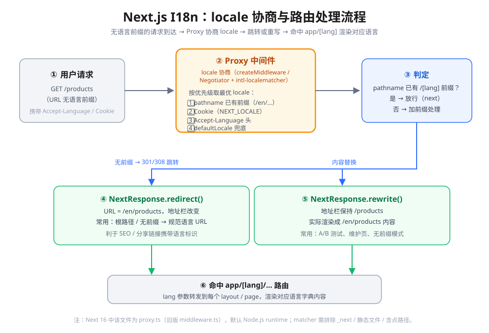

# Next.js I18n（国际化）知识点

> Next.js 16 中 `middleware` 已弃用并更名为 `proxy`。本文以 **Next.js 16 为基线**（App Router），统一按 `proxy.ts` 写法。覆盖：i18n 两个层面、`[lang]` 路由段、Proxy 的 locale 协商与跳转/重写、dictionary 本地化、服务端/客户端组件差异、静态渲染、主流库选型（next-intl 为主），附避坑速记清单与自测题。

## 版本说明

- **本文以 Next.js 16 为基线**（App Router）。所有代码按 16 写法。
- 16 起 `middleware.ts` 弃用 → 改名 `proxy.ts`，导出函数 `middleware` → `proxy`（见本目录《nextjs 中间件middleware知识点.md》）。本文统一用 `proxy.ts`。
- App Router **没有内置 i18n 路由配置**（那是旧版 Pages Router 的 `next.config.js` `i18n` 配置项），官方推荐的写法是：**用顶层 `[lang]` 动态段 + Proxy 做 locale 协商**。
- 一句话理解：**国际化 = 路由层面选语言（locale routing）+ 内容层面翻文字（localization）**。

---

## 一、两个层面：Internationalization vs Localization

官方把 i18n 拆成两层，注意别混为一谈：

| 层面 | 英文 | 做什么 | 谁负责 |
|---|---|---|---|
| 路由国际化 | Internationalized Routing | 根据用户语言决定走哪条 URL（`/en/...`、`/zh/...`） | **Proxy** + `[lang]` 路由段 |
| 内容本地化 | Localization | 把界面文字、日期、数字按语言翻译/格式化 | **dictionary（字典）** + 库 |

> 这两层可拆开用：只做内容翻译但 URL 不带语言（`localePrefix: 'never'`），或只做路由国际化。实战通常两者一起。

## 术语

- **Locale**：一组语言 + 地区偏好的标识。
  - `en-US`：美国英语；`nl-NL`：荷兰荷兰语；`nl`：荷兰语（不指定地区）。
- 建议用用户**浏览器语言偏好**（`Accept-Language` 头）来选 locale。

---

## 二、路由方案总览：子路径 vs 域名

| 方案 | URL 形态 | 适用 |
|---|---|---|
| **子路径（sub-path）** | `/fr/products`、`/zh/products` | 绝大多数站点，一个域名多语言 |
| **域名（domain）** | `my-site.fr/products` | 按地区/品牌分域名，企业级站点 |

- App Router 下两者都靠 `[lang]` 动态段实现，区别只在 Proxy 里如何匹配（按 pathname 还是按 host/`x-forwarded-host`）。
- 旧版 Pages Router 的 `next.config.js` `i18n: { locales, defaultLocale, localeDetection, domains }` **配置项已不属于 App Router 的推荐做法**（保留仅兼容旧项目）。

---

## 三、目录结构：把一切都套进 `[lang]`

App Router 的 i18n 核心：**把 `app/` 下所有特殊文件都嵌套进 `app/[lang]/`**，让 `lang` 参数转发到每个 layout 和 page。

```
app/
├── [lang]/
│   ├── layout.tsx      ← 根布局也在这里（含 <html lang>）
│   ├── page.tsx        ← /en、/zh 首页
│   ├── about/
│   │   └── page.tsx    ← /en/about
│   └── dictionaries/
│       ├── en.json
│       └── zh.json
└── layout.tsx          ← （可选）仅剩一层透传，或不要
```

在页面里读当前语言（Next 16 强类型 `PageProps`，`params` 是 Promise 必须 `await`）：

```tsx
// app/[lang]/page.tsx —— Next 16
export default async function Page({ params }: PageProps<'/[lang]'>) {
  const { lang } = await params;   // /en-US/products → "en-US"
  return <div>当前语言：{lang}</div>;
}
```

> **注意**：`params` / `searchParams` 在 Next 16 **只能异步访问**（同步访问已彻底移除），直接用 `{ lang }` 解构会报错。

---

## 四、Proxy：locale 协商与跳转/重写（核心）

无语言前缀的请求（如 `/products`）到达时，需要在 **Proxy 层**判断语言并处理。官方文档给了两种路径：

### 4.1 协商 locale：Negotiator + @formatjs/intl-localematcher

读取 `Accept-Language` 头 → 解析出浏览器语言列表 → 与站点支持的语言做 best-fit 匹配 → 得到最优 locale：

```ts
import { match } from '@formatjs/intl-localematcher';
import Negotiator from 'negotiator';

let headers = { 'accept-language': 'en-US,en;q=0.5' };
let languages = new Negotiator({ headers }).languages();
let locales = ['en-US', 'nl-NL', 'nl'];
let defaultLocale = 'en-US';

match(languages, locales, defaultLocale);   // -> 'en-US'
```

> best-fit 与 RFC 4647 的 lookup 不同：lookup 只做 subtag 逐步去除（`en-GB` 匹配不到就默认）；best-fit 会算**距离**，能把 `en-GB` 匹配到 `en-US`，体验更好。

### 4.2 手工 Proxy：检测前缀 + 重定向

```ts
// proxy.ts —— Next 16 写法
import { NextResponse } from "next/server";
import type { NextRequest } from "next/server";

let locales = ['en-US', 'nl-NL', 'nl'];
// getLocale(request)：用 Negotiator 等方式解析（见 4.1）

export function proxy(request: NextRequest) {
  const { pathname } = request.nextUrl;
  // ① 路径已带语言前缀 → 放行
  const pathnameHasLocale = locales.some(
    (locale) => pathname.startsWith(`/${locale}/`) || pathname === `/${locale}`
  );
  if (pathnameHasLocale) return NextResponse.next();

  // ② 无前缀 → 协商 locale 后 redirect 到带前缀的 URL
  const locale = getLocale(request);
  request.nextUrl.pathname = `/${locale}${pathname}`;   // /products → /en-US/products
  return NextResponse.redirect(request.nextUrl);
}

export const config = {
  matcher: [
    // 排除内部路径 _next，否则会误伤静态资源/图片
    '/((?!_next).*)',
    // 可选：只想在根路径跑时写 '/'
  ],
};
```

### 4.3 redirect vs rewrite（易混点）

| 方法 | 地址栏 | 典型用途 | i18n 适用 |
|---|---|---|---|
| `NextResponse.redirect(url)` | **改变**（301/308） | 根路径/无前缀 → 规范语言 URL | ✅ 推荐，URL 永久带语言标识 |
| `NextResponse.rewrite(url)` | **不变**（内容替换） | A/B 测试、维护页、灰度 | ⚠️ 会丢掉语言标识，慎用 |



> i18n 场景官方推荐 **redirect**：让分享出去的链接、SEO 抓取都带上明确的 `/lang` 前缀；rewrite 一般用于"地址栏保持统一"的特殊需求（如维护页、灰度），或 `localePrefix: 'never'` 的无前缀模式。

### 4.4 matcher 注意事项（复用中间件笔记要点）

- **必须写 matcher**，且要排除 `_next`、`_vercel`、**含点（`.`）的路径**（如 `favicon.ico`、`/users/jane.doe`）——这些是跟语言无关的静态资源，被协商重写就出问题。
- 推荐写法：`matcher: '/((?!api|trpc|_next|_vercel|.*\\..*).*)'`。
- 含点且又需要匹配的路由（如 `/users/jane.doe`），要**显式补一条** matcher：`'/([\\w-]+)?/users/(.+)'`。

```ts
export const config = {
  matcher: [
    '/((?!api|trpc|_next|_vercel|.*\\..*).*)',
    '/([\\w-]+)?/users/(.+)',   // 显式覆盖含点的动态段
  ],
};
```

---

## 五、本地化 Localization：dictionary（字典）方案

"把界面文字换成对应语言"用**字典对象**（key → 翻译字符串）实现。`app/[lang]/dictionaries/` 下放每种语言的 JSON：

```jsonc
// app/[lang]/dictionaries/en.json
{ "products": { "cart": "Add to Cart" } }
```
```jsonc
// app/[lang]/dictionaries/zh.json
{ "products": { "cart": "加入购物车" } }
```

### 5.1 加载字典：server-only + 类型收窄

```ts
// app/[lang]/dictionaries.ts
import 'server-only';   // 只允许服务端引用，避免打进客户端 bundle

const dictionaries = {
  en: () => import('./dictionaries/en.json').then((m) => m.default),
  zh: () => import('./dictionaries/zh.json').then((m) => m.default),
};

export type Locale = keyof typeof dictionaries;
export const hasLocale = (locale: string): locale is Locale => locale in dictionaries;
export const getDictionary = async (locale: Locale) => dictionaries[locale]();
```

在 layout/page 里用，并用 `hasLocale` 收窄类型、对非法语言返回 404：

```tsx
// app/[lang]/page.tsx
import { notFound } from 'next/navigation';
import { getDictionary, hasLocale } from './dictionaries';

export default async function Page({ params }: PageProps<'/[lang]'>) {
  const { lang } = await params;
  if (!hasLocale(lang)) notFound();          // 不支持的 locale → 404（而非运行时报错）
  const dict = await getDictionary(lang);
  return <button>{dict.products.cart}</button>;   // 按语言渲染
}
```

### 5.2 Next 16 新 API：`next/root-params` 免 props 钻取

`lang` 位于根布局之上，属于**根参数（root param）**。Next 16 提供 `next/root-params` 的 getter，让任意 Server Component / 服务端工具直接读取，**不用一层层传 `lang`**：

```ts
// app/[lang]/dictionaries.ts —— Next 16
import { lang } from 'next/root-params';
import { notFound } from 'next/navigation';

const dictionaries = { en: () => import('./dictionaries/en.json').then((m) => m.default) };
export const hasLocale = (locale: string) => locale in dictionaries;

export const getDictionary = async () => {
  const locale = await lang();          // 直接拿当前 locale
  if (!hasLocale(locale)) notFound();
  return dictionaries[locale]();
};
```

调用方变成无参：`const dict = await getDictionary()`。

> **root-params 限制**：只能在 Server Component 和服务端工具里用；**不能在 Client Component、Server Action、Route Handler 里用**。从 `next/root-params` 导入的文件**不需要** `import 'server-only'`——它本身在客户端构建时就会失败。

### 5.3 为什么字典不会撑爆客户端 bundle

App Router 下 layout 和 page **默认是 Server Component**。`getDictionary`、字典 JSON 只跑在服务端，**只有渲染后的 HTML 发给浏览器**，翻译文件的体积不影响客户端 JS 包。这是把字典留在服务端读的最大好处。

---

## 六、静态渲染：generateStaticParams + `<html lang>`

想为每个语言生成静态路由，用 `generateStaticParams`（放 layout 或 page 均可），并给根布局的 `<html>` 设置 `lang`：

```tsx
// app/[lang]/layout.tsx —— Next 16
export async function generateStaticParams() {
  return [{ lang: 'en-US' }, { lang: 'de' }];   // 构建时枚举所有语言
}

export default async function RootLayout({ children, params }: LayoutProps<'/[lang]'>) {
  return (
    <html lang={(await params).lang}>          {/* 必须，利于无障碍与 SEO */}
      <body>{children}</body>
    </html>
  );
}
```

> `generateStaticParams` 返回 `{ lang }` 数组，Next 会在构建期为每种语言各渲染一份静态页面。

---

## 七、主流库选型：优先 next-intl（社区主流）

纯手写 dictionary + 手工 proxy 可行，但**多语言路由、复数/日期格式化、类型安全**很快会变得复杂。官方文档推荐了一批库，按"下载量高、社区活跃"的主流标准，**首选 next-intl**。

| 库 | 特点 | 定位 |
|---|---|---|
| **next-intl** | 路由 + 翻译 + 复数 + 日期/数字格式化一体化，App Router 深度集成 | ⭐ 社区最主流，官方文档首推 |
| next-international | 轻量、类型安全、无运行时开销 | 纯翻译场景轻选 |
| paraglide-next | 由 Svelte 生态 Inlang 出品，类型安全，编译期提取 | 追求编译期类型安全 |
| lingui | 成熟的老牌 i18n 方案，构建期提取 | 传统 i18n 需求 |
| next-i18next | i18next 的 Next 封装（偏 Pages Router） | 旧项目迁移用 |

> 用户侧倾向主流方案：**业务项目默认 next-intl**。本文 4、5 节的手工方案用于理解原理，实战建议直接套 next-intl（第八节）。

---

## 八、next-intl 快速上手（App Router + i18n routing）

next-intl 用 `createMiddleware` 把 locale 协商、重定向/重写、SEO alternate links 全部封装进 proxy。

### 8.1 核心文件骨架

```ts
// src/i18n/routing.ts —— 集中定义路由配置
import { defineRouting } from 'next-intl/routing';

export const routing = defineRouting({
  locales: ['en', 'de'],      // 支持的语言
  defaultLocale: 'en',        // 兜底语言
});
```

```ts
// src/proxy.ts —— Next 16 写法（旧版叫 middleware.ts）
import createMiddleware from 'next-intl/middleware';
import { routing } from './i18n/routing';

export default createMiddleware(routing);

export const config = {
  matcher: '/((?!api|trpc|_next|_vercel|.*\\..*).*)',
};
```

```ts
// src/i18n/navigation.ts —— 语言感知的导航封装
import { createNavigation } from 'next-intl/navigation';
import { routing } from './routing';

export const { Link, redirect, usePathname, useRouter, getPathname } =
  createNavigation(routing);
```

```ts
// src/i18n/request.ts —— 读取匹配到的 locale
import { getRequestConfig } from 'next-intl/server';
import { hasLocale } from 'next-intl';
import { routing } from './routing';

export default getRequestConfig(async ({ requestLocale }) => {
  const requested = await requestLocale;
  const locale = hasLocale(routing.locales, requested) ? requested : routing.defaultLocale;
  return { locale };
});
```

### 8.2 布局与组件

```tsx
// src/app/[locale]/layout.tsx
import { NextIntlClientProvider, hasLocale } from 'next-intl';
import { notFound } from 'next/navigation';
import { routing } from '@/i18n/routing';

export default async function LocaleLayout({
  children, params,
}: { children: React.ReactNode; params: Promise<{ locale: string }>; }) {
  const { locale } = await params;
  if (!hasLocale(routing.locales, locale)) notFound();   // 校验非法语言
  return <NextIntlClientProvider>{children}</NextIntlClientProvider>;
}
```

### 8.3 组件里取翻译与切换语言

```tsx
// 服务端 / 客户端组件都能用
import { useTranslations } from 'next-intl';

export default function Cart() {
  const t = useTranslations('Products');       // 命名空间
  return <button>{t('cart')}</button>;          // t('cart')
}
```

```tsx
// 切换语言：用语言感知的 Link / useRouter
import { Link, useRouter, usePathname } from '@/i18n/navigation';

<Link href="/" locale="de">Deutsch</Link>        // 自动带 /de 前缀

// 编程式切换
const router = useRouter();
router.replace('/about', { locale: 'de' });
```

### 8.4 元数据（SEO）与静态渲染

```tsx
// app/[locale]/page.tsx —— generateMetadata 也要语言化
import { getTranslations } from 'next-intl/server';

export async function generateMetadata({ params }: PageProps<'/[locale]'>) {
  const { locale } = await params;
  const t = await getTranslations({ locale, namespace: 'Metadata' });
  return { title: t('title') };
}
```

**启用静态渲染**：加 `generateStaticParams` + 在每个相关 layout/page 里 `setRequestLocale(locale)`（让 next-intl 不再因读 header 而退回动态渲染）。

```tsx
import { setRequestLocale } from 'next-intl/server';

export function generateStaticParams() {
  return routing.locales.map((locale) => ({ locale }));
}

export default function Page({ params }: PageProps<'/[locale]'>) {
  setRequestLocale(use(params).locale);   // 先设 locale，再调 useTranslations
  const t = useTranslations('IndexPage');
  return <h1>{t('title')}</h1>;
}
```

---

## 九、注意事项与避坑速记清单

1. **Next 16 用 `proxy.ts`，不是 `middleware.ts`**；旧项目迁移别只改名文件，`export function middleware` → `export function proxy`。
2. **`params` / `searchParams` 必须 `await`**（Next 16 彻底移除同步访问）；`PageProps<'/[lang]'>` / `LayoutProps` 全局类型自动推导。
3. **`<html lang>` 必须设置**，且放在 `app/[lang]/layout.tsx` 里（否则无障碍与 SEO 语言标识缺失）。
4. **Proxy matcher 必须排除** `_next`、`_vercel`、`api`/`trpc`、**含点路径**（`favicon.ico`、`/users/jane.doe`），否则静态资源会被 locale 协商误伤；含点又想匹配的路由需**显式补 matcher**。
5. **i18n 用 redirect 优先**——URL 永久带 `/lang` 前缀，利于 SEO 与分享；rewrite 会丢语言标识，仅用于无前缀模式/维护页。
6. **不支持的 locale 要 404**，用 `hasLocale()` 收窄类型，别让非法语言走到运行时错误。
7. **字典放服务端**（`import 'server-only'`）：Server Component 里读字典不占客户端 bundle；千万别在 Client Component 里 import 大字典。
8. **`next/root-params` 的 `lang()` 只能用在 Server Component / 服务端工具**，Client Component、Server Action、Route Handler 里不能用。
9. **next-intl 静态渲染**：`useTranslations` 在 Server Component 默认会退回动态渲染，需 `generateStaticParams` + 每个 layout/page 里 `setRequestLocale` 先设 locale。
10. **`setRequestLocale` 要在调用任何 next-intl 函数之前调用**，且每个想静态化的 layout/page 都要调。
11. **Client Component 拿语言**：Server Component 用 `lang()` 或 `useTranslations`；Client 侧要用 `NextIntlClientProvider` + `useLocale()`/`useTranslations`，别试图在客户端 import `server-only` 文件。
12. **cookie 记住用户选择**：next-intl 会自动写 `NEXT_LOCALE` 类 cookie，下次访问根路径会按 cookie 跳转；改语言务必走 `<Link locale>` 让协商层记住。
13. **域名方案**：Proxy 从 `x-forwarded-host`（回退 `host`）读域名匹配；跨域名切换语言会**redirect 到另一个域名**。
14. **静态导出（`output: 'export'`）跑不了 proxy**——next-intl 此时必须 `localePrefix: 'always'` + 静态渲染 + 根路径 `redirect('/en')`，且不能用 `pathnames`。
15. **别把翻译逻辑写死进组件**：统一走字典/`useTranslations`，否则换语言要改一堆组件。
16. **日期/数字/复数**别手拼，用 next-intl 的 `formatDateTime`/`formatNumber`/复数规则，否则 `en` 一个形式 `zh` 千差万别。

---

## 十、自测题（互动式考核）

1. App Router 的国际化路由，靠什么结构实现？（提示：`[lang]` 段）旧版 Pages Router 的 `next.config.js` `i18n` 配置还能用吗？
2. 无语言前缀的 `/products` 请求，Proxy 里做完 locale 协商后，官方推荐用 `redirect` 还是 `rewrite`？为什么？
3. Next 16 里，`params` 里的 `lang` 要不要 `await`？`PageProps<'/[lang]'>` 从哪来？
4. `next/root-params` 的 `lang()` 能在 Client Component / Server Action 里用吗？为什么？
5. 想让某个语言在构建期就生成静态页面，需要写什么函数？`<html lang>` 应该放哪个文件？
6. next-intl 想在 Server Component 里启用静态渲染，除了 `generateStaticParams` 还要调什么函数？顺序是什么？
7. proxy 的 matcher 为什么必须排除 `_next` 和含点的路径？`/users/jane.doe` 这类路由要怎么处理？
8. 字典为什么要用 `import 'server-only'`？在 Client Component 里 import 字典会有什么问题？

---

## 附：参考来源

- Next.js 官方《Internationalization》：https://nextjs.org/docs/app/guides/internationalization
- Next.js 官方《proxy.js》：https://nextjs.org/docs/app/api-reference/file-conventions/proxy
- next-intl 官方《Proxy / middleware》：https://next-intl.dev/docs/routing/middleware
- next-intl 官方《Setup locale-based routing》：https://next-intl.dev/docs/getting-started/app-router/with-i18n-routing
