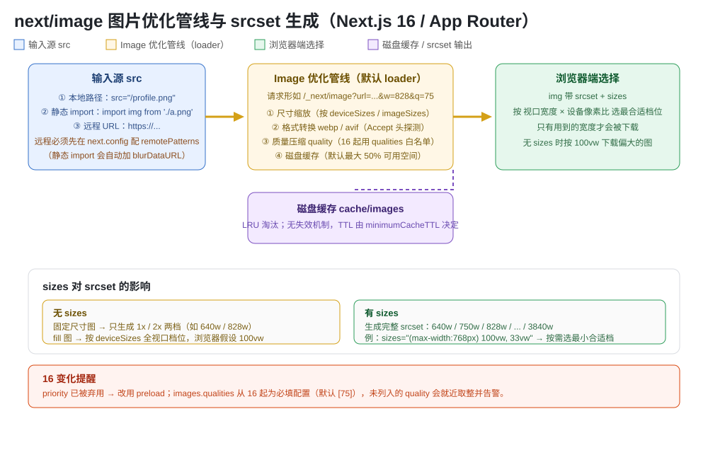

# Next.js Image 与 Font 组件知识点

> App Router（Next.js 16）下的 `next/image` 与 `next/font`：Image 的自动优化管线、`src` 三种来源、`fill`/`sizes` 响应式、16 起 `priority→preload` 与 `qualities` 必填等变化；Font 的内置自托管、`google`/`local` 两种来源、三种应用方式（`className`/`style`/CSS 变量）；末尾附避坑速记清单与自测题。



## 版本说明

- **本文以 Next.js 16 为基线**（App Router，React 19）。所有代码均按 16 写法。
- **`next/image` 的 16 关键变化**：
  - `priority` prop 已被**弃用（deprecated）**，改用 `preload` 来明确“是否在 `<head>` 预载该图”。
  - `next.config` 的 `images.qualities` 从 16 起**必填**（默认 `[75]`），未列入的 `quality` 值会被就近取整并打开发警告（避免恶意请求任意质量档位）。
  - `onLoadingComplete` 早在 14 已弃用，统一用 `onLoad`。
- **`next/font` 16 沿用 v13 起的 `next/font` 命名**（`@next/font` 已并入，无需单独安装）；推荐**可变字体（variable font）**——可变字体无需写 `weight`，且体积更小、flex 更强。

---

## 一、Image 组件：是什么 / 为什么用它

`next/image` 是 `next/image` 导出的组件，**扩展了原生 ``**，带来自动图片优化。它解决三个问题：

1. **性能**：按需缩放、转格式（webp/avif）、压缩质量，默认 `lazy` 加载。
2. **CLS（布局偏移）**：`width`/`height` 提供固有尺寸，浏览器在图片加载前就**预留空间**，避免页面跳动。
3. **一致性**：内置 `remotePatterns` 白名单、`sizes`/`srcset` 自动生成、静态 import 自动模糊占位。

> **一句话**：`next/image` 让你只给 `src` + `width`/`height`，其余（缩放、格式、质量、缓存、懒加载）由框架管。

---

## 二、Image 核心 props 速查表

| Prop | 类型 / 默认 | 说明 |
|---|---|---|
| `src` | String / 静态 import / 远程 URL | **必填**。远程须配 `remotePatterns` |
| `alt` | String | **必填**。语义替换文本；纯装饰图传 `alt=""` |
| `width` / `height` | Integer（px） | 固有尺寸，用于推断宽高比、避免 CLS；**不决定渲染尺寸**（渲染尺寸由 CSS 控制）。除非静态 import 或用 `fill`，否则**必须两者都填** |
| `fill` | Boolean（false） | 让图片撑满父元素；父元素必须 `position: relative/fixed/absolute`，`` 默认 `absolute`；配 `objectFit` 控制裁切/缩放 |
| `sizes` | String | 各断点下图片尺寸，浏览器据此从 `srcset` 选档；缺省假设 `100vw` 会下载偏大图 |
| `quality` | Integer 1-100（默认 75） | 压缩质量。16 起受 `images.qualities` 白名单约束，未列入就近取整 |
| `preload` | Boolean（false） | `true` 时在 `<head>` 插入 `<link rel="preload">`。用于 LCP / 首屏 hero。**16 起替代 `priority`** |
| `placeholder` | `empty`/`blur`/data URL（默认 empty） | 加载中占位。`blur` 须配合 `blurDataURL`；静态 jpg/png/webp/avif 会自动生成 |
| `blurDataURL` | String（data URL） | 模糊占位图；动态/远程图需手动提供，建议 10px 以内小图 |
| `loading` | `lazy`（默认） | `lazy` 延迟到接近视口才载；`eager` 立即载 |
| `onLoad` / `onError` | Function | 回调。接收函数 props 须在 **Client Component** 中用（需序列化） |
| `unoptimized` | Boolean（false） | 关闭优化，原样返回 `src`；适合 SVG、<1KB 小图、GIF 动图 |
| `overrideSrc` | String | 覆盖生成的 `src` 属性（如 SEO 需要保留原 src 防重新抓取） |
| `decoding` | `async`（默认） | `async`/`sync`/`auto` |
| `loader` | Function | 自定义单实例 loader；全局用 `loaderFile` 配置 |

> **注意**：`priority` 在 16 已弃用。官方建议大多数情况用 `loading="eager"` 或 `fetchPriority="high"`，而非 `preload`——当“视口下可能有多个 LCP 候选”或已用 `loading`/`fetchPriority` 时，不要用 `preload`。

---

## 三、`src` 的三种来源与远程配置

```tsx
// ① 本地路径（public 下）
<Image src="/profile.png" width={500} height={500} alt="作者" />

// ② 静态 import（自动拿到宽高与 blurDataURL）
import profile from './profile.png'
<Image src={profile} alt="作者" />

// ③ 远程 URL（必须先在 next.config 配 remotePatterns）
<Image src="https://example.com/profile.png" width={500} height={500} alt="作者" />
```

远程图片要安全地走优化 API，需在 `next.config.ts` 声明允许的主机：

```ts
// next.config.ts
const nextConfig = {
  images: {
    remotePatterns: [
      { protocol: 'https', hostname: '**.example.com', pathname: '/assets/**', search: '' },
      // 或 new URL('https://example.com/account123/**')
    ],
  },
};
```

- `hostname` / `pathname` 支持通配符：`*` 匹配单个段/子域，`**` 匹配任意多段/子域（只在开头或结尾）。
- 省略 `protocol`/`port`/`pathname`/`search` 时隐式 `**`，**不推荐**（可能被利用优化你不想要的 URL）。
- `search` 用于精确限定 query string，建议显式给 `?v=xxx` 之类，防止恶意构造。

---

## 四、`fill` + `sizes` 响应式布局

宽高未知、要填满容器时用 `fill`；父容器必须定位：

```tsx
<div style={{ position: 'relative', width: '100%', height: 320 }}>
  <Image fill src="/banner.png" sizes="(max-width: 768px) 100vw, 50vw" alt="横幅" />
</div>
```

**`sizes` 为什么重要**：
- 缺 `sizes` → 浏览器假设图片 100vw，`fill` 图按 `deviceSizes` 生成整套档位，**可能下载远大于实际需要的大图**。
- 固定尺寸图（有 `width`）缺 `sizes` → 只生成 1x/2x 两档（如 `640w 1x, 828w 2x`）。
- 给了 `sizes` → 生成完整 srcset（`640w, 750w, 828w, ... 3840w`），浏览器按“视口宽度 × DPR”选最合适档，真正按需加载。

---

## 五、16 关键变化（重点）

### 5.1 `priority` → `preload`

```tsx
// 旧写法（已弃用）
<Image src="/hero.png" width={800} height={600} alt="主视觉" priority />

// 16 写法
<Image src="/hero.png" width={800} height={600} alt="主视觉" preload />
// 或更常见：loading="eager" / fetchPriority="high"
```

- `preload={true}` 会在 `<head>` 插入 `<link rel="preload">`，让 LCP/首屏 hero 更早开始加载。
- **不适用**：有多个可能成为 LCP 的候选图；已用 `loading`；已用 `fetchPriority`。

### 5.2 `qualities` 必填（配置白名单）

```ts
// next.config.ts —— 16 起建议显式声明允许的质量档位
const nextConfig = {
  images: { qualities: [25, 50, 75, 100] }, // 默认 [75]
};
```

- `quality` prop 不在白名单内 → **就近取整**（如给 80，白名单 [50,75,100] 时按 75 服务），开发时打警告提示你补进白名单。
- 直接访问优化 REST API 传未列质量 → 返回 400。

### 5.3 SVG 默认不优化

- 默认 `next/image` **不优化 SVG**（矢量可无损缩放、且可能带脚本风险）。
- `src` 以 `.svg` 结尾时自动视为 `unoptimized`；如需走优化 API，显式开 `dangerouslyAllowSVG`，并强烈建议同时设 `contentDispositionType: 'attachment'` 与 `contentSecurityPolicy` 防脚本执行。

---

## 六、`next.config` 的 `images.*` 配置速查

| 配置 | 默认值 | 说明 |
|---|---|---|
| `localPatterns` | - | 允许优化的本地路径白名单（限定 `pathname`/`search`） |
| `remotePatterns` | - | 允许优化的远程主机白名单（protocol/hostname/port/pathname/search） |
| `loaderFile` | - | 全局自定义 loader 文件（替代逐实例 `loader` prop） |
| `path` | `/_next/image` | 优化 API 的路径前缀 |
| `deviceSizes` | `[640,750,828,1080,1200,1920,2048,3840]` | 全宽图档位；影响 fill/无 sizes 时的 srcset |
| `imageSizes` | `[32,48,64,96,128,256,384]` | 小图档位（配 `sizes` 才用），应都小于最小 deviceSizes |
| `qualities` | `[75]` | **16 起必填**；quality 白名单 |
| `formats` | `['image/webp']` | 输出格式；可按 Accept 头探测。AVIF 压缩小 20% 但编码慢约 50% |
| `minimumCacheTTL` | `14400`（4h） | 优化图缓存 TTL；无失效机制，建议别设太大 |
| `disableStaticImages` | false | 关闭静态 import 优化 |
| `maximumRedirects` | `3` | 远程图跟随重定向次数；0 禁用 |
| `maximumDiskCacheSize` | 启动时取可用空间的 50% | 磁盘缓存上限，超限按 LRU 淘汰 |
| `maximumResponseBody` | `50_000_000`（50MB） | 抓取源图最大体积 |
| `dangerouslyAllowLocalIP` | false | 允许优化本地 IP（有 SSRF 风险） |
| `dangerouslyAllowSVG` | false | 允许优化 SVG（配 CSP 用） |
| `contentDispositionType` | `attachment` | 优化图响应头的 Content-Disposition |
| `contentSecurityPolicy` | - | 图片响应 CSP（SVG 场景尤其重要） |

---

## 七、Font 组件：自托管原理

`next/font` 自动优化字体并**内置自托管（built-in self-hosting）**：

- Google Fonts 的 CSS 与字体文件在**构建时**下载到本地静态资源，浏览器**不再向 Google 发请求**（隐私 + 性能双赢）。
- 本地字体（`localFont`）直接引用项目内文件。
- 生成 `@font-face`，按需 `preload`，`display:'swap'` 默认兜底，`adjustFontFallback` 自动生成回退字体以**减小 CLS（布局偏移）**。



---

## 八、`next/font/google` 与 `next/font/local`

### 8.1 Google 字体（推荐可变字体）

```tsx
// app/layout.tsx —— 可变字体无需 weight
import { Inter } from 'next/font/google';
const inter = Inter({ subsets: ['latin'], display: 'swap' });

export default function RootLayout({ children }: { children: React.ReactNode }) {
  return <html lang="en" className={inter.className}><body>{children}</body></html>;
}
```

```tsx
// 非可变字体必须指定 weight（可多组）
import { Roboto } from 'next/font/google';
const roboto = Roboto({ weight: ['400', '700'], style: ['normal', 'italic'], subsets: ['latin'] });
```

> 多词字体名用**下划线**：`Roboto Mono` → `Roboto_Mono`。

### 8.2 本地字体

```tsx
// app/layout.tsx
import localFont from 'next/font/local';
const myFont = localFont({ src: './my-font.woff2', display: 'swap' });
```

多字重/多字型用数组：

```tsx
const roboto = localFont({
  src: [
    { path: './Roboto-Regular.woff2', weight: '400', style: 'normal' },
    { path: './Roboto-Italic.woff2', weight: '400', style: 'italic' },
    { path: './Roboto-Bold.woff2', weight: '700', style: 'normal' },
  ],
});
```

`src` 相对**调用该 loader 的文件**所在目录解析。

---

## 九、Font 参数速查表

| 参数 | google | local | 说明 |
|---|---|---|---|
| `src` | - | **必填** | 字体文件路径或 `{path, weight?, style?}[]` |
| `weight` | 非可变字体必填 | 非可变必填 | 单值 / 范围 `'100 900'` / 数组 |
| `style` | `normal`/`italic` | 可含 `oblique` | 默认 `normal` |
| `subsets` | 可选 | - | 预载的子集（如 `['latin']`）；`preload` 开启时未指定会告警 |
| `axes` | 可选 | - | 可变字体额外轴（默认只带 wght 控制体积），如 Inter 的 `slnt` |
| `display` | `swap` 默认 | `swap` 默认 | `auto`/`block`/`swap`/`fallback`/`optional` |
| `preload` | `true` 默认 | `true` 默认 | 是否注入 preload `<link>` |
| `fallback` | 可选 | 可选 | 兜底字体数组（如 `['system-ui']`），无默认 |
| `adjustFontFallback` | `true` 默认 | `'Arial'` 默认 | 自动生成回退字体降 CLS；local 可 `'Times New Roman'` 或 `false` |
| `variable` | 可选 | 可选 | 对外暴露的 CSS 变量名（如 `'--font-inter'`） |
| `declarations` | - | 可选 | 额外 `@font-face` 描述符（如 ascent-override） |

---

## 十、三种应用方式 + 多字体 + Tailwind

### 10.1 三种应用方式

```tsx
// ① className（最常用，整站套到根元素）
<p className={inter.className}>Hello</p>

// ② style（局部内联；style.fontFamily 含 fallback）
<p style={inter.style}>Hello</p>

// ③ CSS 变量（外部样式表 / Tailwind 集成首选）
const inter = Inter({ variable: '--font-inter' });
// <main className={inter.variable}>
// .text { font-family: var(--font-inter); }
```

### 10.2 多字体（单点定义 + 按需导入）

```tsx
// app/fonts.ts —— 每处调用都会实例化一份，务必集中定义再导入
import { Inter, Roboto_Mono } from 'next/font/google';
export const inter = Inter({ subsets: ['latin'] });
export const roboto_mono = Roboto_Mono({ subsets: ['latin'] });

// app/layout.tsx
import { inter } from './fonts';
export default function RootLayout({ children }) {
  return <html lang="en" className={inter.className}><body>{children}</body></html>;
}
```

> **预载范围**：字体定义在 page → 仅该路由预载；在 layout → 该 layout 包的所有路由预载；在 root layout → 全站预载。

### 10.3 Tailwind 集成（CSS 变量 + @theme）

```css
/* global.css */
@import 'tailwindcss';
@theme inline {
  --font-sans: var(--font-inter);
  --font-mono: var(--font-roboto-mono);
}
```

```tsx
// app/layout.tsx
import { Inter, Roboto_Mono } from 'next/font/google';
const inter = Inter({ subsets: ['latin'], variable: '--font-inter' });
const roboto_mono = Roboto_Mono({ subsets: ['latin'], variable: '--font-roboto-mono' });
// <html className={`${inter.variable} ${roboto_mono.variable}`}>
```

之后即可用 `font-sans` / `font-mono` 工具类。**多字体要克制**——每加一种字体都是客户端要下载的一份资源。

---

## 十一、避坑速记清单

**Image**
1. **`width`/`height` 必须成对给**（除非静态 import 或用 `fill`），否则可能拿不到宽高比、产生 CLS。
2. **`fill` 的父元素必须定位**（relative/fixed/absolute），否则图片不撑满、行为异常。
3. **远程图必须配 `remotePatterns`**，否则开发报错；配好后仍只允许声明的 host/path/search。
4. **`sizes` 缺失 = 假设 100vw**，容易下载远超需要的图；响应式/`fill` 图务必给 `sizes`。
5. **`quality` 受 `qualities` 白名单约束**（16 必填项），给白名单外的值会就近取整 + 告警。
6. **`priority` 在 16 已弃用**，用 `preload` 或 `loading="eager"` / `fetchPriority="high"`。
7. **接收函数 props（`onLoad`/`onError`）必须在 Client Component** 用，否则无法序列化。
8. **SVG 默认不优化**且 `.svg` 结尾自动 `unoptimized`；真要优化须 `dangerouslyAllowSVG` + CSP。
9. **优化 API 默认不透传源图请求头**；需要鉴权的源图用 `unoptimized` 绕过。
10. **`overrideSrc`** 可保留原 `src`（SEO/防重抓），但 `srcset` 仍由真实 `src` 生成。

**Font**
1. **可变字体别写 `weight`**；非可变字体不写 `weight` 会编译报错。
2. **同一字体只实例化一次**——多处在用就建 `fonts.ts` 集中定义再 import，避免重复实例化多份下载。
3. **`subsets` 未指定 + `preload` 开启会告警**（google）；按需声明所需子集控制体积。
4. **多词字体名用下划线**（`Roboto_Mono`），空格会取不到。
5. **`localFont` 的 `src` 相对调用文件**所在目录，不是 public。
6. **多字体克制**——每个字体都是一次客户端下载；能少则少。

---

## 十二、自测题

**Q1**：`next/image` 的 `width`/`height` 决定渲染尺寸吗？为什么需要它们？

<details><summary>答案</summary>不决定。它们是图片的固有尺寸（intrinsic size），用于在加载前让浏览器预留空间、推断宽高比，从而避免 CLS。渲染尺寸由 CSS 控制。</details>

**Q2**：远程图片报 “hostname not configured”，怎么解决？

<details><summary>答案</summary>在 `next.config.ts` 的 `images.remotePatterns` 里声明允许的 protocol/hostname/pathname/search。只开放你确实要用的主机，避免通配放行。</details>

**Q3**：`sizes` 缺省时浏览器会怎么下载图片？为什么响应式图要写 `sizes`？

<details><summary>答案</summary>缺省按 `100vw` 假设，会下载可能远超实际展示宽度的图。写上 `sizes`（如 `"(max-width:768px) 100vw, 33vw"`）会生成完整 srcset，浏览器按视口宽度 × DPR 选最小合适档，真正按需加载。</details>

**Q4**：16 里想给首屏 hero 图尽快加载，怎么写？

<details><summary>答案</summary>用 `preload`（替代已弃用的 `priority`），或更常见的 `loading="eager"` / `fetchPriority="high"`。若有多个可能成为 LCP 的候选，或已用 loading/fetchPriority，则不要用 preload。</details>

**Q5**：`quality={80}` 但白名单是 `[50,75,100]`，会怎样？

<details><summary>答案</summary>就近取整，实际按 75 服务，并在开发时打警告提示把 80 加进 `images.qualities`。直接访问优化 API 传未列质量会返回 400。</details>

**Q6**：`next/font` 为什么说“浏览器不再请求 Google”？

<details><summary>答案</summary>Google Fonts 的 CSS 与字体文件在**构建时**被下载并随静态资源自托管（built-in self-hosting），浏览器只从自己的域名加载，既提升性能也避免把访客 IP 等泄露给 Google。</details>

**Q7**：可变字体和非可变字体在使用上有什么区别？

<details><summary>答案</summary>可变字体无需（也建议不要）写 `weight`，体积更小、可连续调节字重；非可变字体必须显式给 `weight`（可给数组如 `['400','700']`），否则编译报错。</details>

**Q8**：想在多个页面用同一字体，最佳实践是什么？

<details><summary>答案</summary>建 `fonts.ts`（或 `styles/fonts.ts`）集中定义并导出，页面 import 使用；每个字体函数调用都会实例化一份并可能重复下载，所以务必单点定义。可按需配 tsconfig 的 `@/fonts` 别名。</details>

---

## 参考来源

- Next.js 官方《Image Component》（`nextjs.org/docs/app/api-reference/components/image`，2026-09 更新；props 表、`fill`/`sizes`、`preload`、`overrideSrc`、`qualities`/`formats`/`remotePatterns` 等配置、SVG 与 `dangerouslyAllowSVG`）
- Next.js 官方《Image Optimization（Getting Started）》（`nextjs.org/docs/app/getting-started/images`；宽高推断宽高比、远程图需配置）
- Next.js 官方《Font Module》（`nextjs.org/docs/app/api-reference/components/font`，2026-09 更新；参数表、Google/local、多字体、Tailwind、preloading、版本变化）
- Next.js 官方《Font Optimization（Getting Started）》（`nextjs.org/docs/app/getting-started/fonts`；内置自托管、`localFont` 相对路径解析）
- Next.js 官方 v16 发布与文档更新（`priority` 弃用改 `preload`、`images.qualities` 必填）
