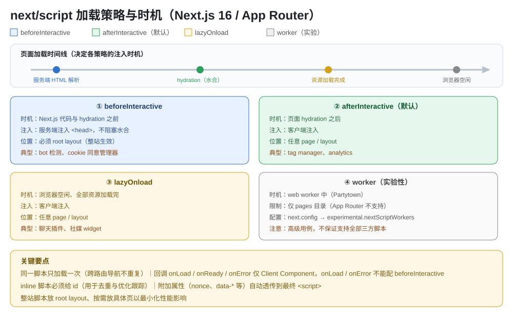

# Next.js Script 组件知识点

> App Router（Next.js 16）下的 `next/script`：为什么用它替代原生 `<script>`、四种 `strategy` 加载策略的时机与适用、Layout/Application 两种整站与按需布局、inline 脚本与去重、`onLoad`/`onReady`/`onError` 回调、附加属性透传；末尾附避坑速记清单与自测题。



## 版本说明

- **本文以 Next.js 16 为基线**（App Router，React 19）。所有代码均按 16 写法。
- **`next/script` 自 v11 引入**，`v13.0.0` 起 `beforeInteractive`/`afterInteractive` 支持 App Router，`v12.2.4` 新增 `onReady`。
- **16 中 `next/script` 核心 API 无重大变更**；但以下两点务必注意：
  - `strategy="worker"` **仍是实验特性，且不支持 App Router**（只能用于 `pages/` 目录），需在 `next.config` 开 `experimental.nextScriptWorkers`。
  - 所有回调（`onLoad`/`onReady`/`onError`）**只能在 Client Component 中使用**（Server Component 下无效）。
- 覆盖场景：第三方脚本（分析、广告、聊天插件、社媒 widget、bot 检测等）的**加载时机控制**与**只加载一次**。

---

## 一、为什么用它（替代原生 `<script>`）

直接写原生 `<script>` 时，你无法控制“何时加载、何时执行、重复导航会不会重复加载”。`next/script` 解决四件事：

1. **加载时机（strategy）**：四种策略精确控制脚本在页面生命周期的哪个阶段注入与执行。
2. **只加载一次（去重）**：同一脚本跨路由导航不重复加载——即使在不同页面/layout 里声明了同一 `src`。
3. **生命周期回调**：`onLoad`/`onReady`/`onError` 在加载完成后执行你的初始化代码。
4. **内联脚本管理**：inline 脚本配合 `id` 被 Next.js 跟踪与去重。

> **一句话**：`next/script` = 原生 `<script>` + 加载时机编排 + 全局去重 + 生命周期钩子。

---

## 二、四种加载策略（核心）

| strategy | 注入时机 | 注入位置 | 可放置位置 | 适用场景 |
|---|---|---|---|---|
| `beforeInteractive` | **Next.js 任何代码与 hydration 之前** | 服务端注入到 `<head>` | **仅 root layout**（整站生效） | bot 检测、cookie 同意管理器等**最紧要**脚本 |
| `afterInteractive`（**默认**） | 页面**部分 hydration 之后** | 客户端注入 | 任意 page / layout | tag manager、analytics 等“尽早但不抢首屏”的脚本 |
| `lazyOnload` | **浏览器空闲**、所有资源加载完 | 客户端注入 | 任意 page / layout | 聊天插件、社媒 widget 等低优先级脚本 |
| `worker`（实验） | **web worker** 中（Partytown） | worker | **仅 `pages/` 目录** | 高级场景，释放主线程 |

> **`beforeInteractive` 细节**：脚本在服务端注入初始 HTML、在首个第一方代码前**预取并加载**，但其执行**不会阻塞 hydration**；会被预加载、在任何第一方代码前获取。它必须放在 root layout（如 `app/layout.tsx`），整站生效。**每文档只执行一次**——客户端导航（包括只改 root 参数如 `/en→/fi`，root layout 不变时）不会再次执行。
>
> **`afterInteractive` 细节**：脚本在客户端注入，`<script>` 默认带 `async`（不影响其“在 hydration 后执行”的语义），适合“尽早但无需赶在首屏代码前”。

---

## 三、两种布局场景：整站 vs 按需

### 3.1 Application Scripts（全站）

放 **root layout**，任何路由访问都会加载执行：

```tsx
// app/layout.tsx
import Script from 'next/script';

export default function RootLayout({ children }: { children: React.ReactNode }) {
  return (
    <html lang="en">
      <body>{children}</body>
      <Script src="https://example.com/script.js" />
    </html>
  );
}
```

### 3.2 Layout Scripts（一组路由）

放某个 **layout**，该 layout 包住的所有路由访问时加载：

```tsx
// app/dashboard/layout.tsx
import Script from 'next/script';

export default function DashboardLayout({ children }: { children: React.ReactNode }) {
  return (
    <section>
      {children}
      <Script src="https://example.com/script.js" />
    </section>
  );
}
```

> 同一 layout 内的多个路由间导航，脚本**只加载一次**。官方建议：**只在具体页面或 layout 放第三方脚本，以最小化对性能的影响**，不要动不动就全站注入。

---

## 四、Props 速查表

| Prop | 类型 | 必填 | 说明 |
|---|---|---|---|
| `src` | String | 除非 inline | 外部脚本 URL（绝对外链或内部路径）；用 inline 脚本时可省略 |
| `strategy` | String | - | `beforeInteractive`/`afterInteractive`(默认)/`lazyOnload`/`worker` |
| `onLoad` | Function | - | 加载完成后执行；**仅 Client Component**；**不能配 `beforeInteractive`** |
| `onReady` | Function | - | 加载完成 + **每次组件挂载后**（如路由导航后重新实例化）；仅 Client Component |
| `onError` | Function | - | 加载失败时处理；**仅 Client Component**；**不能配 `beforeInteractive`** |
| `id` | String | **inline 必填** | 内联脚本去重与优化跟踪的标识；外链也可用 |
| 其他 DOM 属性 | - | - | `nonce`、`data-*` 等自动透传到最终 `<script>` |

---

## 五、Inline 脚本（无外部文件）

两种写法，**必须给 `id`** 以便 Next.js 跟踪与去重：

```tsx
// ① 花括号内联
<Script id="show-banner">
  {`document.getElementById('banner').classList.remove('hidden')`}
</Script>

// ② dangerouslySetInnerHTML
<Script
  id="show-banner"
  dangerouslySetInnerHTML={{
    __html: `document.getElementById('banner').classList.remove('hidden')`,
  }}
/>
```

> 不给 `id` 的 inline 脚本会报错/无法被正确优化跟踪。

---

## 六、事件回调：onLoad / onReady / onError

三个回调都**只能在 Client Component**（文件顶部 `'use client'`）使用。语义区别：

- **`onLoad`**：脚本**加载完成后**执行一次（初始化库、调用函数）。
- **`onReady`**：脚本加载完成时 + **之后每次组件挂载时**都执行（适合“每次进入页面都重新实例化”的场景，如地图）。
- **`onError`**：脚本**加载失败**时执行（打日志、回退）。

```tsx
// app/page.tsx —— 必须在 Client Component
'use client';
import Script from 'next/script';

export default function Page() {
  return (
    <>
      <Script
        src="https://cdnjs.cloudflare.com/ajax/libs/lodash.js/4.17.20/lodash.min.js"
        onLoad={() => console.log('lodash loaded')}
      />
      <Script
        id="google-maps"
        src="https://maps.googleapis.com/maps/api/js"
        onReady={() => {
          // 每次组件挂载后重新实例化
          new google.maps.Map(document.getElementById('map'), {
            center: { lat: -34.397, lng: 150.644 },
            zoom: 8,
          });
        }}
      />
      <Script
        src="https://example.com/script.js"
        onError={(e: Error) => console.error('Script failed to load', e)}
      />
    </>
  );
}
```

> **关键限制**：`onLoad` 与 `onError` **不能配 `beforeInteractive`**——`beforeInteractive` 在服务端注入、hydration 前执行，回调无从触发，用 `onReady` 替代。

---

## 七、附加属性透传

未被子组件使用的 DOM 属性（`nonce`、自定义 `data-*` 等）会被**自动透传**到最终优化后的 `<script>` 元素：

```tsx
<Script
  src="https://example.com/script.js"
  id="example-script"
  nonce="XUENAJFW"
  data-test="script"
/>
```

---

## 八、避坑速记清单

1. **`strategy` 默认是 `afterInteractive`**，不是 `beforeInteractive`——要“最早加载”必须显式写 `beforeInteractive`。
2. **`beforeInteractive` 只能放 root layout**（`app/layout.tsx`），放别处不生效/报错；且每文档只执行一次，导航不重跑。
3. **`onLoad`/`onError` 不能配 `beforeInteractive`**，用 `onReady`；三个回调都**只能在 Client Component** 用（文件顶部 `'use client'`）。
4. **inline 脚本必须给 `id`**，否则无法被 Next.js 跟踪与去重。
5. **`worker` 策略不支持 App Router**、仍为实验性，且需 `next.config` 里 `experimental.nextScriptWorkers: true`；不保证支持所有第三方脚本。
6. **同一 `src` 只加载一次**：整站脚本放 root layout，别在多个 layout 重复声明，避免多余注入与维护负担。
7. **第三方脚本尽量按需放置**（具体页/局部 layout），不要默认全站注入，减少对性能的拖累。
8. **`beforeInteractive` 执行不阻塞 hydration**——它是“尽早加载”，不是“阻塞渲染”；别把它当同步屏障。
9. 需要 CSP 时用 `nonce` 透传，配合你的 CSP 策略；`data-*` 自定义属性也会原样透传。

---

## 九、自测题

**Q1**：`next/script` 相比原生 `<script>` 解决了哪几个核心问题？

<details><summary>答案</summary>① 加载时机可控（strategy 四种策略）；② 同一脚本只加载一次（跨路由去重）；③ 生命周期回调（onLoad/onReady/onError）；④ 内联脚本的跟踪与去重（需 id）。</details>

**Q2**：想加载一个「必须在任何第一方代码之前执行」的脚本（如 cookie 同意管理器），怎么写？有什么约束？

<details><summary>答案</summary>用 `strategy="beforeInteractive"`，且必须放在 root layout（app/layout.tsx）里，脚本会服务端注入 <head>、在 hydration 前加载但不阻塞 hydration。注意它每文档只执行一次，客户端导航不重跑；onLoad/onError 回调不能配它，用 onReady。</details>

**Q3**：`onLoad` 和 `onReady` 的区别是什么？各适合什么场景？

<details><summary>答案</summary>onLoad 只在脚本首次加载完成后执行一次；onReady 在加载完成时 + 之后每次组件挂载时都执行。需要“每次进入页面重新实例化”（如 Google 地图、聊天组件重新初始化）用 onReady；只需初始化一次（如加载 lodash 后调用）用 onLoad。</details>

**Q4**：想全站加载一个分析脚本，同时避免在不同页面重复加载，最佳做法？

<details><summary>答案</summary>放在 root layout 里用 `<Script src=... />`（默认 afterInteractive 即可），Next.js 会保证同一 src 整站只加载一次，跨路由导航不重复。</details>

**Q5**：`strategy="worker"` 在 App Router 项目里能用吗？为什么？

<details><summary>答案</summary>不能。worker 策略目前是实验性且不支持 App Router，只能用于 pages/ 目录，且需在 next.config 开启 experimental.nextScriptWorkers（底层用 Partytown）。App Router 项目里请改用 beforeInteractive/afterInteractive/lazyOnload。</details>

**Q6**：内联脚本（Inline）有哪些写法？为什么必须给 `id`？

<details><summary>答案</summary>两种：把 JS 直接放在花括号内（`{`...`}`），或写进 `dangerouslySetInnerHTML`。必须给 id 是因为 Next.js 需要它来跟踪与去重内联脚本、进行优化。</details>

---

## 参考来源

- Next.js 官方《Script Component》（`nextjs.org/docs/app/api-reference/components/script`，2026-08 更新；props 表、四种 strategy、onLoad/onReady/onError、版本历史）
- Next.js 官方《How to load and optimize scripts》（`nextjs.org/docs/app/guides/scripts`，2026-10 更新；Layout/Application Scripts、worker 与 Partytown、inline 脚本、事件回调、附加属性透传）
