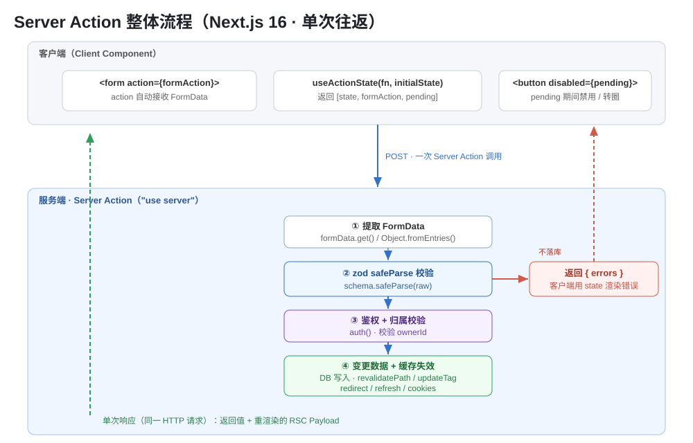

# Next.js Server Actions / Server Functions 知识点

> **术语澄清（Next.js 16）**：官方 16 版把总称改为 **Server Functions**（服务端函数），其中用于表单提交、数据变更（mutation）的调用形式称为 **Server Actions**（服务端操作）。二者常被混用，本质都是**运行在服务端的异步函数**，只能通过 POST 调用。本文以 **Next.js 16 为基线**，重点覆盖：**zod 服务端校验、文件上传、`useActionState` Hook**，并补充调用方式、单次往返、缓存失效、安全边界与避坑清单。

---

## 一、是什么：Server Function vs Server Action

一句话理解：**Server Action = 从客户端发起一次网络请求，在服务器上执行的函数**。你写一段 `async` 函数，加一行 `"use server"`，浏览器里调用它时，代码实际跑在服务器上。

| 概念 | 含义 | 举例 |
|---|---|---|
| **Server Function** | 广义：任何运行在服务端的异步函数 | `createPost`、`deletePost` |
| **Server Action** | Server Function 中用于表单/变更（mutation）的那类，通常配 `startTransition` | 传给 `<form action>` / `<button formAction>` 的函数 |

- **触发方式**：传给 `<form action>`、`<button formAction>`，或客户端事件里包 `startTransition` 调用。
- **只有 POST 能触发**：Server Action 底层就是一个 `POST` 请求。
- **返回值 + 新 UI 可一次返回**：见第八节“单次往返响应”。

> 与 **Route Handler（`route.ts`）** 的区别：Route Handler 是你要自己定义 REST 接口、手动解析请求；Server Action 是框架帮你处理表单提交、重新渲染和缓存失效，是“更贴近业务的写法”。

### 整体流程（示意）



---

## 二、`"use server"` 约定与文件位置

`"use server"` 可以放在两处：

### 1. 独立文件顶部（推荐，整个文件所有导出都成为 Server Function）

```ts
// app/actions.ts
"use server";

export async function createPost(formData: FormData) {
  // ... 跑在服务器上
}

export async function deletePost(formData: FormData) {
  // ...
}
```

### 2. 单个异步函数体内（只标记这一个函数）

```tsx
// app/page.tsx —— Server Component 内联
export default function Page() {
  async function createPost(formData: FormData) {
    "use server";
    // ...
  }
  return <form action={createPost}>{/* ... */}</form>;
}
```

### 关键规则

- **Server Component 里可以内联**定义；**Client Component 里不能定义**，只能从带 `"use server"` 的文件导入后调用。
- 文件顶部的 `"use server"` 使**所有导出**都是 Server Function，不要在该文件导出非服务端工具。
- 把 action 传给 Client Component 时，直接作为 prop 传递即可（Next 会把它序列化成 POST 引用）。

---

## 三、如何调用 Server Action（四种方式）

| 方式 | 写法 | 适用 |
|---|---|---|
| ① 表单 `action` | `<form action={fn}>` | 最常用，自动拿到 `FormData`，支持渐进增强 |
| ② 按钮 `formAction` | `<button formAction={fn}>` | 表单内多个提交按钮（草稿/发布） |
| ③ 事件 handler + `startTransition` | `startTransition(async () => { await fn() })` | 点击/非表单场景，可配 `useActionState` |
| ④ `useEffect` | 挂载/依赖变化时触发 | 浏览量、自动同步 |

```tsx
// ③ 事件 handler
"use client";
import { incrementLike } from "./actions";

export function LikeButton() {
  return (
    <button
      onClick={async () => {
        const n = await incrementLike();
        // setLikes(n)
      }}
    >
      👍
    </button>
  );
}
```

### 传额外参数：`.bind` 或隐藏字段

```tsx
"use client";
import { updateUser } from "./actions";

export function UserProfile({ userId }: { userId: string }) {
  // bind 预绑定 userId，提交时只追加 FormData
  const updateUserWithId = updateUser.bind(null, userId);
  return <form action={updateUserWithId}>{/* ... */}</form>;
}
```

```ts
// app/actions.ts
"use server";
export async function updateUser(userId: string, formData: FormData) {}
```

> 也可用 `<input type="hidden" name="userId" value={userId} />`，但值会出现在渲染后的 HTML 里、且不被编码。

---

## 四、表单基本写法：取出 FormData

在 `<form action={fn}>` 里，Server Action **自动接收 `FormData`**，用原生方法取字段：

```ts
"use server";
export async function createInvoice(formData: FormData) {
  const raw = {
    customerId: formData.get("customerId"),
    amount: formData.get("amount"),
    status: formData.get("status"),
  };
  // 变更数据 / 缓存失效
}
```

- **多个字段**可用 `Object.fromEntries(formData)`，但注意返回的对象会带以 `$ACTION_` 开头的前缀键，需过滤或用 `get()`。
- 服务端校验（zod）通常**不直接 trust** `formData.get()` 的返回值（类型是 `FormDataEntryValue | null`），先套 schema。

---

## 五、zod 服务端校验（核心）

> 客户端可用 HTML 属性（`required`、`type="email"`）做基础校验；**真正可靠的校验在服务端**——用 **Zod**（或 Valibot）定义 schema，对提交数据 `safeParse`。

### 5.1 定义 schema + safeParse

```ts
// app/actions.ts
"use server";
import { z } from "zod";

const schema = z.object({
  email: z.string({ invalid_type_error: "请输入邮箱" }).email("邮箱格式不对"),
  password: z.string().min(8, "至少 8 位"),
  age: z.coerce.number().min(18, "未满 18 岁"),
});

export async function createUser(formData: FormData) {
  // safeParse 不抛异常，返回 success 布尔
  const result = schema.safeParse({
    email: formData.get("email"),
    password: formData.get("password"),
    age: formData.get("age"),
  });

  if (!result.success) {
    // 把错误扁平化成字段级对象，交给 useActionState 渲染
    return {
      errors: result.error.flatten().fieldErrors,
    };
  }
  // result.data 已是类型安全、通过校验的数据
  // ... 落库、缓存失效
}
```

**要点**：
- 用 `safeParse`（不 throw），不要用 `parse`（校验失败会抛异常，导致 action 非预期中断）。
- `error.flatten().fieldErrors` 返回形如 `{ email?: string[], password?: string[] }` 的结构，方便逐字段渲染。
- `z.coerce.number()` 负责把字符串转数字（表单值都是字符串）。

### 5.2 完整例子：zod + useActionState 联动（签名变化）

用 `useActionState` 后，Server Function 的**第一个参数变为 `prevState`/`initialState`**，`FormData` 变成第二个参数：

```ts
"use server";
import { z } from "zod";

const schema = z.object({
  email: z.string().email(),
});

// 注意：第一个参数 prevState，第二个参数 formData
export async function createUser(prevState: unknown, formData: FormData) {
  const result = schema.safeParse({ email: formData.get("email") });
  if (!result.success) {
    return { errors: result.error.flatten().fieldErrors };
  }
  // ...落库
  return { success: true };
}
```

```tsx
"use client";
import { useActionState } from "react";
import { createUser } from "@/app/actions";

const initialState = { message: "", errors: {} };

export function Signup() {
  const [state, formAction, pending] = useActionState(createUser, initialState);

  return (
    <form action={formAction}>
      <input type="email" name="email" />
      <p aria-live="polite">{state?.message}</p>
      {state?.errors?.email?.map((e) => <p key={e}>{e}</p>)}
      <button disabled={pending}>注册</button>
    </form>
  );
}
```

> **安全提示**：zod 只校验输入**形状**（类型、长度、格式）。一个格式合法的对象仍可能指向你不拥有的数据——**归属/权限必须在 action 内用 session 单独校验**（见第七节）。

---

## 六、文件上传（核心）

文件也是表单的一部分，`<input type="file" name="file">` 提交后，`formData.get("file")` 返回一个 **`File` 对象**（服务端表现为文件流），用 `arrayBuffer()` 读取再写盘。

### 6.1 基础写法（服务端落盘）

```ts
"use server";
import { writeFile } from "fs/promises";
import { join } from "path";

export async function uploadFile(formData: FormData) {
  const file = formData.get("file") as File;
  if (!file) return { error: "未选择文件" };

  const bytes = await file.arrayBuffer(); // 读成二进制
  const buffer = Buffer.from(bytes);      // 转 Node Buffer
  const path = join(process.cwd(), "public/uploads", file.name);

  await writeFile(path, buffer);
  return { success: true, path };
}
```

### 6.2 用 zod 校验文件（类型 + 大小 + MIME）

```ts
"use server";
import { z } from "zod";
import { writeFile } from "fs/promises";
import { join } from "path";

const fileSchema = z.object({
  file: z
    .instanceof(File)                                   // 必须是文件
    .refine((f) => f.size <= 5 * 1024 * 1024, "文件不能超过 5MB")
    .refine(
      (f) => ["image/png", "image/jpeg", "image/webp"].includes(f.type),
      "仅支持图片格式"
    ),
});

export async function uploadAvatar(formData: FormData) {
  const result = fileSchema.safeParse({ file: formData.get("file") });
  if (!result.success) {
    return { errors: result.error.flatten().fieldErrors };
  }
  const file = result.data.file;
  const bytes = await file.arrayBuffer();
  await writeFile(join(process.cwd(), "public/avatars", file.name), Buffer.from(bytes));
  return { success: true };
}
```

### 6.3 大小限制：`bodySizeLimit`

Server Action 的请求体**默认上限 1MB**。上传稍大文件要改配置：

```js
// next.config.js
module.exports = {
  experimental: {
    serverActions: {
      bodySizeLimit: "2mb",          // 默认 "1mb"
    },
  },
};
```

> **建议**：较大文件（视频、大图）应改用 **Route Handler + 分片 / 云存储直传**，而不是 Server Action——Server Action 更适合小文件与表单字段一起提交。

---

## 七、`useActionState` Hook（核心）

React 19 新增的 Hook（旧 React 18 叫 `useFormState`）。用于读取 Server Action 的返回状态、拿到提交函数、以及 pending 状态。

### 7.1 签名

```tsx
const [state, formAction, pending] = useActionState(fn, initialState, permalink?);
```

| 返回值 | 含义 |
|---|---|
| `state` | 当前状态 = 上次 action 的返回值（初始为 `initialState`） |
| `formAction` | 传给 `<form action={formAction}>` 的新提交函数 |
| `pending` | 布尔，action 执行中为 `true`，用于禁用按钮/转圈 |

- `fn` 签名：**`(prevState, formData) => Promise<state>`**（注意第一个参数是 `prevState`）。
- `permalink`：可选，用于无 JS 时的渐进增强 URL。

```tsx
"use client";
import { useActionState } from "react";
import { createPost } from "@/app/actions";

const initialState = { message: "" };

export function Form() {
  const [state, formAction, pending] = useActionState(createPost, initialState);

  return (
    <form action={formAction}>
      <textarea name="content" />
      <p>{state?.message}</p>
      <button disabled={pending}>{pending ? "提交中…" : "发布"}</button>
    </form>
  );
}
```

### 7.2 `useFormStatus`（在子组件里读 pending）

如果提交按钮想抽成独立组件（尤其要放进别处复用），用 `react-dom` 的 `useFormStatus`：

```tsx
"use client";
import { useFormStatus } from "react-dom";

export function SubmitButton() {
  const { pending } = useFormStatus(); // 必须是 <form> 的后代组件
  return (
    <button type="submit" disabled={pending}>
      {pending ? "提交中…" : "提交"}
    </button>
  );
}
```

```tsx
import { SubmitButton } from "./button";
import { createUser } from "@/app/actions";

export function Signup() {
  return (
    <form action={createUser}>
      {/* ... */}
      <SubmitButton />  {/* 嵌套在 form 内 */}
    </form>
  );
}
```

> React 19 的 `useFormStatus` 额外返回 `data`、`method`、`action`（可读当前 FormData）；React 18 只有 `pending`。
> **区别**：`useActionState` 需要自己绑定 action 并返回 state；`useFormStatus` 只读父级 `<form>` 的状态，不持有 state。

### 7.3 错误处理策略

- **不要 throw**：把错误放进 `state` 返回，客户端用 `state` 渲染（`aria-live` 提升可访问性）。
- 只有非预期/系统错误才 throw（或返回全局 `message`）。

---

## 八、单次往返响应（返回值 + 新 UI 一次返回）

这是 Server Action 最区别于普通 API 的点：当 action 触发了**即时重校验**时，Next 在**同一个 HTTP 请求**内完成“跑 action → 重渲染当前路由”，响应里同时带：

1. **action 的返回值**（`useActionState` 读到的 `state`）；
2. **当前路由重渲染后的 RSC Payload**（客户端当作“播种导航”提交，无需再次请求就刷新 UI）。

触发同响应内重渲染的调用：`updateTag` / `revalidatePath` / `refresh`、设置/删除 cookie、`redirect`。

```ts
"use server";
import { revalidatePath } from "next/cache";
import { redirect } from "next/navigation";

export async function createPost(formData: FormData) {
  // ... 校验 + 落库
  revalidatePath("/posts"); // 让 /posts 读取到最新数据
  redirect("/posts");       // 导航到目标页（需在 revalidate 之后）
}
```

> `redirect` 会抛一个控制流异常，其后的代码不执行，所以**先 revalidate 再 redirect**。
> `revalidateTag`（配合 stale-while-revalidate）是例外：它标记后台刷新，**不会**在同响应里带重渲染。

### 顺序派发

客户端会**逐个**派发 Server Action（一次一个）：连续触发 3 个 action，第二个会等第一个完成。所以**不要用 `Promise.all` 并行**多个 action；要并行就写在一个 action 内部做并行 fetch。

---

## 九、变更后缓存失效：怎么选

| 函数 | 行为 | 适用 |
|---|---|---|
| `updateTag(tag)` | 立即失效某 tag，**下次读取**（含 action 响应里的重渲染）拿新数据；仅 Server Action 可用 | 要“读到自己刚写的” |
| `revalidateTag(tag, cacheLife)` | 某 tag 走 stale-while-revalidate 后台刷新，action 自身重渲染不等待新数据 | 允许旧值短暂展示 |
| `revalidatePath(path)` | 按 URL 路径失效 | 只影响单条路由、用 tag 嫌重 |
| `refresh()` | 重取当前路由的 RSC Payload，**不**失效缓存 | 视图依赖缓存之外的状态 |
| `redirect()` / `cookies()` | 导航 / 改 cookie 也会触发重渲染 | 跳转、登录态变更 |

---

## 十、安全边界（必须知道）

Server Action **就是一条可被直接 POST 的路由**，任何能发 POST 的人都能调用，不只是 UI。框架自带部分保护，但**不能替代应用层校验**：

### 框架层保护
- **CSRF 检查**：比对请求 `Origin` 与 `Host`（或 `X-Forwarded-Host`），不一致则拒绝；代理/CDN 域名要配 `serverActions.allowedOrigins`。
- **请求体上限**：默认 1MB，配 `serverActions.bodySizeLimit`。
- **加密 action ID + 死代码消除**：构建时 action 引用被加密，未使用的 Server Function 会从客户端 bundle 剔除（没有公开端点）。
- **闭包变量加密**：内联 action 捕获的变量会加密后再发给客户端；多实例/自托管要设 `NEXT_SERVER_ACTIONS_ENCRYPTION_KEY` 保持一致。

### 应用层必须做
- **每个 action 内鉴权**：`render-time gating`（只在登录页渲染表单）不是安全边界，因为请求可以不经过 UI 直接发。
- **校验输入**：把 `FormData`、query、headers 都当不可信。
- **约束返回值**：返回值会序列化到客户端，只返回 UI 需要的东西，别吐原始 DB 记录。
- **归属校验**：客户端只能传“改什么”（如 itemId），不要传整行内容；从 session 推导身份，再按 ownerId 查出真正可操作的行。

```ts
"use server";
export async function completeItem(itemId: string) {
  const session = await auth();
  if (!session?.user) return;
  const item = await db.item.findFirst({
    where: { id: itemId, ownerId: session.user.id }, // 归属校验
  });
  if (!item) return;
  await db.item.update({ where: { id: item.id }, data: { completed: true } });
}
```

### 部署注意
每个 Server Action 有随构建产物生成的 action ID；新部署通常生成新 ID（最长 14 天轮换），老客户端可能报 **"Failed to find Server Action"**。UI 应提供重试/刷新兜底，优先滚动部署。

---

## 十一、避坑速记清单

1. **术语**：16 官方总称 Server Function，表单/变更语境叫 Server Action；本质都是服务端异步函数，**只能 POST**。
2. **`"use server"` 位置**：独立文件顶部（整个文件都是）或单函数体内；**Client Component 里不能定义**，只能导入。
3. **用 `safeParse` 不要 `parse`**：`parse` 失败会 throw，破坏 action 的返回状态约定。
4. **`z.coerce.number()`**：表单值都是字符串，直接 `z.number()` 会校验失败。
5. **用 `useActionState` 后函数签名变化**：第一个参数是 `prevState`，`FormData` 退到第二参数，别写反。
6. **`useFormStatus` 必须是 `<form>` 的后代组件**；它不持有 state，只读父表单状态。
7. **文件默认 1MB 上限**：超了先想清楚是改 `bodySizeLimit` 还是改用 Route Handler/直传。
8. **`Object.fromEntries(formData)`** 会带 `$ACTION_` 前缀键，多字段时注意过滤。
9. **zod 只校验形状，不校验归属**：权限/owner 必须在 action 内用 session 单独查。
10. **每个 action 都要鉴权**，别只依赖“表单只在登录页渲染”。
11. **先 `revalidate` 再 `redirect`**：`redirect` 抛异常，后面的代码不执行。
12. **别用 `Promise.all` 并行多个 action**：客户端是顺序派发，逐个 await。
13. **`revalidateTag`（SWR 模式）不会在同响应里带重渲染**，要立即见新数据用 `updateTag`/`revalidatePath`/`refresh`。

---

## 十二、自测题（互动式考核）

1. Server Function 和 Server Action 是什么关系？只能通过哪个 HTTP 方法调用？
2. `"use server"` 写在函数体内 和 写在文件顶部 有什么区别？Client Component 里能定义 Server Action 吗？
3. 用 zod 时为什么推荐 `safeParse` 而不是 `parse`？`flatten().fieldErrors` 返回什么结构？
4. 表单里文件字段，`formData.get("file")` 返回什么类型？如何读它的内容写盘？
5. 上传超过默认限制会怎样？改哪个配置项？
6. `useActionState` 返回哪三个值？传给它的 Server Function 第一个参数是什么？和直接 `<form action={fn}>` 的 `fn` 参数顺序有什么不同？
7. `useFormStatus` 和 `useActionState` 的区别是什么？前者必须在什么位置使用？
8. 为什么说“zod 校验通过 ≠ 数据安全”？还要做什么？
9. `revalidatePath` 和 `revalidateTag`（SWR）在同一次 action 响应里，谁会带重渲染的新 UI？
10. 客户端能直接 POST 调用你的 Server Action 吗？框架做了哪些保护、还需要你做哪些？

---

## 附：参考来源

- Next.js 官方《Server Actions and Mutations》：https://nextjs.org/docs/app/guides/server-actions
- Next.js 官方《How to create forms with Server Actions》：https://nextjs.org/docs/app/guides/forms
- Next.js 官方《Mutating Data》：https://nextjs.org/docs/app/getting-started/mutating-data
- React 官方《useActionState》：https://react.dev/reference/react/useActionState
- React 官方《Server Actions》：https://react.dev/reference/rsc/server-actions
