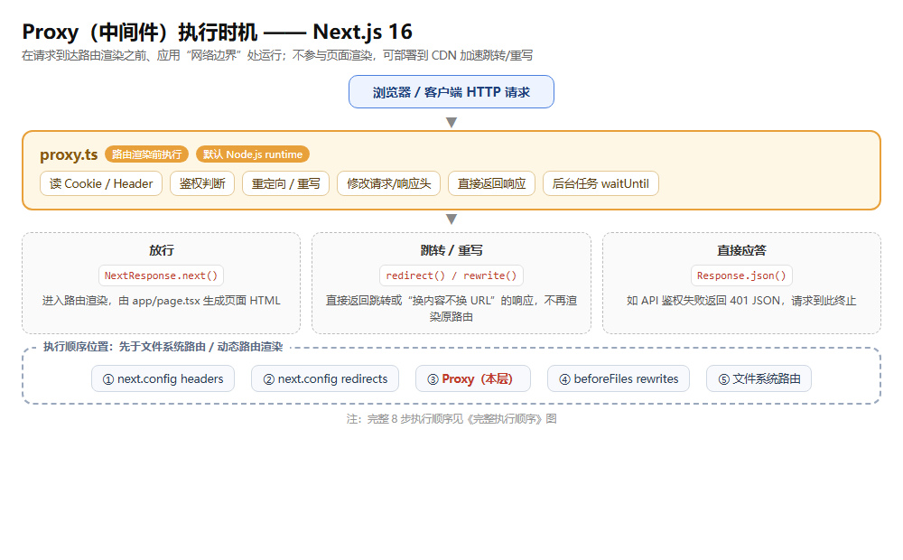
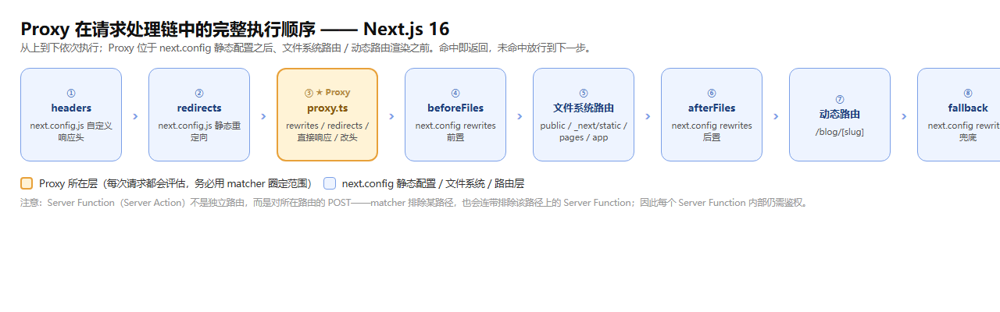
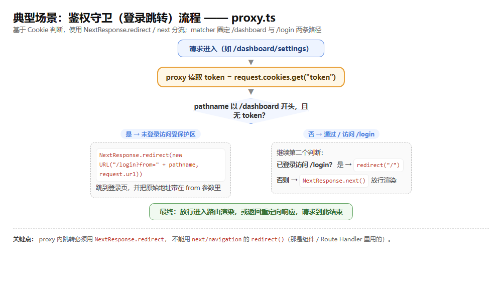

# Next.js 中间件（Middleware / Proxy）知识点

> Next.js 16 中 `middleware` 已弃用并更名为 `proxy`。本文以 **Next.js 16 为基线**，统一按 `proxy.ts` 写法，并对比旧版 `middleware.ts`，覆盖：文件约定、matcher 过滤、NextResponse API、Cookies/Headers、执行顺序、运行时限制、典型场景、迁移与避坑，附自测题。

## 版本说明

- **本文以 Next.js 16 为基线**。16 起 `middleware.ts` 弃用 → 改名 `proxy.ts`，导出函数 `middleware` → `proxy`。
- 旧版 `middleware.ts`（12–15）内容仅作对比，**不是实践基线**。
- 一句话理解：**中间件 = 在网络边界、路由渲染前运行的一层代码**，现在官方叫 Proxy。

---

## 一、是什么：中间件 / Proxy 的作用

在**请求到达页面/API 之前**在服务端执行的代码。拿到请求后，可以：

- 改请求或响应头（headers）
- 改/删/读 Cookies
- 重定向（redirect）
- 重写（rewrite，URL 不变、内容换成别的路由）
- 直接返回一个响应（鉴权失败返回 401 JSON 等）

典型用途：鉴权、登录跳转、维护页、灰度/AB 测试、国际化（i18n 前缀）、CORS、日志埋点。



> **核心定位**：它是“应用前面的网络边界”，不参与路由渲染。官方强烈建议**能不用就不用**——只作为最后手段（last resort），优先用 Route Groups、layout、Server Functions、`next.config.js` 的 headers/redirects/rewrites 等更贴近业务的 API。

### 与其他“跳转/拦截”手段的区别

| 手段 | 执行时机 | 适用 |
|---|---|---|
| `next.config.js` 的 `redirects/rewrites/headers` | 构建时静态配置 | 固定规则、无需读取运行时请求逻辑 |
| **proxy / middleware** | 请求时、路由渲染前 | 需要读 Cookie/Header 做动态判断（鉴权、A/B） |
| 页面内 `redirect()`（`next/navigation`） | 渲染过程中 | Server Component / Route Handler / Server Action 内 |
| Route Handlers 内逻辑 | 请求命中 API 时 | 单个接口自身的处理 |

---

## 二、Next 16 关键变化：middleware → proxy

### 2.1 命名变更

| 项 | 旧（≤15） | 新（16） |
|---|---|---|
| 文件名 | `middleware.ts` / `middleware.js` | `proxy.ts` / `proxy.js` |
| 导出函数 | `export function middleware()` | `export function proxy()`（默认导出也行） |
| 运行时 | 默认 Edge（可配 Node） | **默认且只能 Node.js**，`runtime` 配置项不可用 |
| 配置 flag | `skipMiddlewareUrlNormalize` | `skipProxyUrlNormalize` |
| 官方推荐 | — | “尽量别用” |

### 2.2 版本历史（官方）

| 版本 | 变化 |
|---|---|
| v16.0.0 | middleware 弃用、改名为 proxy；**默认 Node.js runtime** |
| v15.5.0 | middleware 可稳定使用 Node.js runtime |
| v15.2.0 | middleware 实验性支持 Node.js runtime |
| v13.1.0 | 加入高级 flag（skipMiddlewareUrlNormalize 等） |
| v13.0.0 | middleware 可改请求头/响应头、直接返回响应 |
| v12.0.0 | middleware（Beta）引入 |

### 2.3 为什么改名

官方理由：**“middleware”一词易与 Express.js 的 middleware 混淆**，让人误以为能像 Express 那样串联中间件；而 Proxy 更能准确表达“应用前面的一道网络边界”这一行为——它运行在主运行时之外、可在请求到达应用前处理。

---

## 三、文件位置与命名

`proxy.ts` 放在**项目根目录**（与 `app/` 或 `pages/` 平级），或 `src/` 下（若有 `src/` 则放在 `src/` 里）。

```
项目根/
├── proxy.ts        ← 中间件，与 app/ 平级
├── app/
│   └── ...
└── src/            ← 若用 src 目录，则 proxy.ts 放在 src/ 下
```

- 若自定义了 `pageExtensions`（如 `.page.ts`），则文件名改为 `proxy.page.ts`。
- 一个文件只能导出一个函数（默认导出或 `export function proxy`），**不支持同文件多个 proxy**。

---

## 四、基础写法

```ts
// proxy.ts —— Next 16 写法
import { NextResponse } from "next/server";
import type { NextRequest } from "next/server";

// 命名导出（推荐）
export function proxy(request: NextRequest) {
  return NextResponse.redirect(new URL("/home", request.url));
}

// 也可用默认导出
// export default function proxy(request: NextRequest) { ... }

// matcher：只对 /about 及子路径生效
export const config = {
  matcher: "/about/:path*",
};
```

> 对比旧版：把 `export function middleware` 改成 `export function proxy`，文件名 `middleware.ts` → `proxy.ts` 即可。官方 codemod：`npx @next/codemod@canary middleware-to-proxy .`（或升级时 `npx @next/codemod@canary upgrade latest`）。

---

## 五、matcher：精确控制哪些请求触发

**不写 matcher = 每个请求都跑**，包括静态文件（`_next/static`）、图片优化（`_next/image`）、`public/` 资源——鉴权/重定向逻辑可能误伤 CSS、JS、图片加载。**强烈建议总是写 matcher**。

### 5.1 三种写法

| 写法 | 语法 | 说明 |
|---|---|---|
| 单路径字符串 | `matcher: "/about"` | 只匹配该路径 |
| 多路径数组 | `matcher: ["/about", "/dashboard/:path*"]` | 命中任意一个即触发 |
| 正则字符串 | `matcher: "/((?!api\|_next/static\|_next/image).*)"` | 用负向断言排除某些前缀 |

### 5.2 路径模式语法（source）

| 规则 | 示例 | 匹配 |
|---|---|---|
| 必须以 `/` 开头 | `/about` | 必须 `/` 开头 |
| 命名参数 `:path` | `/about/:path` | `/about/a`、`/about/b`，**不匹配** `/about/a/c` |
| 修饰符 `*` | `/about/:path*` | `/about/a/b/c`（`*`=0 或多个段） |
| 修饰符 `?` | `/about/:path?` | 0 或 1 个段 |
| 修饰符 `+` | `/about/:path+` | 1 个或多个段 |
| 正则 `(.*)` | `/about/(.*)` | 等价于 `/about/:path*` |
| 锚定起点 | `/about` | 匹配 `/about`、`/about/team`，**不匹配** `/blog/about` |

### 5.3 对象形式：`has` / `missing`（更精细）

可精确到“在什么条件下匹配 / 不匹配”，支持 `header` / `query` / `cookie` 三种类型。

```ts
export const config = {
  matcher: [
    {
      source: "/api/:path*",
      locale: false,                       // 忽略 locale 前缀
      has: [
        { type: "header", key: "Authorization", value: "Bearer Token" },
        { type: "query", key: "userId", value: "123" },
      ],
      missing: [{ type: "cookie", key: "session", value: "active" }],
    },
  ],
};
```

### 5.4 matcher 注意事项

- **matcher 值必须是常量**（构建期静态分析），不能用变量。
- 兼容性：`/public` 会被视为 `/public/index`，所以 `matcher: "/public/:path"` 也能匹配。
- **`_next/data` 即使被正则排除，proxy 仍会执行**（官方故意为之，防止你保护了页面却漏保护了对应数据路由导致安全漏洞）。
- 想排除 prefetch 请求，可用 `has`/`missing` 判断 `next-router-prefetch` / `purpose: prefetch` 头。

---

## 六、函数参数：request 与 event

Proxy 函数接收两个参数（按顺序）：`request`（`NextRequest`）和 `event`（`NextFetchEvent`），按需声明即可。

### 6.1 request —— `NextRequest`

表示入站 HTTP 请求，包含：

- `request.nextUrl`：`NextURL` 对象，含 `pathname`、`searchParams`、`origin`、`locale` 等。
- `request.cookies`：入站 Cookie（同步访问，方法见下）。
- `request.headers`：入站请求头。
- `request.method` / `request.url` 等标准 Request 属性。

```ts
export function proxy(request: NextRequest) {
  const pathname = request.nextUrl.pathname;   // "/dashboard"
  const q = request.nextUrl.searchParams.get("q");
  const origin = request.nextUrl.origin;       // "https://site.com"
}
```

### 6.2 event —— `NextFetchEvent`

暴露 `waitUntil(promise)`：让 proxy 生命周期**延长到 promise 结束**，适合响应已发出后仍要做的后台工作（日志、埋点、分析上报）。

```ts
import type { NextFetchEvent, NextRequest } from "next/server";

export function proxy(request: NextRequest, event: NextFetchEvent) {
  event.waitUntil(
    fetch("https://my-analytics.com/log", {
      method: "POST",
      body: JSON.stringify({ pathname: request.nextUrl.pathname }),
    })
  );
  return NextResponse.next();
}
```

### 6.3 `NextProxy` 类型简写

用 `NextProxy` 类型自动推导 request / event 参数：

```ts
import type { NextProxy } from "next/server";

export const proxy: NextProxy = (request, event) => {
  event.waitUntil(Promise.resolve());
  return Response.json({ pathname: request.nextUrl.pathname });
};
```

---

## 七、NextResponse：返回/改写响应

`NextResponse` 支持：`redirect`、`rewrite`、设置请求/响应头、设置响应 Cookie。也可以直接返回 `Response` 或 `NextResponse` 实例。

| 方法 | 作用 | 示例 |
|---|---|---|
| `NextResponse.next()` | 放行，继续处理（可传入 `{ request: { headers } }` 改上游请求头） | 鉴权通过时返回 |
| `NextResponse.redirect(url)` | 301/302 跳转 | 未登录 → `/login` |
| `NextResponse.rewrite(url)` | 显示该 URL 对应内容，**地址栏不变** | 灰度/维护页 |
| `NextResponse.json(data, init)` | 直接返回 JSON 响应 | 401 鉴权失败 |
| `Response.json(...)` | 同样可直接返回 | 同上 |

```ts
// 鉴权重定向
export function proxy(request: NextRequest) {
  const token = request.cookies.get("token")?.value;
  if (!token && request.nextUrl.pathname.startsWith("/dashboard")) {
    return NextResponse.redirect(new URL("/login", request.url));
  }
  return NextResponse.next();
}

// 重写（地址栏仍是 /old，实际渲染 /new）
export function proxy(request: NextRequest) {
  if (request.nextUrl.pathname === "/old") {
    return NextResponse.rewrite(new URL("/new", request.url));
  }
}

// 直接返回 JSON（API 鉴权）
export function proxy(request: NextRequest) {
  if (!isAuthed(request)) {
    return Response.json(
      { success: false, message: "authentication failed" },
      { status: 401 }
    );
  }
}
```

> **注意**：proxy 里**不能用** `next/navigation` 的 `redirect()`（那是 Server Component / Route Handler / Server Action 里的）。proxy 里跳转要用 `NextResponse.redirect`。

### 7.1 修改 Cookies

Cookie 本质是请求头 `Cookie` / 响应头 `Set-Cookie`。`NextRequest` 和 `NextResponse` 上提供了 `cookies` 便捷 API。

**入站（request.cookies）**：`get` / `getAll` / `set` / `delete` / `has` / `clear`
**出站（response.cookies）**：`get` / `getAll` / `set` / `delete`

```ts
export function proxy(request: NextRequest) {
  // 读入站 cookie
  const cookie = request.cookies.get("nextjs");   // { name, value }
  const all = request.cookies.getAll();

  // 设置出站 cookie
  const response = NextResponse.next();
  response.cookies.set("token", "fast");
  response.cookies.set({ name: "vercel", value: "fast", path: "/" });
  return response;   // 响应头会带 Set-Cookie: vercel=fast;path=/
}
```

### 7.2 修改 Headers（注意区别）

```ts
export function proxy(request: NextRequest) {
  // 复制入站请求头并新增一个
  const requestHeaders = new Headers(request.headers);
  requestHeaders.set("x-hello-from-proxy1", "hello");

  // 传给上游（服务端）：用 request: { headers } —— 关键！
  const response = NextResponse.next({
    request: { headers: requestHeaders },
  });

  // 传给客户端（浏览器）：用 response.headers.set
  response.headers.set("x-hello-from-proxy2", "hello");
  return response;
}
```

- `NextResponse.next({ request: { headers } })` → 上游（页面/API）能读到。
- `NextResponse.next({ headers })` → 只会出现在给客户端的响应头。
- **别设置超大请求头**，可能触发 `431 Request Header Fields Too Large`。

> **RSC 注意**：RSC 请求时，Next 会从 `request` 上剥离内部 Flight 头（`rsc`、`next-router-state-tree`、`next-router-prefetch`），防止你把 RSC 请求和 HTML 请求处理得不一样。用 `NextResponse.rewrite()` 会自动带上所需 RSC 头；若你自定义 `fetch` 做重写，需手动转发或用 `skipProxyUrlNormalize`。

---

## 八、执行顺序（重要）



Proxy 对**项目里每个路由**都会被调用，所以必须用 matcher 精确圈定。完整执行顺序：

```
1. next.config.js 的 headers
2. next.config.js 的 redirects
3. Proxy（rewrites / redirects / 直接响应等）
4. beforeFiles（next.config 的 rewrites）
5. 文件系统路由（public/、_next/static、pages/、app/）
6. afterFiles（next.config 的 rewrites）
7. 动态路由（/blog/[slug]）
8. fallback（next.config 的 rewrites）
```

> **Server Functions（Server Action）不是独立路由**：它们是对所在路由的 POST 请求。所以 proxy 的 matcher 排除了某个路径，也就排除了该路径上的 Server Function 调用。**改 matcher 或移动 Server Function 可能悄悄去掉 proxy 覆盖**——官方建议在每个 Server Function 内部也做鉴权，别只依赖 proxy。

---

## 九、运行时与部署限制（Next 16）

| 项 | 说明 |
|---|---|
| 默认运行时 | **Node.js**（16 起） |
| `runtime` 配置 | **不可用**——在 proxy 文件里设置 `runtime` 会**直接抛错** |
| Edge runtime | **不支持** proxy。想用 edge 只能保留旧 `middleware.ts` |
| 部署支持 | Node.js server ✅、Docker ✅、**静态导出（`output: export`）❌**、Adapters 平台相关 |

> 迁移提醒：**不能**把 edge 版 middleware 直接改名成 proxy 就完事——proxy 固定 Node runtime。要 edge 就继续用 middleware。

---

## 十、与 Server Component 里 `cookies()`/`headers()` 的区别

| 维度 | proxy 里的 `request.cookies` / `request.headers` | Server Component / Route Handler 里的 `cookies()` / `headers()` |
|---|---|---|
| 访问方式 | **同步**（request 对象上直接 `.get()`） | **异步**（Next 16 必须 `await`，同步访问已移除） |
| 来源 | 从 `next/server` 的 `NextRequest` | 从 `next/headers` |
| 场景 | 请求边界拦截、跳转前判断 | 页面渲染、数据获取时读取 |

```ts
// proxy —— 同步
export function proxy(request: NextRequest) {
  const token = request.cookies.get("token");
}

// Server Component —— 异步
export default async function Page() {
  const token = (await cookies()).get("token");
}
```

---

## 十一、典型场景

### 1. 鉴权重定向（登录守卫）



```ts
export function proxy(request: NextRequest) {
  const token = request.cookies.get("token")?.value;
  const { pathname } = request.nextUrl;

  // 未登录访问受保护区 → 跳登录
  if (!token && pathname.startsWith("/dashboard")) {
    const loginUrl = new URL("/login", request.url);
    loginUrl.searchParams.set("from", pathname);
    return NextResponse.redirect(loginUrl);
  }
  // 已登录访问登录页 → 跳首页
  if (token && pathname === "/login") {
    return NextResponse.redirect(new URL("/", request.url));
  }
  return NextResponse.next();
}

export const config = { matcher: ["/dashboard/:path*", "/login"] };
```

### 2. 维护页（rewrite）

```ts
export function proxy(request: NextRequest) {
  if (request.nextUrl.pathname !== "/maintenance") {
    return NextResponse.rewrite(new URL("/maintenance", request.url));
  }
}

export const config = { matcher: ["/((?!_next/static|_next/image|favicon.ico).*)"] };
```

### 3. i18n 语言前缀（rewrite，URL 不变）

```ts
export function proxy(request: NextRequest) {
  const { pathname } = request.nextUrl;
  // 无语言前缀时，按 cookie/头推断并 rewrite 到对应语言路由
  if (!/^\/[a-z]{2}(-|$)/.test(pathname)) {
    const locale = request.cookies.get("NEXT_LOCALE")?.value ?? "zh";
    return NextResponse.rewrite(new URL(`/${locale}${pathname}`, request.url));
  }
}
```

### 4. CORS

```ts
export function proxy(request: NextRequest) {
  const origin = request.headers.get("origin") ?? "";
  const allowed = ["https://acme.com", "https://my-app.org"].includes(origin);
  const cors = {
    "Access-Control-Allow-Methods": "GET, POST, PUT, DELETE, OPTIONS",
    "Access-Control-Allow-Headers": "Content-Type, Authorization",
  };

  if (request.method === "OPTIONS") {                       // 预检请求
    return NextResponse.json({}, {
      headers: { ...(allowed && { "Access-Control-Allow-Origin": origin }), ...cors },
    });
  }

  const response = NextResponse.next();
  if (allowed) response.headers.set("Access-Control-Allow-Origin", origin);
  Object.entries(cors).forEach(([k, v]) => response.headers.set(k, v));
  return response;
}

export const config = { matcher: "/api/:path*" };
```

---

## 十二、迁移指南（middleware → proxy）

1. 改名：`mv middleware.ts proxy.ts`（或在 `src/` 下）。
2. 函数改名：`export function middleware` → `export function proxy`。
3. 配置 flag 改名：`skipMiddlewareUrlNormalize` → `skipProxyUrlNormalize`。
4. 确认运行时：proxy 默认 Node runtime，**不能设 `runtime: 'edge'`**；需要 edge 就保留 middleware。
5. 可运行 codemod 自动迁移：`npx @next/codemod@canary middleware-to-proxy .`
6. 升级时：`npx @next/codemod@canary upgrade latest`（会顺带处理其他 breaking changes）。

---

## 十三、避坑速记清单

1. **Next 16 写 `proxy.ts`，不是 `middleware.ts`**；导出函数名 `proxy`。旧代码迁移别只改文件名忘改函数名。
2. **proxy 是 Node runtime，不能设 `runtime`**——设了直接抛错；edge 需求就保留 middleware，别硬改。
3. **必须写 matcher**——不写会对每个请求（含静态文件、图片、public 资源）都跑，鉴权可能误伤 CSS/JS。
4. **matcher 值必须是常量**，不能用变量（构建期静态分析）。
5. **proxy 里跳转用 `NextResponse.redirect`，别用 `next/navigation` 的 `redirect()`**（后者是组件/Route Handler 用的）。
6. **改上游请求头用 `NextResponse.next({ request: { headers } })`，不是 `{ headers }`**——后者只进客户端响应头。
7. **Server Function 不是独立路由**，是所在路径的 POST；改 matcher 或挪位置可能让 proxy 悄悄失效，Server Function 内部也要鉴权。
8. **`_next/data` 即使被 matcher 排除 proxy 仍会执行**——别因此以为数据路由没被保护。
9. **RSC 请求时 request 上拿不到 `rsc` / `next-router-state-tree` 等内部头**；`NextResponse.rewrite()` 会自动带上，自定义 `fetch` 重写则要手动转发。
10. **别设超大请求头**，可能触发 431。
11. **静态导出（`output: export`）不支持 proxy**。
12. **proxy 与 Server Component 的 headers/cookies 访问方式不同**：proxy 里同步 `request.cookies.get()`；组件里必须 `await cookies()`。
13. **官方建议“最后手段”**——能靠 Route Groups / layout / Server Functions / next.config 实现就别上 proxy，避免滥用。

---

## 十四、自测题（互动式考核）

1. Next 16 中，`middleware.ts` 应该改名叫什么？导出的函数名呢？`runtime: 'edge'` 能不能用？
2. 不写 matcher 时，proxy 会对哪些请求执行？为什么通常必须写 matcher？
3. `matcher: "/about/:path*"` 能否匹配 `/about` 本身？`/about/a/c` 呢？
4. 想“URL 不变但渲染成另一个路由”，用 `NextResponse` 的哪个方法？想跳转地址栏呢？
5. proxy 里想把一个自定义请求头传给上游页面，应该用 `NextResponse.next({ request: { headers } })` 还是 `{ headers }`？区别是什么？
6. proxy 里读 Cookie 是同步还是异步？Server Component 里 `cookies()` 是同步还是异步？
7. 为什么说“改 matcher 或移动 Server Function 可能悄悄去掉 proxy 覆盖”？官方建议怎么补？
8. 执行顺序里，proxy 是在 `next.config.js` 的 redirects 之前还是之后运行？

---

## 附：参考来源

- Next.js 官方文档《proxy.js》：https://nextjs.org/docs/app/api-reference/file-conventions/proxy
- Next.js 16 升级指南《Upgrade to version 16》：https://nextjs.org/docs/app/guides/upgrading/version-16
- Next.js 官方《NextResponse》：https://nextjs.org/docs/app/api-reference/functions/next-response
