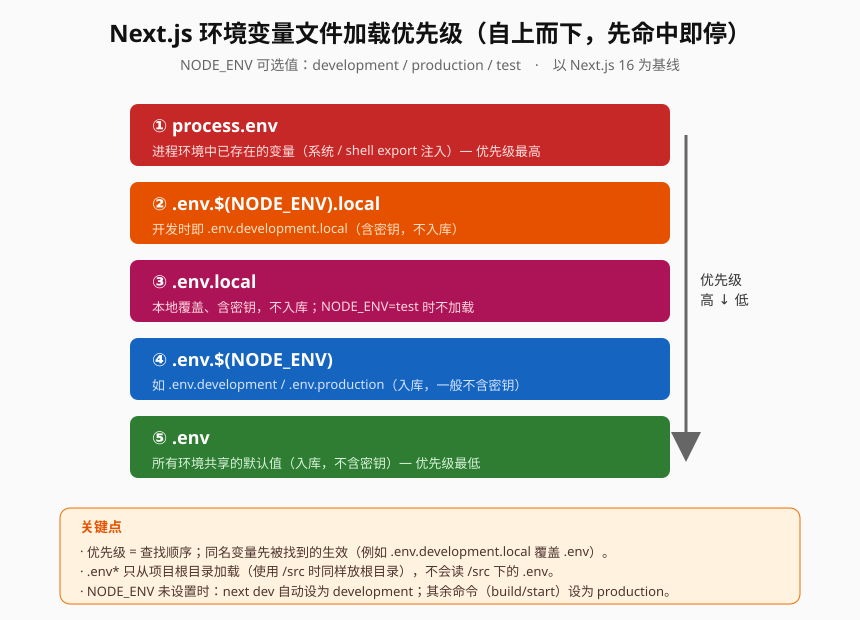
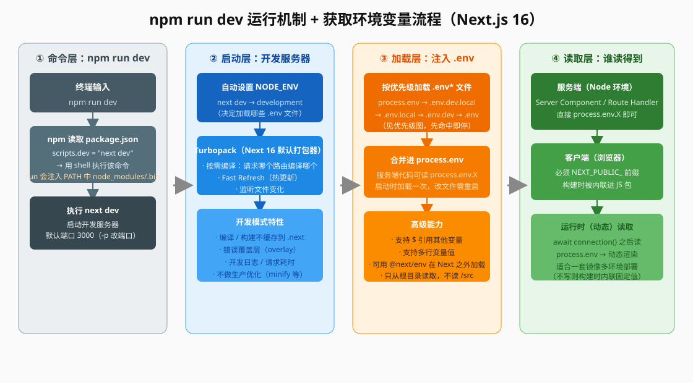

# Next.js 环境变量知识点（含 npm run dev 运行机制）

> 本文以 **Next.js 16 为基线**（官方文档版本 16.2.6，最后更新 2026-05），覆盖：`.env` 文件机制、环境变量文件加载优先级、获取环境变量的完整流程（服务端 / 客户端 / 运行时）、`npm run dev` 的运行机制，附避坑速记清单与自测题。

## 版本说明

- **Next.js 16 起 Turbopack 是默认打包器**，`next dev` 与 `next build` 都默认走 Turbopack（退出可 `next build --webpack`）。
- 环境变量加载顺序在 v9.4 引入 `.env` 与 `NEXT_PUBLIC_` 后长期稳定，16 未改动**文件优先级**，但新增了**运行时读取**的官方写法（`connection()`）。
- 一句话理解：**`.env*` 文件 = 在启动/构建时把密钥或配置批量注入 `process.env` 的机制；`NEXT_PUBLIC_` = 唯一能暴露给浏览器的入口。**

---

## 一、环境变量文件机制（.env）

Next.js 内置支持从 `.env*` 文件加载变量进 `process.env`：

```txt title=".env"
DB_HOST=localhost
DB_USER=myuser
DB_PASS=mypassword
```

- 加载后，服务端代码（Route Handler、Server Component、Server Action）里 `process.env.DB_HOST` 即返回该值。
- 使用 `/src` 目录时，`.env*` **仍必须放在项目根目录**，Next.js 不会从 `/src` 下读取 `.env`。
- 文件内容支持：
  - **多行值**（引号包住、内部可换行，或用 `\n`）。
  - **引用其他变量**：`$VARIABLE` 会被展开，例如 `TWITTER_URL=https://x.com/$TWITTER_USER`；如果值里想用字面 `$`，需转义成 `\$`。
- `create-next-app` 模板默认把 `.env*` 全部加入 `.gitignore`，因为 `.env.local` 等常含密钥。

### 各文件的用途与是否入库

| 文件 | 用途 | 是否提交 git |
|---|---|---|
| `.env` | 所有环境共享的默认值 | ✅ 提交（不含密钥） |
| `.env.local` | 本地覆盖，常含密钥 | ❌ 不提交；**NODE_ENV=test 时不加载** |
| `.env.development` | 开发环境默认值 | ✅ 提交 |
| `.env.development.local` | 开发环境本地覆盖（密钥） | ❌ 不提交 |
| `.env.production` | 生产环境默认值 | ✅ 提交 |
| `.env.production.local` | 生产环境本地覆盖（密钥） | ❌ 不提交 |
| `.env.test` | 测试环境默认值 | ✅ 提交 |
| `.env.test.local` | 测试环境本地覆盖 | ❌ 不提交 |

> 总原则：`.env*.local` 一律不入库（被 `.gitignore` 忽略）；其余按环境文件入库。

---

## 二、环境变量文件加载优先级（重点）

环境变量按以下位置**依次查找，一旦找到即停止**（先命中者生效）：

```
1. process.env                     ← 进程环境里已存在的变量（最高）
2. .env.$(NODE_ENV).local          ← 例如 .env.development.local
3. .env.local                      ← NODE_ENV=test 时不检查
4. .env.$(NODE_ENV)                ← 例如 .env.development / .env.production
5. .env                            ← 最低
```

> `$(NODE_ENV)` 的取值只允许 `production` / `development` / `test`。
> 例如开发时变量同时定义在 `.env.development.local` 和 `.env`，则取 `.env.development.local` 的值。



### NODE_ENV 从哪来

- 如果 NODE_ENV **未设置**：`next dev` 自动设为 `development`；**其他所有命令**（`next build` / `next start`）自动设为 `production`。
- 测试环境一般由测试工具（jest / cypress）自动置为 `test`，通常无需手动设置。

### test 环境的特殊点

- 测试环境**不加载 `.env.local`**，以保证所有人测出的结果一致。
- `.env.test` 应入库，`.env.test.local` 不入库。
- 测试时若想用和 Next.js 一样的方式加载变量，可借助 `@next/env` 的 `loadEnvConfig`。

---

## 三、获取环境变量的流程

**谁读得到、怎么读，取决于代码跑在哪一层。**



### 3.1 服务端（Node 环境）

```tsx title="app/page.tsx（Server Component）"
export default function Page() {
  // 直接读即可
  return <p>{process.env.MY_SERVER_SECRET}</p>
}
```

- Server Component / Route Handler / Server Action 里直接 `process.env.X`。
- 非 `NEXT_PUBLIC_` 前缀的变量**只在服务端可用**，不会进入浏览器。

### 3.2 客户端（浏览器）

必须给变量加 `NEXT_PUBLIC_` 前缀，Next.js 会在**构建时**把所有 `process.env.NEXT_PUBLIC_X` 引用替换成硬编码值，内联进发给浏览器的 JS 包：

```txt title=".env"
NEXT_PUBLIC_ANALYTICS_ID=abcdefghijk
```

```tsx
setupAnalyticsService(process.env.NEXT_PUBLIC_ANALYTICS_ID)
// 构建后被替换为 setupAnalyticsService('abcdefghijk')
```

**不会内联的动态查找：**

```ts
const varName = 'NEXT_PUBLIC_ANALYTICS_ID'
setupAnalyticsService(process.env[varName]) // ❌ 不内联
const env = process.env
setupAnalyticsService(env.NEXT_PUBLIC_ANALYTICS_ID) // ❌ 不内联
```

**关键限制：** `NEXT_PUBLIC_` 变量在构建时被“冻结”，构建完成后不再响应值的变化。若要客户端拿到运行时值，需自建 API（按需或在初始化时下发）。

### 3.3 服务端运行时（动态）读取

默认情况下，服务端环境变量也会在**构建时被内联**成固定值。如果希望一套镜像在多个环境（如 Docker 提升部署）读取**运行时**变量，需要先用 `connection()` 切换到动态渲染，再读 `process.env`：

```tsx title="app/page.ts"
import { connection } from 'next/server'

export default async function Component() {
  await connection() // 触发动态渲染，环境变量在运行时求值
  const value = process.env.MY_VALUE
  // ...
}
```

> 在 `await connection()` 之后读取，还会顺带让 cookies、headers 等请求期 API 生效并开启动态渲染。不这样做，服务端变量同样在构建时被内联固定。

---

## 四、npm run dev 的运行机制

### 4.1 npm 层：`npm run dev` 做了什么

1. 终端输入 `npm run dev`。
2. npm 读取项目根目录 `package.json` 的 `scripts` 对象，找到 `"dev"` 对应的命令字符串（通常是 `"next dev"`）。
3. npm 用 shell 执行该字符串，并且会**把 `node_modules/.bin` 注入 PATH**，所以可以直接写 `next dev` 而无需带路径。
4. 只有 `scripts` 里定义了 `"dev"` 才能 `npm run dev`；`npm start` / `npm run build` 同理，分别对应 `"start"` / `"build"`。

```json title="package.json"
{
  "scripts": {
    "dev": "next dev",
    "build": "next build",
    "start": "next start"
  }
}
```

### 4.2 Next 层：`next dev` 启动开发服务器

- **自动设置 `NODE_ENV = development`** → 这决定了会按优先级加载哪些 `.env` 文件（见上）。
- **Turbopack 为默认打包器**（Next 16）：负责模块打包、转换与按需编译。
- **按需编译（on-demand compilation）**：只有请求到某个路由时才编译它，而不是启动时全量编译，因此冷启动快。
- **Fast Refresh（热更新）**：保存代码后，浏览器局部热更新组件状态，不整页刷新。
- **监听文件变化**，改动 `.tsx/.ts/.js` 等自动重新编译。
- 默认监听端口 **3000**（`-p` 可改，如 `next dev -p 4000`）。
- 开发模式**不做生产优化**（不压缩、不缓存到 `.next` 供发布），并在页面上显示错误覆盖层（overlay）辅助排错。

### 4.3 与 `next build` / `next start` 的分工

| 命令 | NODE_ENV | 行为 | 产物 |
|---|---|---|---|
| `next dev` | development | 按需编译 + 热更新，实时加载 `.env` | 不产出可发布包 |
| `next build` | production | 全量构建、内联变量、优化压缩 | 产出 `.next` 与静态文件 |
| `next start` | production | 以生产模式跑已构建产物 | 读取已构建的 `.next` |

> 因此 `.env` 文件是在 **`next dev` 启动时 / `next build` 构建时**被加载的；修改 `.env` 后一般需要重启 dev（或重新 build）才生效。

---

## 五、避坑速记清单

1. **优先级 = 查找顺序**：`process.env` > `.env.{NODE_ENV}.local` > `.env.local` > `.env.{NODE_ENV}` > `.env`，先命中即停。
2. **客户端拿不到非 `NEXT_PUBLIC_` 变量**，浏览器里 `process.env` 只有 `NEXT_PUBLIC_` 前缀的值。
3. **`NEXT_PUBLIC_` 在构建时内联**，改值必须重新 `build`；动态查找（`process.env[var]`）不会被内联。
4. **`.env.local` 在 test 环境不加载**，别指望测试读到本地密钥。
5. **`.env*` 只读项目根目录**，放 `/src` 下无效（用了 `/src` 也一样放根目录）。
6. **密钥只放 `.env*.local`** 并确保在 `.gitignore` 里；普通 `.env` 入库也别塞密码。
7. 服务端变量默认也内联，**需要运行时读取记得 `await connection()`**，否则一套镜像到多环境时值不变。
8. 改了 `.env` 要**重启 `npm run dev`** 才生效（它只在启动时加载一次）。
9. 值里用 `$` 引用其他变量会自动展开，想用字面 `$` 需转义 `\$`。
10. 想统一给测试/ORM 等场景加载变量，用 `@next/env` 的 `loadEnvConfig`，保证和 Next.js 同规则。

---

## 六、自测题

**Q1.** 开发模式下，同一变量 `DB_PASS` 同时出现在 `process.env`、`.env.development.local`、`.env`，最终取哪个值？为什么？

**Q2.** 为什么浏览器端 `process.env.API_KEY` 永远是 `undefined`？要让它在前端可用需要怎么做？

**Q3.** `NEXT_PUBLIC_ANALYTICS_ID` 的值在部署后还能不能改？如果不重新构建就换环境部署会怎样？

**Q4.** `npm run dev` 究竟执行了什么？它如何决定加载 `.env` 里的哪一组值？

**Q5.** 测试环境下 `.env.local` 会被加载吗？如果不加载，测试想用统一变量该怎么办？

<details>
<summary>参考答案（点击展开）</summary>

**A1.** 取 `process.env` 的值。查找顺序中 `process.env` 优先级最高，先命中即停。

**A2.** 非 `NEXT_PUBLIC_` 前缀的变量只在 Node（服务端）环境存在，不会被放进发给浏览器的 bundle。前端要用需加 `NEXT_PUBLIC_` 前缀并在构建时内联。

**A3.** 不能靠运行时改。它在 `next build` 时被内联成固定值并“冻结”；同一构建产物推广到多环境时值不变，需在构建时设置正确，或改用运行时读取方案（`connection()` + 自建 API 下发）。

**A4.** `npm run dev` → npm 读 `package.json` 的 `scripts.dev` → 执行 `next dev` → 设置 `NODE_ENV=development` → 启动 Turbopack 开发服务器，并按 `process.env → .env.development.local → .env.local → .env.development → .env` 的顺序加载变量。

**A5.** 不加载。`.env.local` 在 `NODE_ENV=test` 时被跳过，以保证测试结果一致；测试用统一默认值应放进 `.env.test`（入库）。
</details>

---

## 参考

- Next.js 官方文档 · Environment Variables（version 16.2.6，2026-05）— https://nextjs.org/docs/app/guides/environment-variables
- Next.js 16 升级说明（Turbopack 默认、`connection()` 运行时环境变量）— https://nextjs.org/blog/next-16
