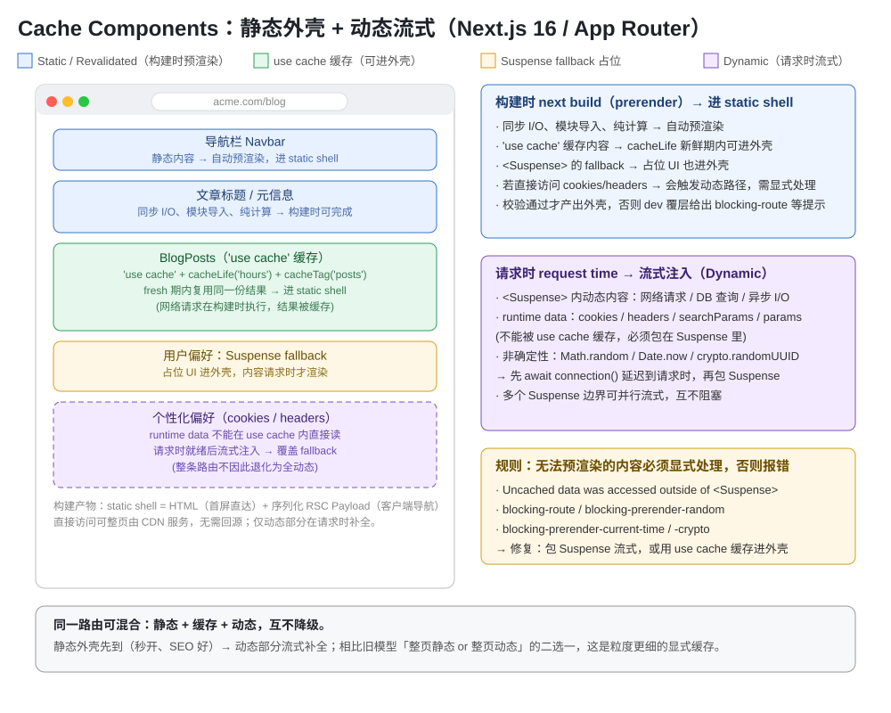

# Next.js 缓存组件（Cache Components）知识点

> App Router（Next.js 16）下的缓存组件体系：**Cache Components + `use cache`** 的概念、开启方式、数据级/UI级/文件级缓存、`cacheLife`/`cacheTag`/`revalidateTag`/`updateTag` 失效语义、三种存储位置，以及与旧版「四层缓存模型」的对照与迁移要点；末尾附避坑速记清单与自测题。

## 版本说明

- **本文以 Next.js 16 为基线**（App Router，React 19）。所有代码均按 16 写法。
- **Cache Components 是 opt-in（显式开启）特性**：在 `next.config.ts` 里设 `cacheComponents: true`（新 `create-next-app` 默认已开）。
- **Next.js 16 的缓存从「隐式」走向「显式」**：旧版 App Router 靠隐式缓存（默认静态化 + fetch 缓存 + `dynamic`/`revalidate` 路由段配置）；16 的 Cache Components 让**所有缓存行为都显式 opt-in**，用 `use cache` 指令声明哪些函数/组件/文件要缓存，不再靠“猜”。
- **PPR 实验配置已移除**，其职责由 Cache Components 接管：Partial Prerendering（部分预渲染）现在是 Cache Components 的**默认渲染行为**。
- 旧版相关 API（`dynamic` / `fetchCache` / `unstable_cache` / `export const revalidate`）仍可用于**未开启 Cache Components** 的项目（官方称 “Previous Model”）。**不启用时怎么缓存，具体写法见 §2.1**；本文主体按启用后的 `use cache` 体系展开，旧 API 作对照与迁移基线，**不是 16 的推荐写法**。

---

## 一、为什么需要 Cache Components（旧模型的痛点）

服务端渲染应用过去被迫在两种选择间做取舍：

- **整页静态（SSG）**：快，但内容会过期。
- **整页动态（SSR）**：新鲜，但每次请求都算、慢、服务端压力大。
- **全搬去客户端（CSR）**：把服务端压力转嫁为更大的 JS 包和更慢的首次渲染。

Cache Components 的目标：**在一条路由里同时混合静态、缓存、动态三类内容**，取各自优点、互不降级——静态外壳秒开，动态部分流式补全。

---

## 二、旧版「四层缓存模型」（对照 / 迁移基线）

在 16 之前（不开 Cache Components 时），App Router 的缓存分散在四层，且多数是隐式的，容易误判“到底哪一层给了你旧数据”：

| 层 | 缓存什么 | 存哪 | 失效方式 |
|---|---|---|---|
| **① Client Router Cache** | 已访问/预取的 RSC payload，按路由段拆分 | 浏览器内存 | 导航 / `router.refresh()` / `updateTag` |
| **② Full Route Cache（服务端整页）** | 构建时或 ISR 生成的整页 HTML | 服务端/CDN | `revalidate`（时间）/ `revalidatePath` / `revalidateTag` |
| **③ Data Cache（数据缓存）** | `fetch` 请求结果（旧默认 `force-cache`） | 服务端持久化 | `next.revalidate` / `next.tags` |
| **④ fetch 之外的函数** | 靠 `unstable_cache` 包一层 | 服务端 | `revalidate` / `tags` 参数 |

**旧模型的问题**：默认隐式缓存（fetch 默认缓存、页面默认静态化），新手常拿到旧数据；要靠 `dynamic`、`fetchCache`、`revalidate` 一堆段配置去“凑”想要的行为，规则繁杂（`only-cache`/`force-no-store` 等交叉约束），且**粒度是“整页”**——要么整页静态要么整页动态。

> **一句话**：旧模型是“框架替你做决定、你靠配置纠偏”；Cache Components 是“你显式声明，编译器自动生成缓存键”。

### 2.1 不启用 Cache Components 时，缓存到底怎么写（Previous Model 具体用法）

> 只开一个开关就切换体系：`cacheComponents: true`（启用 → 用下面第五节的 `use cache`）；**不启用 → 仍用本节写法**。下面三招是“不启用”时的全部缓存手段。

**① `fetch` 请求缓存（v16 默认不缓存，要缓存需显式）**

```tsx
// app/page.tsx
const data = await fetch("https://api.example.com/data", {
  cache: "force-cache",               // 缓存这个请求
  next: { revalidate: 3600 },         // 按时间失效：1 小时
  // next: { tags: ["user"] },        // 按标签失效：配 revalidateTag("user")
});
```

> 注意 v16 变化：**Previous Model 下 `fetch` 默认已改为不缓存**，想缓存必须显式 `cache: 'force-cache'`；与更早版本“fetch 默认缓存”的直觉相反。

**② 非 `fetch` 函数（DB 查询等）→ `unstable_cache`**

```ts
// app/lib/data.ts
import { unstable_cache } from "next/cache";
import { db } from "@/lib/db";

export const getCachedUser = unstable_cache(
  async (id: string) => db.select().from(users).where(eq(users.id, id)).then((r) => r[0]),
  ["user"],            // 缓存键前缀
  { tags: ["user"], revalidate: 3600 }  // 按标签 / 按时间失效
);
```

**③ 路由段配置（整页级开关）**

```tsx
// app/page.tsx
export const dynamic = "force-dynamic";   // 'auto'|'force-dynamic'|'error'|'force-static'
export const revalidate = 3600;           // 0 = 总是动态；false|0|number（秒）
export const fetchCache = "force-cache";  // 高级，覆盖所有 fetch 的默认 cache
```

**一句话对照**：不启用时，你用 `force-cache` / `unstable_cache` / `dynamic` / `revalidate` 去“命令”框架缓存，粒度是**整页或单个 fetch**；启用后，你用 `'use cache'` 声明“这段要缓存”，粒度细到**函数 / 组件 / 文件**，还能在一条路由里混合静态 + 缓存 + 动态。

### 2.2 不启用 Cache Components 时，怎么禁用 / 绕过缓存（7 种写法 + 等价关系）

> 与 §2.1「怎么缓存」相对的另一半：上一节是“命令框架缓存”，这里是把缓存**关掉、让数据每次请求都新鲜**。分 3 类本质手段、共 7 种写法。

**第 1 类：单个 `fetch` 请求级（最小粒度）**

```tsx
// app/page.tsx
const a = await fetch("https://api.example.com/data", { cache: "no-store" }); // ① 不缓存
const b = await fetch("https://api.example.com/data", { next: { revalidate: 0 } }); // ② 立即失效（等价不缓存）
```

**第 2 类：整个路由段级（page / layout / route.ts 导出配置）**

```tsx
// app/page.tsx
export const dynamic = "force-dynamic";       // ③ 强制动态渲染（最常用）
export const revalidate = 0;                  // ④ 该段永远动态
export const fetchCache = "force-no-store";   // ⑤ 强制该段所有 fetch 不缓存（连显式 force-cache 也覆盖）
// export const fetchCache = "only-no-store";     // ⑥ 所有 fetch 默认不缓存，有人用 force-cache 则报错
// export const fetchCache = "default-no-store";  // ⑦ 没设 cache 的默认不缓存，但允许显式 force-cache
```

**关键等价关系（官方明示）**：`dynamic = 'force-dynamic'`（③）等价于同时发生——所有 `fetch` 加 `cache: 'no-store'`、所有 `fetch` 加 `next.revalidate: 0`、段级设 `fetchCache = 'force-no-store'`。所以想“一条命令关到底”，写 `export const dynamic = 'force-dynamic'` 即可，其余大多只是同一效果的更细粒度变体。

**一句话选型**：只想某个请求新鲜 → ①②（`no-store` / `revalidate: 0`）；整页每次现算 → ③（`force-dynamic`）；全段默认不缓存但留个别 `force-cache` 口子 → ⑦（`default-no-store`）；绝对禁止该段任何缓存（写了 `force-cache` 就报错） → ⑥（`only-no-store`）。

---

## 三、Cache Components 是什么（核心机制）

### 3.1 一句话定义

开启后，Next.js 在**构建时**把路由组件树预渲染成一个 **静态 HTML 外壳（static shell）** 立刻发给浏览器；凡是构建时无法完成的内容（网络、DB、runtime data、随机数），要么用 `<Suspense>` 延迟到请求时**流式注入**，要么用 `use cache` **缓存进外壳**。这种“静态外壳 + 动态流式”就是 **Partial Prerendering（PPR）**，即 Cache Components 的默认行为。



- **静态外壳** = 首次直访的完整 HTML + 客户端导航用的序列化 **RSC Payload**。
- 直访可整页由 CDN 服务、**无需回源**；动态部分在就绪后流式补全。
- 好处：**首屏即渲染、SEO 好、秒开**，又保留动态内容的实时性。

### 3.2 开启方式（两步）

```ts
// next.config.ts —— 启用 Cache Components（含 PPR）
import type { NextConfig } from "next";

const nextConfig: NextConfig = {
  cacheComponents: true,
  partialPrefetching: true, // 显式声明；不设会打 warning
};

export default nextConfig;
```

> `partialPrefetching` 需显式设置：Cache Components 首发版不含 Partial Prefetching，官方要求显式声明，仅在迁移旧启用项目时可临时设 `false`。两个选项在下个大版本会变成默认并移除。

---

## 四、构建时哪些内容会自动进静态外壳，哪些必须显式处理

### 4.1 自动预渲染（Predictable values → 自动进外壳）

构建时能确定、且不依赖请求的内容，输出自动并入静态 HTML 外壳：

- **同步 I/O**：`fs.readFileSync`
- **模块导入**：`await import('./constants.json')`
- **纯计算**：`JSON.parse(...).map(...)`
- 同步 API 的嵌入式数据库查询（`better-sqlite3`、`node:sqlite`）

```tsx
// app/page.tsx —— 全部可在构建时完成 → 自动进 static shell
import fs from "node:fs";

export default async function Page() {
  const constants = await import("./constants.json");
  const content = fs.readFileSync("./config.json", "utf-8");
  const items = JSON.parse(content).items ?? [];
  return (
    <div>
      <h1>{constants.appName}</h1>
      <ul>{items.map((it) => <li key={it.id}>{it.value}</li>)}</ul>
    </div>
  );
}
```

> 若某个资源“每个请求都一样且不常变”，官方建议在**模块顶层**读一次（如 `const content = await readFile('./config.json')` 放在模块作用域），而不是放进渲染函数。

### 4.2 动态内容 → 用 `<Suspense>` 延迟到请求时（流式）

网络请求、DB 查询、异步文件读等**构建时无法完成**的内容，预渲染会停在第一个 `fetch` 处。父组件必须用 `<Suspense>` 提供 fallback：

```tsx
// app/page.tsx
import { Suspense } from "react";

async function DynamicContent() {
  const data = await fetch("https://api.example.com/data");
  return <div>{/* ... */}</div>;
}

export default function Page() {
  return (
    <>
      <h1>在 static shell 里</h1>
      {/* <p>Loading...</p> 也进 static shell */}
      <Suspense fallback={<p>Loading...</p>}>
        <DynamicContent />
      </Suspense>
    </>
  );
}
```

- fallback 进外壳，内容在请求时流式注入。
- **Suspense 边界越靠近需要它的组件越好**，让更多内容留在外壳里。
- 多个动态块放不同 Suspense 边界可**并行**流式，互不阻塞。

### 4.3 runtime data（请求上下文）→ 必须包 Suspense，不能被 use cache 缓存

下列 API 依赖“有用户请求时才有”的信息，预渲染时不可用：

- `cookies()`、`headers()`
- `searchParams`（URL query）
- `params`（动态路由参数，除非用 `generateStaticParams` 提供了样例）

```tsx
// app/page.tsx
import { cookies } from "next/headers";
import { Suspense } from "react";

async function UserGreeting() {
  const cookieStore = await cookies();
  const theme = cookieStore.get("theme")?.value || "light";
  return <p>Your theme: {theme}</p>;
}

export default function Page() {
  return (
    <>
      <h1>Dashboard</h1>
      <Suspense fallback={<p>Loading...</p>}>
        <UserGreeting />
      </Suspense>
    </>
  );
}
```

> 读取 `cookies()` **不再像旧模型那样把整条路由拖成全动态**——Suspense 边界提供了 fallback，静态和缓存内容仍随首屏 HTML 发出，只有 runtime 部分流式。若只想延迟到请求时而不读任何 runtime API，用 `connection()`。

### 4.4 非确定性操作 → 先 `await connection()` 再包 Suspense，或 `use cache` 缓存

`Math.random()`、`Date.now()`、`crypto.randomUUID()`、`getRandomValues()` 每次执行结果都不同，构建时不能擅自执行。必须显式声明意图：

```tsx
// app/page.tsx —— 每次请求生成唯一值：延迟到请求时
import { connection } from "next/server";
import { Suspense } from "react";

async function UniqueContent() {
  await connection();                    // 显式延迟到请求时
  const uuid = crypto.randomUUID();
  return <p>Request ID: {uuid}</p>;
}

export default function Page() {
  return (
    <Suspense fallback={<p>Loading...</p>}>
      <UniqueContent />
    </Suspense>
  );
}
```

或者**缓存结果**，让所有用户看到同一个值直到失效：

```tsx
export default async function Page() {
  "use cache";
  const buildId = crypto.randomUUID();   // 所有用户共用，直到 revalidate
  return <p>Build ID: {buildId}</p>;
}
```

> `performance.now()` 专用于遥测，Next.js 不把它当需要保护的“值”，别拿它渲染 UI。
> dev 覆层会按调用给出 `blocking-prerender-random` / `blocking-prerender-current-time` / `blocking-prerender-crypto` 提示及对应修复。

### 4.5 速查表：到底哪些组件需要包 `<Suspense>`（汇总）

> 一句话规则：**只有“构建时完成不了、又没被 `use cache` 缓存”的组件才必须包 `<Suspense>`**。§4.1–4.4 的集中对照：

| 组件情况 | 要包 `<Suspense>` 吗 | 归属 / 处理 |
|---|---|---|
| 纯静态（同步 I/O、模块导入、纯计算） | ❌ 不用 | 构建时自动预渲染，进 static shell |
| 打了 `'use cache'`（数据级 / UI级 / 文件级） | ❌ 不用 | 缓存进 static shell |
| 客户端组件（`'use client'`） | ❌ 不用 | 本来就在浏览器端跑 |
| 动态内容（网络 / DB / 异步文件读） | ✅ 要 | 包 Suspense，请求时流式注入 |
| runtime data（cookies / headers / searchParams / params） | ✅ 要 | 包 Suspense，请求时流式注入 |
| 非确定性（Math.random / Date.now / crypto.randomUUID） | ✅ 要 | 先 `await connection()` 再包 Suspense |

**两个误区再强调**：
- `<Suspense>` **不会把组件“变动态”**——只做同步工作的组件即使被包着也在构建时完成；它只是提供 fallback 并允许异步工作流式。
- `use cache` 和 `<Suspense>` 是**两条并行路**：动态内容要么包 Suspense 流式、要么 `use cache` 缓存进外壳，二选一即可，不是“谁包谁”。

---

## 五、`use cache` 指令（核心）

`use cache` 让一个**异步**的路由 / React 组件 / 函数可缓存。可放在文件顶部（该文件所有导出都被缓存），也可内联在函数/组件体顶部。

### 5.1 三个作用层级

```tsx
// ① 数据级：缓存一个取数/计算函数
// app/lib/data.ts
import { cacheLife } from "next/cache";

export async function getUsers() {
  "use cache";
  cacheLife("hours");
  return db.query("SELECT * FROM users");
}
```

```tsx
// ② UI 级：缓存整个组件/页面/布局
// app/page.tsx
import { cacheLife } from "next/cache";

export default async function Page() {
  "use cache";
  cacheLife("hours");
  const users = await db.query("SELECT * FROM users");
  return (
    <ul>{users.map((u) => <li key={u.id}>{u.name}</li>)}</ul>
  );
}
```

```tsx
// ③ 文件级：文件顶部写一次，覆盖所有导出（每个导出必须 async）
// app/lib/reports.ts
"use cache";

export async function getMonthlyTotals(accountId: string) {
  return db.orders.aggregate({ where: { accountId }, _sum: { amount: true } });
}

export async function getTopProducts() {
  return db.products.findMany({ orderBy: { sales: "desc" }, take: 10 });
}
```

### 5.2 cache key 由编译器自动生成

一个缓存条目的键由输入序列化得到，包含：

1. **Build ID**（每次构建不同；配置了 `deploymentId` 则用它）
2. **Function ID**（函数在代码中位置与签名的安全哈希）
3. **可序列化参数**（组件的 props 或函数实参）
4. **HMR 刷新哈希**（仅开发）

**闭包捕获的变量也会自动成为 cache key 的一部分**——不同输入产生不同条目，天然支持个性化/参数化缓存：

```ts
// lib/data.ts —— userId（闭包）与 filter（实参）都进 cache key
async function getForUser({ userId }: { userId: string }) {
  const getData = async (filter: string) => {
    "use cache";
    const res = await fetch(
      `https://api.example.com/users/${userId}/data?filter=${filter}`
    );
    return res.json();
  };
  return getData("active");
}
```

### 5.3 序列化约束

- **实参**用 Server Component 序列化（更严格），**返回值**用 Client Component 序列化。
- **支持**：基础类型、普通对象、数组、Date/Map/Set/TypedArray/ArrayBuffer；返回值额外支持 JSX。
- **不支持**：class 实例、函数（除非作为 pass-through）、Symbol/WeakMap/WeakSet、URL 实例。
- **pass-through**：非序列化值（如 `children`、Server Action）可以接收、不能读取/调用，原样透传即可组合缓存组件。

```tsx
// 合法：透传 children，不读取 → 缓存键不受影响
async function CachedWrapper({ children }: { children: ReactNode }) {
  "use cache";
  return <div className="wrapper">{children}</div>;
}
```

### 5.4 约束：运行时 API 不可在缓存作用域内访问

`use cache` 函数**不能**直接读 `cookies()` / `headers()` / `searchParams`，且限制**跟随调用栈**——它调用的辅助函数若读了这些，同样报 `next-request-in-use-cache` 错。**正确姿势：在缓存作用域外读出值，作为参数传进缓存函数**：

```tsx
// app/profile/page.tsx
import { cookies } from "next/headers";
import { Suspense } from "react";

export default function Page() {
  return (
    <Suspense fallback={<div>Loading...</div>}>
      <ProfileContent />
    </Suspense>
  );
}

// 组件（未缓存）读 runtime data
async function ProfileContent() {
  const session = (await cookies()).get("session")?.value;
  return <CachedContent sessionId={session} />;
}

// 缓存组件接收提取出的值作为 prop → sessionId 进 cache key
async function CachedContent({ sessionId }: { sessionId: string }) {
  "use cache";
  const data = await fetchUserData(sessionId);
  return <div>{data}</div>;
}
```

---

## 六、生命周期与失效（cacheLife / cacheTag / updateTag / revalidateTag）

两种失效方式可组合：**按时间（time-based）** 用 `cacheLife`，**按需（on-demand）** 用 `cacheTag` + `revalidateTag` / `updateTag`。

### 6.1 按时间：`cacheLife`

官方**建议每个 `use cache` 都配一个 `cacheLife`**。不写则套用 `default` profile：

| profile | stale（客户端） | revalidate（服务端） | expire |
|---|---|---|---|
| `default`（隐式） | 5 分钟 | 15 分钟 | 永不过期（按时间） |
| `hours` / `max` 等 | 内置 profile 自行定义 | — | — |

```ts
// lib/data.ts
import { cacheLife } from "next/cache";

async function getData() {
  "use cache";
  cacheLife("hours"); // 显式声明 1 小时（内置 profile）
  const res = await fetch("https://api.example.com/data");
  return res.json();
}
```

### 6.2 按需：`cacheTag` + `updateTag` / `revalidateTag`

先在缓存作用域里打上 `cacheTag`，变更数据后失效该 tag 下的所有缓存：

```ts
// lib/data.ts
import { cacheTag } from "next/cache";

async function getProducts() {
  "use cache";
  cacheTag("products");
  const res = await fetch("https://api.example.com/products");
  return res.json();
}
```

```ts
// app/actions.ts —— 数据变更后失效
"use server";
import { updateTag } from "next/cache";

export async function updateProduct() {
  await db.products.update(/* ... */);
  updateTag("products"); // 使所有 'products' 缓存失效
}
```

**v16 变更（迁移必看）**：`revalidateTag(tag, cacheLife)` 现在**需要第二个 `cacheLife` profile 参数**才能启用 stale-while-revalidate（SWR）行为：

```ts
import { revalidateTag } from "next/cache";

export async function updateUser(id: string) {
  // 变更数据后
  revalidateTag("user", "max"); // 第二参数：cacheLife profile（启用 SWR）
}
```

### 6.3 `revalidatePath`

按路径失效该路由的缓存数据（只能在 Server Function / Route Handler 里调用，不能用于 Client Component 或 proxy）：

```ts
import { revalidatePath } from "next/cache";

export async function updateUser(id: string) {
  // 变更数据后
  revalidatePath("/profile");
}
```

> 优先级建议：**`updateTag`（“读你写”即时失效）在 Server Actions 场景是更顺手的 v16 API**；`revalidateTag` 需补 cacheLife 参数，`revalidatePath` 粒度较粗（按路径）。一般规则：文章编辑用长 `cacheLife` + `cacheTag` 按需失效；列表类用短 profile 按时间自刷新。

---

## 七、缓存放哪里（三种存储位置）

一个缓存函数/组件的输出被序列化成 **RSC payload**，再被渲染成 HTML 存到不同位置，`cacheLife` 决定各副本的新鲜时长：

| 位置 | 说明 | 适用 |
|---|---|---|
| **① Prerendered HTML** | 构建时生成的 static shell / ISR 升级后的具体页，存磁盘或平台持久存储、放 CDN 后 | 直访秒开、无需回源 |
| **② Shared store（服务端共享）** | 默认**每实例内存 LRU**；serverless 下常不跨请求复用 | 复用频繁、命中率高的数据 |
| **③ Browser（浏览器）** | 随客户端导航/预取的 RSC 里带过去，`stale` 时间内保持新鲜 | 客户端导航复用 |

- **serverless**：默认内存缓存条目通常不跨请求存在（每次请求可能不同实例），**构建时缓存正常**。
- **自托管（self-hosted）**：内存条目跨请求持久；用 `cacheMaxMemorySize` 控制大小。
- 需要**跨实例共享 / 持久化** → `'use cache: remote'`（配 Redis/KV 等 cache handler；有网络往返与平台费用，只在**高命中率**时划算）。
- 需要**给读 runtime data 的函数一个生命周期**、且只能放在浏览器 → `'use cache: private'`（见下）。

### 7.1 两个变体：`'use cache: private'` 与 `'use cache: remote'`

| 指令 | 语义 | 存哪 | 典型用途 |
|---|---|---|---|
| `use cache` | 常规缓存（不能读 runtime API） | 服务端内存 / HTML / 浏览器 | 大多数数据与 UI |
| `'use cache: private'` | 允许直接读 cookies/headers/searchParams 并给生命周期 | **仅浏览器**（客户端缓存） | 个性化但无法重构传参的合规场景 |
| `'use cache: remote'` | 结果存**远程共享缓存**（cache handler） | 跨实例共享 | 高命中率、需要持久/共享 |

```ts
// lib/data.ts —— 读取 runtime data 但想给生命周期 → 只能在浏览器端缓存
async function getPrivatePrefs() {
  "use cache: private";
  const theme = (await cookies()).get("theme")?.value;
  return { theme };
}
```

> 优先还是**提取 runtime 值 → 作为参数传给 `use cache` 函数**（可进服务端共享缓存与 prefetch）；`use cache: private` 只在“合规要求 / 实在无法重构”时才用。

### 7.2 几个全局注意点

- **部署即清空**：所有缓存都绑定 Build ID，`use cache` 条目（含 remote）**跨部署不保留**；要跨部署持久用 `unstable_cache`（非 fetch 函数）或 fetch 缓存。
- **客户端最低 stale 30 秒**：客户端 router 强制最少 30 秒 stale 时间，无论你配多短。
- `x-nextjs-stale-time` 响应头把缓存生命周期从服务端告知客户端。
- **Draft Mode** 开启时，所有缓存函数每次请求都重执行、结果不落缓存，保证草稿始终新鲜。

---

## 八、与旧模型对照 & 迁移要点

| 维度 | 旧模型（Previous Model） | Cache Components（16） |
|---|---|---|
| 默认取数 | fetch 默认缓存、页面默认静态化（隐式） | **动态为默认**，你显式 `use cache` 选缓存 |
| 缓存粒度 | **整页**（静态 or 动态二选一） | **函数 / 组件 / 文件**粒度，可混合 |
| 声明方式 | `dynamic` / `fetchCache` / `export const revalidate` | `'use cache'` 指令 + `cacheLife` |
| 非 fetch 函数缓存 | `unstable_cache(id, tags, { revalidate })` | `'use cache'` + `cacheLife` / `cacheTag` |
| PPR | 实验配置（已移除） | Cache Components 默认行为 |
| 失效 | `revalidatePath` / `revalidateTag(tag)` | + `updateTag`；`revalidateTag(tag, cacheLife)` 需第二参数 |
| 读取 cookies | 触发整路由动态化 | 不再拖累整路由，Suspense 局部流式 |

**迁移提示**（官方 Upgrade 指南相关）：
- `dynamic = 'force-dynamic'` → 大多可去掉，Cache Components 下不缓存即动态；但真正的“每次请求现算”仍可用 `dynamic = 'force-dynamic'` 强制。
- `dynamic = 'force-static'` / `export const revalidate` / `fetchCache` → 这些段配置只在未开启 Cache Components 时生效；开启后改由 `use cache` 表达。
- 数据级缓存优先用 `use cache` 替代 `unstable_cache`；`unstable_cache` 仍保留用于**跨部署持久**等极少数场景。

---

## 九、避坑速记清单

1. **Cache Components 是 opt-in**——不加 `cacheComponents: true`，`use cache` 不生效，你还在旧模型。
2. **`use cache` 只接受 async 函数/组件**——同步函数加了会报错。
3. **缓存作用域内不能读 cookies/headers/searchParams**（报 `next-request-in-use-cache`），且限制跟调用栈走；把值在外部读出后**作为参数传进来**。
4. **构建时无法完成的内容必须显式处理**——不包 `<Suspense>` 也不标 `use cache`，构建/dev 报 `Uncached data was accessed outside of <Suspense>` 或 `blocking-route` 提示。
5. **随机数/时间戳不会自动“每次新”**——要每请求唯一，先 `await connection()` 再包 Suspense；要所有用户共用则 `use cache`。
6. **闭包捕获的变量是 cache key 的一部分**——改了个性化变量自然得到新条目，别自己拼 key。
7. **实参和返回值用不同序列化器**——能返回 JSX，但通常不能把 JSX 当实参接收（除 pass-through）。
8. **`revalidateTag` 在 16 要第二个 cacheLife 参数**（SWR）；Server Actions 场景更顺手的是 `updateTag`。
9. **serverless 下内存缓存不跨请求**——别指望默认内存缓存替你扛高流量；要高命中率共享用 `'use cache: remote'`。
10. **部署即清空**——`use cache` 条目绑定 Build ID，跨部署不保留；跨部署持久用 `unstable_cache` / fetch 缓存。
11. **静态导出（Static Export）不支持 Cache Components**（平台支持表里 `output: 'export'` 为 No）。
12. **Suspense 本身不会把组件“变动态”**——只做同步工作的组件即使被 Suspense 包着也在构建时完成；它只给异步工作提供 fallback 并允许流式。
13. **别把动态 Promise 传进 `use cache`**（作为 props 或存进共享 Map）——构建会卡 50 秒超时报 “Filling a cache during prerender timed out”；先 await 成值再传。
14. **查看构建产物**确认哪些路由/内容进了静态外壳；dev 覆层的 `blocking-*` 提示直接给修复方向，按提示改即可。

---

## 十、自测题

**Q1**：想在同一页上：导航栏静态、文章列表 1 小时刷新一次、用户偏好每次请求个性化。分别该怎么做？

<details><summary>答案</summary>导航栏：同步/纯计算内容，构建时自动预渲染进 static shell；文章列表：包在 `'use cache'` + `cacheLife('hours')` 里（可加 `cacheTag('posts')`）；用户偏好：读 cookies 的组件用 `<Suspense>` 包住，fallback 进外壳、内容请求时流式注入。</details>

**Q2**：`use cache` 的缓存键由哪些部分组成？为什么闭包捕获的变量也算？

<details><summary>答案</summary>Build ID（或 deploymentId）+ Function ID（位置与签名的哈希）+ 可序列化参数（props/实参）+ HMR 哈希（仅开发）。闭包捕获的变量会被编译器当作隐式实参自动纳入键，所以不同输入自动分条目，支持个性化而不需手拼 key。</details>

**Q3**：为什么在 `use cache` 里直接读 `cookies()` 会报错？正确做法是什么？

<details><summary>答案</summary>缓存函数在隔离环境执行，runtime data 依赖请求上下文、无法安全缓存，调用栈内任何一处访问都报 `next-request-in-use-cache`。正确做法：在缓存作用域外（如未缓存组件里）读出 cookie 值，作为参数传给 `use cache` 函数，它便进入缓存键。</details>

**Q4**：`Math.random()` 想“每次请求不同”和“所有用户相同直到失效”，分别怎么写？

<details><summary>答案</summary>每请求不同：先 `await connection()` 延迟到请求时，再包 `<Suspense>`；所有用户相同：放进 `'use cache'` 作用域（缓存结果，直到 revalidate）。</details>

**Q5**：`revalidateTag('posts')` 在 16 里哪里变了？

<details><summary>答案</summary>16 起需要第二个 `cacheLife` profile 参数 `revalidateTag('posts', 'max')` 才启用 stale-while-revalidate（SWR）；Server Actions 场景更推荐用 `updateTag('posts')` 做“读你写”即时失效。</details>

**Q6**：serverless 环境下，`use cache` 的内存缓存为什么不总能复用？怎么办？

<details><summary>答案</summary>serverless 每次请求可能是不同实例，默认内存 LRU 缓存条目不跨请求/不跨 revalidate 存在，只有构建时缓存可靠。要跨实例共享且高命中率，用 `'use cache: remote'`（配 Redis/KV 等 cache handler），但它有网络往返与平台费用。</details>

---

## 参考来源

- Next.js 官方《Cache Components（Getting Started）》（`nextjs.org/docs/app/getting-started/cache-components`，2026-03 更新；PPR 为默认行为、runtime data、`use cache`、迁移路由段配置）
- Next.js 官方《Caching（Getting Started）》（`nextjs.org/docs/app/getting-started/caching`，2026-10 更新；开启方式、数据级/UI级缓存、Suspense 流式、随机值、三种存储位置、ISR、预取）
- Next.js 官方 `use cache` 指令参考（`nextjs.org/docs/app/api-reference/directives/use-cache`；cache key、序列化约束、runtime 限制、Draft Mode、运行时缓存）
- Next.js 官方《Caching and Revalidating (Previous Model)》（`nextjs.org/docs/app/guides/caching-without-cache-components`；旧四层缓存、`dynamic`/`fetchCache`/`revalidate`/`unstable_cache` 对照）
- Next.js 官方 `cacheComponents` 配置参考（`nextjs.org/docs/app/api-reference/config/next-config-js/cacheComponents`）
- Next.js 官方 v16 发布公告《Next.js 16》（`nextjs.org/blog/next-16`；Cache Components 显式缓存、`revalidateTag` 需 cacheLife 第二参数）
