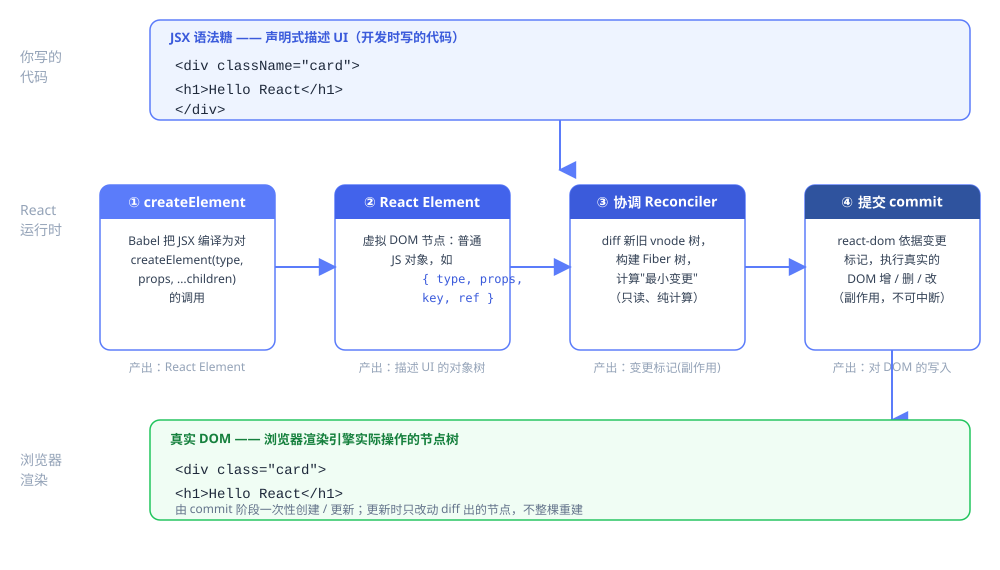
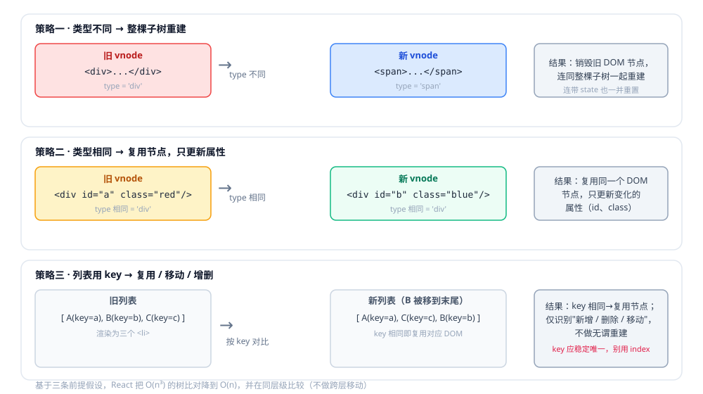
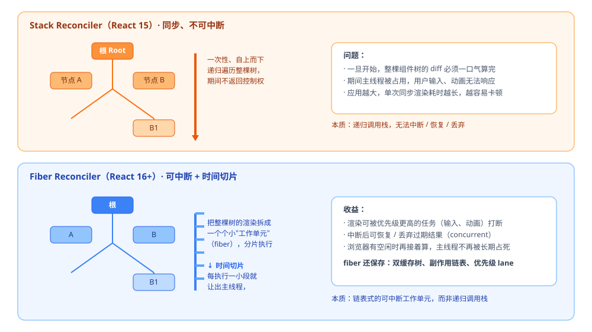

# React 虚拟 DOM 笔记

> 前端技术笔记 · React 目录
> 适用范围：React 16+（Fiber / Concurrent），当前主流版本（18 / 19）。

---

## 1. 什么是虚拟 DOM

**虚拟 DOM（Virtual DOM，简称 vdom）不是"真实 DOM 的一份内存拷贝"，而是一棵用普通 JavaScript 对象描述 UI 结构的树。**

在 React 里，虚拟 DOM 的具体形态就是 **React Element 树**。它只描述"这一层应该长成什么样"（元素类型、属性、子节点），并不包含浏览器 DOM 的真实实例、布局、渲染等一切运行时细节。

一个 React Element（vnode 节点）大致长这样：

```js
{
  $$typeof: Symbol.for('react.element'), // 标记这是 React 元素，防 XSS 注入
  type: 'div',                            // 原生标签字符串 / 函数组件 / 类组件
  key: null,                              // 列表 diff 用
  ref: null,
  props: {
    className: 'card',
    children: [ /* 子元素 */ ]
  },
  _owner: null,
  _store: {}
}
```

关键点：

- 虚拟 DOM **只声明"要什么"**，不关心"怎么操作 DOM"。真实 DOM 的操作由 React 在 commit 阶段统一完成。
- 它和真实 DOM 不是一一对应的镜像，而是**按需生成的最小描述**：只有需要渲染的节点才会进到树里。
- 因为只是普通 JS 对象，虚拟 DOM 可以脱离浏览器存在，这正是**跨平台**的基础。

---

## 2. 为什么需要虚拟 DOM

| 痛点 | 说明 |
| --- | --- |
| 直接操作 DOM 昂贵 | 每次增删改都可能触发浏览器的**重排（reflow）与重绘（repaint）**，复杂页面频繁操作会让渲染线程长期忙碌，导致卡顿、掉帧。 |
| 命令式繁琐 | `document.getElementById(...)` 一步步改属性、插节点，代码难维护、易出错。 |
| 声明式编程模型 | 开发者只声明"当前状态对应的 UI"，React 负责算出并同步差异，可维护性大幅提升。 |
| 跨平台 | vdom 作为中间层，同一套组件可以渲染到浏览器 DOM、React Native、Canvas、服务端字符串（SSR）等不同"宿主"。 |

> 注意：**虚拟 DOM 的出现不是为了"必然更快"，而是为了"更好的编程模型 + 可维护性 + 跨平台"**，性能只是其中一部分收益（详见第 7 节误区）。

---

## 3. 从 JSX 到虚拟 DOM

JSX 是语法糖，运行时会被 Babel/编译器转换为对 `React.createElement` 的调用，后者返回 React Element（也就是 vnode）：

```jsx
// 你写的 JSX
const el = <div className="card"><h1>Hello</h1></div>;

// 编译后等价于
const el = React.createElement('div', { className: 'card' },
  React.createElement('h1', null, 'Hello')
);

// el 就是虚拟 DOM 节点（一个普通对象）
```

所以 **"写 JSX = 描述一棵虚拟 DOM 树"**，组件渲染函数（`render` / 函数组件本体）执行一次，就产出一棵新的 vnode 树，用于和上一棵比较。

---

## 4. 渲染管线：挂载与更新

React 的渲染分成两个阶段：

- **Render 阶段（协调 Reconciliation）**：从根出发，diff 新旧 vnode 树，构建 Fiber 树，算出"最小变更集"。**纯计算、无副作用、可中断**。
- **Commit 阶段（提交）**：依据变更标记真正调用 DOM API（`appendChild`、`removeChild`、改属性等）。**有副作用、不可中断**（必须一次性做完）。

```
JSX 源码 ──编译──▶ createElement ──返回──▶ React Element 树(vdom) ──render──▶ diff / Fiber 树 ──commit──▶ 真实 DOM
```



- **初次挂载**：`createRoot(domNode).render(<App />)` → render 阶段构建整棵 Fiber 树 → commit 阶段一次性创建全部真实 DOM 节点并挂载。
- **更新**：`setState` / 新 props 触发重渲染 → 生成新 vnode 树 → 与 old fiber 对应节点 diff → 只对变化的部分打标记 → commit 阶段应用到 DOM。

> 批量更新：React 会在一个事件循环内把多次 `setState` 合并成一次渲染（batching），进一步减少对真实 DOM 的写入次数。

---

## 5. 协调与 diff 算法

diff 的目的是**以最小代价复用已有的真实 DOM 节点**。朴素的树比对是 O(n³)，React 通过三条前提假设把它降到 **O(n)**：

1. **只做同层比较**，不做跨层移动（跨层的"移动"会被当成"删除 + 新增"）。
2. **元素类型不同 → 整棵子树重建**（连 DOM 和 state 一起重置）。
3. **列表用 `key` 帮助识别**可复用的节点。

三种典型处理：



```
旧: <div>...</div>      新: <span>...</span>     type 不同 → 销毁重建整棵子树
旧: <div id="a"/>       新: <div id="b"/>        type 相同 → 复用节点，只更新变化的 props
旧: [A(key=a),B(b),C(c)] 新: [A(a),C(c),B(b)]    key 相同 → 复用节点，识别移动/增删
```

### key 的正确用法

- **要稳定且唯一**：业务 id、唯一字段是最佳选择。
- **不要用数组 index 当 key**：当列表在头部插入或删除时，index 会整体错位，导致 React 复用错误的 DOM 节点，出现**状态错乱**（输入框内容、勾选状态串到别的行）。
- key 只在**兄弟节点之间**需要唯一，不必全局唯一。

```jsx
// 推荐
{items.map(item => <li key={item.id}>{item.name}</li>)}
// 不推荐（易错位）
{items.map((item, i) => <li key={i}>{item.name}</li>)}
```

---

## 6. 为什么还需要 Fiber：从 Stack 到并发渲染

虚拟 DOM 的 diff 本身只是"结构比较"，真正决定"能不能中断"的是承载 diff 的调度架构。

- **React 15（Stack Reconciler）**：用递归调用栈一次性、同步地遍历整棵组件树，期间主线程被占死，无法响应输入和动画。应用越大，卡顿越明显。
- **React 16+（Fiber Reconciler）**：把整棵树的渲染拆成一个个**可中断的工作单元（fiber）**，配合**时间切片（time slicing）**，每执行一小段就让出主线程；配合优先级（lane），高优先级任务可打断低优先级任务，这就是 **Concurrent（并发）特性**的基础。



> 一句话区分：**虚拟 DOM 描述"要渲染成什么样"，Fiber 决定"怎么安排这些渲染、能不能中断"**。两者不是一回事，Fiber 是更底层的调度结构。

---

## 7. 常见误区与取舍

| 误区 | 事实 |
| --- | --- |
| "虚拟 DOM 一定比直接操作 DOM 快" | 不必然。创建对象、diff 都有开销；**小场景或极简更新时，手写原生 DOM 操作反而更快**。虚拟 DOM 的价值更多在编程模型、可维护性、跨平台与批量更新。 |
| "虚拟 DOM = 不碰真实 DOM" | 不是。最终仍要写真实 DOM，只是**由 React 统一、最小化地写**。 |
| "每次渲染都重建整棵真实 DOM" | 不是。commit 阶段只改 diff 出的节点，其余复用。 |
| "key 只是性能优化" | 不止。key 用错（如 index）会导致**状态错位**这类正确性问题。 |

**真正的收益点**：在**频繁、大面积、结构复杂的更新**场景下，虚拟 DOM + diff + 批量更新能显著减少对真实 DOM 的高成本写入；同时声明式写法让复杂 UI 更易维护。

---

## 参考

- React 官方文档：Reconciliation（协调）、createElement、Fiber 架构（react.dev）
- 配图：`img/vdom-render-pipeline.svg`、`img/diff-strategy.svg`、`img/fiber-vs-stack.svg`
