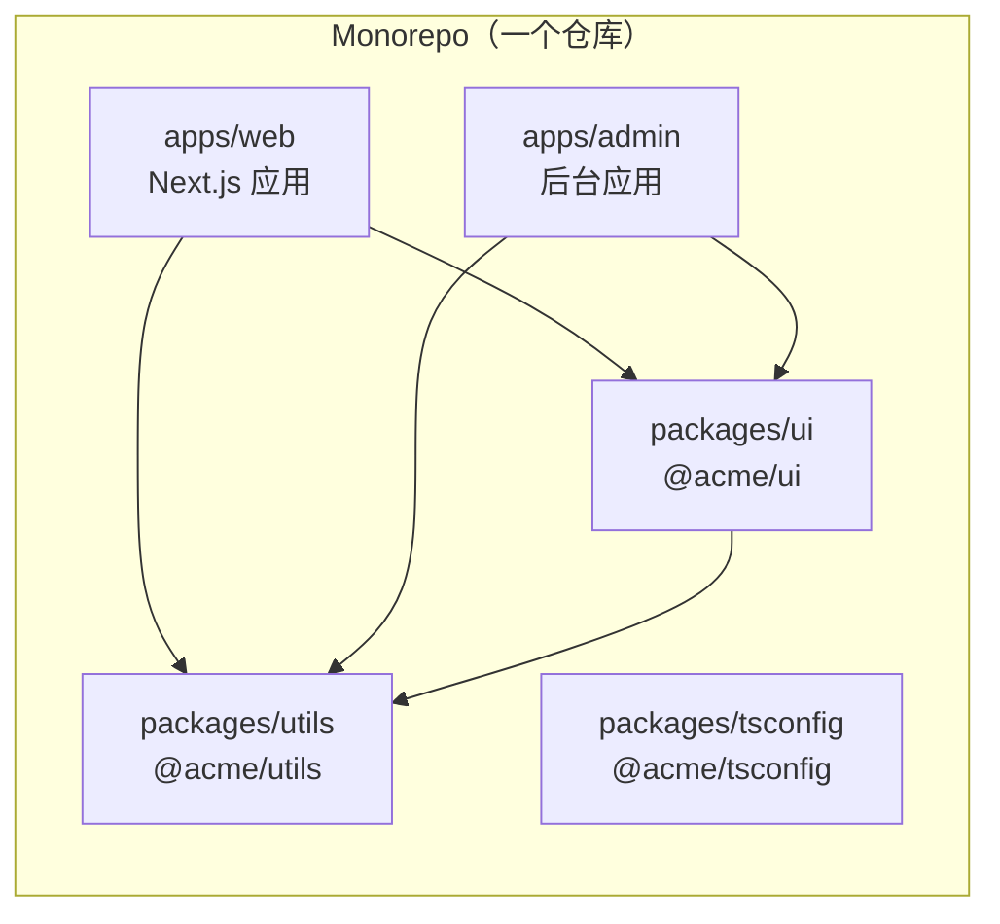

# Monorepo

## 一句话定义

**Monorepo（Monolithic Repository）= 一个 Git 仓库里管理多个 package（包）**，这些包各自有独立的 `package.json`、独立的版本号、可以独立发布到 npm，但共享同一套工具链、CI 配置和代码历史。

它不是"把所有代码堆在一个仓库里"——那叫 **Monolith（巨石应用）**。Monorepo 内部仍然是多包结构，包与包之间边界清晰。

## 目录索引

| 模块 | 笔记 |
|---|---|
| 为什么需要 monorepo | [[1-背景与动机\|1. 背景与动机]] |
| 包管理（workspaces） | [[2-workspaces-包管理\|2. Workspaces 包管理]] |
| 任务编排 | [[3-任务编排\|3. 任务编排（Turborepo / Nx）]] |
| 版本与发布 | [[4-版本与发布\|4. 版本与发布（Changesets）]] |
| 目录结构与工程规范 | [[5-目录结构与工程规范\|5. 目录结构与工程规范]] |
| CI/CD 优化 | [[6-CICD优化\|6. CI/CD 优化]] |
| 常见坑 | [[7-常见坑\|7. 常见坑]] |
| 最小可跑骨架 | [[8-最小可跑骨架\|8. 最小可跑骨架]] |
| 最佳实践（含代码） | [[9-最佳实践\|9. 最佳实践]] |

## 知识点地图

| 模块 | 核心知识点 |
|---|---|
| **包管理 Workspace** | npm / Yarn / pnpm workspaces、`workspace:*` 协议、hoisting 依赖提升、symlink 软链、`.bin` 注册、pnpm catalog、`overrides` / `resolutions` |
| **任务编排** | Turborepo、Nx、Lerna（已并入 Nx）、Rush、Bazel；task graph、local/remote cache、affected 增量、并行、拓扑排序 |
| **版本与发布** | SemVer、Changesets、fixed vs independent、dist-tag（latest/beta/next）、CHANGELOG 自动生成 |
| **目录与规范** | `apps/` + `packages/` + `tools/`、`@scope/pkg-name` 命名、TS project references、共享 tsconfig / eslint-config |
| **CI/CD** | affected、远程缓存（Turbo Remote Cache / Nx Cloud）、并行流水线、缓存 key 设计 |
| **常见坑** | 构建顺序、循环依赖、幻影依赖、peerDeps 防重复打包、缓存失效、仓库瘦身 |

## 工具对比

| 工具 | 定位 | 适用规模 | 备注 |
|---|---|---|---|
| npm workspaces | 包管理 | 小型 | Node 原生内置 |
| Yarn workspaces | 包管理 | 小~中型 | 经典方案 |
| **pnpm workspaces** | 包管理（磁盘高效） | 中~大型 | **当前主流推荐**，硬链接节省磁盘 |
| **Turborepo** | 任务编排 | 中型 | Vercel 出品，Rust 编写，速度快 |
| Nx | 任务编排 + code generator | 大型 | 企业级，依赖图可视化，已收购 Lerna |
| Rush | 微软 monorepo 工具链 | 巨型 | 超大型仓库 |
| Bazel | Google 构建系统 | 巨型 | 远程执行 + 缓存，学习曲线陡 |
| **Changesets** | 版本与发布 | 中大型开源库 | 社区事实标准 |

**现代主流组合：`pnpm workspaces + Turborepo + Changesets`**。

> **原笔记理解**：
> 是以 `package.json` 的 workspaces 管理包的一种工具，会将 workspaces 里的目录在初始化的时候以 `npm link` 的形式注册到 `.bin` 中，在使用时，也是使用 workspaces 目录里的包，而不是 node_modules 里面的包。
>
> 详见 [[2-workspaces-包管理]]。

## FAQ 速答

- **Monorepo 和 Monolith 区别？** Monolith 是一个 package，整个仓库就一个 `package.json`；Monorepo 是多个 package，每个包独立 `package.json`、可独立发版。
- **Monorepo 解决 Multirepo 什么痛点？** 原子提交、版本即时生效、工具链统一、依赖去重、新人单仓上手。详见 [[1-背景与动机]]。
- **pnpm workspaces 比 npm workspaces 好在哪？** 硬链接节省磁盘、严格依赖隔离（杜绝幻影依赖）、`catalog` 统一版本号。
- **Turborepo 的缓存原理？** 根据任务 `inputs` 算 hash，命中就直接用 `outputs` 里的产物，跳过执行。
- **怎么处理跨包原子提交？** Monorepo 下天然就是一次 commit 改所有包；Multirepo 才需要痛点。
- **Changesets 的工作流？** 改代码 → `pnpm changeset` 写变更说明 → PR 合并 main → CI 跑 `changeset version` 升版本+生成 CHANGELOG → `changeset publish` 发 npm。

## 参考

- Turborepo 官方文档：https://turbo.build
- pnpm workspaces：https://pnpm.io/workspaces
- Changesets：https://github.com/changesets/changesets
- Nx：https://nx.dev
