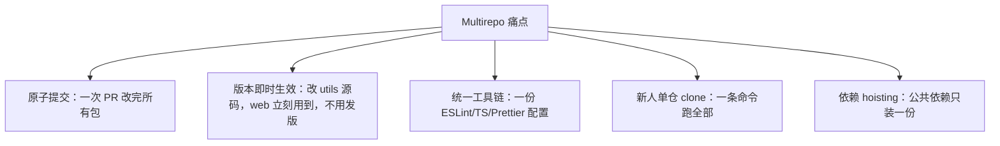

# 1. 为什么需要 Monorepo

## Multirepo 的痛点

假设你团队有 3 个仓库：`acme-utils`、`acme-ui`、`acme-web`。

### 1. 跨包改动无法原子提交

你要给 `utils` 加一个函数，然后在 `ui` 里用它，最后在 `web` 里上线。

Multirepo 下你得：
1. 在 `acme-utils` 发 PR → 合并 → 发版 `v1.3.0`
2. 在 `acme-ui` 升 `@acme/utils@1.3.0` → 发 PR → 合并 → 发版 `v2.1.0`
3. 在 `acme-web` 升 `@acme/ui@2.1.0` → 发 PR → 合并 → 部署

任何一步卡住，整条链路就断了。**你无法在一次提交里同时改三个仓库**，git 历史是割裂的，出问题时 bisect 都没法做。

### 2. 版本同步地狱

`@acme/utils` 发了新版，下游 N 个仓库要逐个升 `package.json`。结果就是：

- A 仓库用 `utils@1.2.0`
- B 仓库用 `utils@1.5.0`
- C 仓库还在用 `utils@1.0.0`

同一个工具库在不同仓库里版本碎片化，bug 修了等于没修。

### 3. 代码重复

每个仓库都自己写一遍 axios 封装、请求拦截器、表单校验、日期格式化……没人统一维护，bug 到处都是。

### 4. 工具链 / CI 重复建设

每个仓库都要配一遍 ESLint、Prettier、TypeScript、Jest、GitHub Actions。配完还漂移——A 仓 ESLint 9，B 仓 ESLint 8，规则还不一样。

### 5. 环境搭建成本

新人入职要 clone N 个仓库、配 N 套 `node_modules`、记 N 套启动命令。

### 6. 依赖重复安装

每个仓库一份 `node_modules`，磁盘和 CI 时间翻倍。`react`、`lodash` 这种公共依赖在 5 个仓库里装 5 份。

## Monorepo 怎么破

## 收益

- **原子提交**：跨包重构一次完成，git 历史连贯
- **统一工具链**：lint / test / format / tsconfig 一份配置
- **内部包零成本引用**：改完 `packages/utils`，`apps/web` 立刻生效，不用等 npm 发版
- **依赖去重**：hoisting 后 `react` 只装一份
- **代码共享**：组件、工具函数天然复用

## 代价（别盲目吹）

- **仓库体积膨胀**：git history 越来越大，binary 资源要单独管
- **CI 必须做增量**：全量跑会慢死，必须配 affected + 远程缓存
- **权限粒度变粗**：一个 PR 能影响所有包，code review 压力变大
- **构建顺序复杂**：`A 依赖 B`，必须先 build B 再 build A
- **循环依赖**：`ui` 引用了 `utils`，`utils` 又 import 了 `ui` 里的类型——会炸
- **幻影依赖（phantom deps）**：代码里用了 `lodash` 但没在自己 `package.json` 里声明，靠 hoisting 侥幸跑通
- **版本策略变复杂**：所有包一起发版（fixed）还是各自发版（independent）？

具体踩坑与解法见 [[7-常见坑]]。

## 典型案例

- **开源**：Babel、React、Vue 3、Angular、Next.js、Nx、Turborepo、Lodash
- **公司**：Google、Meta、Microsoft、Vercel、字节
- **触发场景**：设计系统（core / theme / icons / utils 多包）、全栈 monorepo（前端 + 后端 + 共享类型）、组件库/工具库生态
