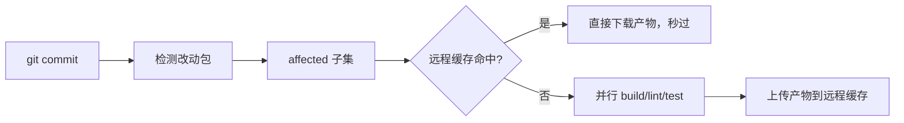

# 6. CI/CD 优化

Monorepo 最大的 CI 痛点：每次 PR 都跑全量 build/test，仓库一大就慢到不可用。

三板斧：**affected + 远程缓存 + 并行流水线**。

## 1. affected（只跑受影响包）

```bash
# 对比 origin/main，找出改动的包 + 它们的下游依赖
turbo run build lint test --filter="...[origin/main]"
```

- `...` = 改动包 + 下游
- `[origin/main]` = 对比基准
- 没改动的包直接跳过（或命中缓存）

Nx 对应命令：`nx affected --targets=build,lint,test --base=main`

## 2. 远程缓存

本地 build 过一次的产物，上传到云端；其他开发者和 CI 直接下载，跳过 build。



### Turborepo Remote Cache

```bash
# 登录 Vercal Remote Cache 或自托管
npx turbo login

# 或在 CI 里配环境变量
# TURBO_TOKEN=xxx
# TURBO_TEAM=xxx
```

### Nx Cloud

Nx 自带托管缓存，免费额度够中小团队用。

### 自托管缓存

Turborepo 支持自定义缓存 server（S3、GCS、自建 HTTP），数据不出公司。

## 3. 并行流水线

把 build / lint / test 拆成独立 job，在 GitHub Actions / GitLab CI 里并行跑：

```yaml
jobs:
  build:
    runs-on: ubuntu-latest
    steps: [pnpm install, turbo run build]
  lint:
    runs-on: ubuntu-latest
    steps: [pnpm install, turbo run lint]
  test:
    runs-on: ubuntu-latest
    steps: [pnpm install, turbo run test]
```

三个 job 并行，总时长 = max(build, lint, test)，而不是三者相加。

## 缓存 key 设计

CI 上 `pnpm install` 本身也要缓存：

```yaml
- uses: pnpm/action-setup@v3
- uses: actions/setup-node@v4
  with:
    node-version: 20
    cache: 'pnpm'        # 自动按 pnpm-lock.yaml 做 key
```

Turbo 的本地缓存也可以在 CI 之间持久化：

```yaml
- uses: actions/cache@v4
  with:
    path: node_modules/.cache/turbo
    key: turbo-${{ github.ref }}-${{ github.sha }}
    restore-keys: |
      turbo-${{ github.ref }}-
      turbo-
```

但更好的做法是直接用远程缓存，本地缓存只在本地开发用。

## CI 流水线示例

完整 GitHub Actions workflow 见 [[9-最佳实践]]。

## 常见 CI 坑

| 坑 | 解法 |
|---|---|
| PR 上 `origin/main` 不存在 | `git fetch origin main` 先拉一下 |
| 缓存命中但产物缺失 | turbo.json 里 `outputs` 要写全 |
| pnpm install 慢 | 用 `pnpm/action-setup` + store 缓存 |
| 每个 job 都 install 一遍 | 用远程缓存后，build job 命中缓存时 install 也很快 |
| changeset 发版 job 失败 | 先 `turbo run build` 成功再 `changeset publish` |
