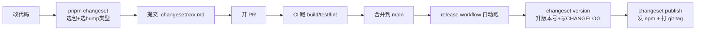

# 9. 最佳实践

生产级 monorepo 的工程规范与代码模板。

## 章节目录

- [内部库 package.json 最佳实践](#内部库-packagejson-最佳实践)
- [共享 tsconfig 最佳实践](#共享-tsconfig-最佳实践)
- [生产级 turbo.json 最佳实践](#生产级-turbojson-最佳实践)
- [共享 ESLint / Prettier 配置](#共享-eslint--prettier-配置)
- [GitHub Actions CI 最佳实践](#github-actions-ci-最佳实践)
- [发布工作流最佳实践](#发布工作流最佳实践)
## 团队协作规范

### 分支策略

- `main` 是保护分支，不能直接 push
- feature 分支命名：`feat/ui-button`、`fix/utils-date`、`chore/upgrade-deps`
- PR 必须带 changeset（除非只改 docs / 内部脚本）

### PR 规范

- 标题用 Conventional Commits：`feat(ui): add Button component`
- PR 描述写清楚：改了什么、为什么、怎么测
- CI 全绿才能合并
- 至少 1 个 approve

### CODEOWNERS

```
# .github/CODEOWNERS
apps/web/        @acme/web-team
apps/admin/      @acme/admin-team
packages/ui/     @acme/design-system
packages/utils/  @acme/core
```

PR 改哪个包，自动 request 对应 owner review。

### 版本策略选择

| 场景 | 策略 |
|---|---|
| 大多数 monorepo（包之间相对独立） | **independent**（默认） |
| 真正同步演进的套件（如 Next.js 全家桶、React 核心包） | **fixed** |
| 应用类包（apps/web） | `ignore`，不发 npm |

### 何时该拆包、何时不该拆

**该拆**：
- 两个模块被多个 app 共用
- 一个模块有独立发版需求
- 一个模块有独立测试/维护边界

**不该拆**：
- 只在一个 app 里用 → 放 app 内部
- 高频耦合、拆了之后包之间要来回改 → 先合着
- 为了"架构好看"硬拆 → 过度设计

### 依赖管理原则

- 每个包显式声明自己用到的依赖（杜绝幻影依赖）
- 框架级依赖（react、vue）放 `peerDependencies`
- 工具链依赖（typescript、eslint、tsup）放 `devDependencies`
- 公共版本用 pnpm `catalog` 统一
- 升级依赖用 `pnpm up --latest -r`，一次升全仓


---

## 内部库 package.json 最佳实践

一个生产级内部库的 `package.json` 完整模板。

## 完整模板

```jsonc
{
  "name": "@acme/ui",
  "version": "0.1.0",
  "description": "Acme design system UI components",
  "license": "MIT",
  "author": "Acme Team",
  "repository": {
    "type": "git",
    "url": "https://github.com/acme/monorepo.git",
    "directory": "packages/ui"
  },
  "type": "module",

  // ===== 入口字段 =====
  "main": "./dist/index.cjs",
  "module": "./dist/index.js",
  "types": "./dist/index.d.ts",
  "exports": {
    ".": {
      "types": "./dist/index.d.ts",
      "import": "./dist/index.js",
      "require": "./dist/index.cjs"
    },
    "./styles.css": "./dist/styles.css",
    "./themes/*": "./dist/themes/*.css"
  },

  // ===== 发布到 npm 的文件 =====
  "files": [
    "dist",
    "styles.css",
    "themes"
  ],
  "sideEffects": [
    "*.css"
  ],

  // ===== 脚本 =====
  "scripts": {
    "build": "tsup",
    "dev": "tsup --watch",
    "test": "vitest run",
    "test:watch": "vitest",
    "lint": "eslint src",
    "typecheck": "tsc --noEmit"
  },

  // ===== 运行时 peer 依赖（不打包进 bundle）=====
  "peerDependencies": {
    "react": ">=18.0.0",
    "react-dom": ">=18.0.0"
  },
  "peerDependenciesMeta": {
    "react-dom": {
      "optional": false
    }
  },

  // ===== 运行时依赖 =====
  "dependencies": {
    "@acme/utils": "workspace:*",
    "clsx": "^2.1.0",
    "tailwind-merge": "^2.5.0"
  },

  // ===== 开发依赖 =====
  "devDependencies": {
    "@acme/tsconfig": "workspace:*",
    "@acme/eslint-config": "workspace:*",
    "@types/react": "^18.3.0",
    "@types/react-dom": "^18.3.0",
    "react": "^18.3.0",
    "react-dom": "^18.3.0",
    "tsup": "^8.0.0",
    "typescript": "^5.4.0",
    "vitest": "^1.6.0"
  },

  // ===== 引擎约束 =====
  "engines": {
    "node": ">=18.0.0"
  },

  // ===== 发布标签 =====
  "publishConfig": {
    "access": "public"
  }
}
```

## 字段逐行解释

### `exports`（条件导出）

现代打包器（Vite、Webpack 5、Node 18+）优先读 `exports`，而不是 `main` / `module`。

- `"."` 是主入口，按环境（types/import/require）指向不同文件
- 子路径如 `"./styles.css"` 允许用户 `import '@acme/ui/styles.css'`
- 没有声明的子路径**不能被 import**（防止内部文件泄漏）

### `sideEffects`

告诉打包器：这个文件有副作用，不要 tree-shake 掉。CSS 文件一定是 side effect。

### `files`

`npm publish` 时只上传这些目录，别把 `src/`、`__tests__/`、`.turbo/` 传上去。

### `peerDependencies`

`react` 放这里而不是 `dependencies`——否则每个用 `@acme/ui` 的 app 都会装一份自己的 react，导致 React 实例不唯一，hooks 直接炸。

`devDependencies` 里自己装一份 react，是为了本地跑测试和 storybook。

### `engines`

声明最低 Node 版本，CI 和用户本地不满足时 npm 会警告。

### `publishConfig.access`

`@scope/pkg` 默认是 private，必须显式 `"public"` 才能发到公共 npm。

## tsup 配置（同时打 ESM + CJS）

```ts
// packages/ui/tsup.config.ts
import { defineConfig } from 'tsup'

export default defineConfig({
  entry: ['src/index.ts'],
  format: ['esm', 'cjs'],       // 同时打 ESM 和 CJS
  dts: true,                     // 生成 .d.ts
  sourcemap: true,
  clean: true,
  external: ['react', 'react-dom'],  // peerDeps 不打包
  treeshake: true,
})
```

---

## 共享 tsconfig 最佳实践

把 tsconfig 做成内部包 `@acme/tsconfig`，所有业务包 extends 它，避免每个包重复配置。

## 目录结构

```
packages/tsconfig/
├── package.json
├── base.json          # 通用基底
├── nextjs.json        # Next.js 应用
├── node.json          # Node.js 库 / CLI
└── react-library.json # React 组件库
```

## `packages/tsconfig/package.json`

```jsonc
{
  "name": "@acme/tsconfig",
  "version": "0.1.0",
  "private": true,
  "files": ["base.json", "nextjs.json", "node.json", "react-library.json"]
}
```

## `base.json`

```jsonc
{
  "$schema": "https://json.schemastore.org/tsconfig",
  "compilerOptions": {
    "target": "ES2022",
    "lib": ["ES2022"],
    "module": "ESNext",
    "moduleResolution": "Bundler",

    "strict": true,
    "noUncheckedIndexedAccess": true,
    "noImplicitOverride": true,
    "noFallthroughCasesInSwitch": true,
    "forceConsistentCasingInFileNames": true,

    "esModuleInterop": true,
    "skipLibCheck": true,
    "resolveJsonModule": true,
    "isolatedModules": true,
    "verbatimModuleSyntax": true,

    "declaration": true,
    "declarationMap": true,
    "sourceMap": true,

    "incremental": true
  }
}
```

关键开关：
- `strict: true`：全开严格模式
- `noUncheckedIndexedAccess`：`arr[0]` 返回 `T | undefined`，避免越界
- `verbatimModuleSyntax`：强制 `import type`，配合 ESM 友好
- `skipLibCheck`：跳过 .d.ts 类型检查，提速

## `nextjs.json`

```jsonc
{
  "$schema": "https://json.schemastore.org/tsconfig",
  "extends": "./base.json",
  "compilerOptions": {
    "lib": ["DOM", "DOM.Iterable", "ES2022"],
    "jsx": "preserve",
    "noEmit": true,
    "incremental": true,
    "plugins": [{ "name": "next" }],
    "paths": {
      "@/*": ["./src/*"]
    }
  }
}
```

## `node.json`

```jsonc
{
  "$schema": "https://json.schemastore.org/tsconfig",
  "extends": "./base.json",
  "compilerOptions": {
    "module": "NodeNext",
    "moduleResolution": "NodeNext",
    "types": ["node"],
    "outDir": "dist"
  }
}
```

## `react-library.json`

```jsonc
{
  "$schema": "https://json.schemastore.org/tsconfig",
  "extends": "./base.json",
  "compilerOptions": {
    "lib": ["DOM", "DOM.Iterable", "ES2022"],
    "jsx": "react-jsx",
    "module": "ESNext",
    "moduleResolution": "Bundler",
    "declaration": true,
    "declarationMap": true,
    "outDir": "dist"
  }
}
```

## 业务包怎么用

```jsonc
// apps/web/tsconfig.json（Next.js 应用）
{
  "extends": "@acme/tsconfig/nextjs.json",
  "include": ["next-env.d.ts", "**/*.ts", "**/*.tsx", ".next/types/**/*.ts"],
  "exclude": ["node_modules"]
}
```

```jsonc
// packages/ui/tsconfig.json（React 库）
{
  "extends": "@acme/tsconfig/react-library.json",
  "include": ["src"],
  "exclude": ["node_modules", "dist"]
}
```

```jsonc
// packages/utils/tsconfig.json（Node 工具库）
{
  "extends": "@acme/tsconfig/node.json",
  "include": ["src"],
  "exclude": ["node_modules", "dist"]
}
```

## TypeScript project references（可选，大型仓库用）

包多了之后 `tsc -b` 增量编译：

```jsonc
// packages/ui/tsconfig.json
{
  "extends": "@acme/tsconfig/react-library.json",
  "compilerOptions": {
    "composite": true
  },
  "references": [
    { "path": "../utils" }
  ],
  "include": ["src"]
}
```

根目录 `tsc -b` 自动按引用拓扑顺序编译。

---

## 生产级 turbo.json 最佳实践

## 完整配置

```jsonc
{
  "$schema": "https://turbo.build/schema.json",

  // ===== 全局依赖：任何任务 hash 都包含这些文件 =====
  "globalDependencies": [
    "**/.env.*local",
    ".env",
    "tsconfig.json"
  ],

  // ===== 全局环境变量 =====
  "globalEnv": [
    "NODE_ENV",
    "CI",
    "VERCEL_ENV",
    "TURBO_TOKEN",
    "TURBO_TEAM"
  ],

  "tasks": {
    // ===== build =====
    "build": {
      "dependsOn": ["^build"],
      "outputs": [
        "dist/**",
        ".next/**",
        "!.next/cache/**"
      ],
      "inputs": [
        "src/**",
        "tailwind.config.ts",
        "postcss.config.js",
        "tsconfig.json",
        "package.json"
      ]
    },

    // ===== dev（长驻进程，不缓存）=====
    "dev": {
      "cache": false,
      "persistent": true
    },

    // ===== lint =====
    "lint": {
      "dependsOn": ["^build"],
      "outputs": []
    },

    // ===== typecheck =====
    "typecheck": {
      "dependsOn": ["^build"],
      "outputs": []
    },

    // ===== test =====
    "test": {
      "dependsOn": ["^build"],
      "outputs": ["coverage/**"],
      "env": ["DATABASE_URL"]
    },

    // ===== e2e =====
    "e2e": {
      "dependsOn": ["^build", "build"],
      "outputs": ["playwright-report/**"],
      "cache": false
    }
  }
}
```

## 关键字段解释

### `globalDependencies`

任何任务的 hash 都会把这些文件内容算进去。改了 `.env`，所有任务缓存失效。

### `globalEnv`

任何任务的 hash 都会把这些环境变量的值算进去。改了 `NODE_ENV=production`，缓存失效。

### 任务级 `inputs`

精确声明这个任务依赖哪些文件。没声明的文件改了，不影响缓存 hash——**这是缓存命中率的关键**。

### 任务级 `env`

只让这个任务 hash 这个环境变量。比如 test 依赖 `DATABASE_URL`，但 build 不依赖。

### `outputs`

声明哪些目录是产物，缓存命中时直接还原回来。`!.next/cache/**` 表示排除 `.next/cache`（那是 Next.js 自己的缓存，不需要 Turbo 管）。

### `dependsOn`

- `"^build"`：先把上游依赖包的 build 跑完
- `"build"`：先把本包的 build 跑完
- 数组可以组合：`["^build", "build"]`

### `persistent: true`

告诉 Turbo 这是长驻进程（dev server），不要等它退出，并行起其他任务。

## 常用命令

```bash
## 构建所有包
turbo run build

## 只构建 @acme/web 及其依赖
turbo run build --filter=@acme/web...

## 只构建相对于 main 有改动的包 + 下游
turbo run build --filter="...[origin/main]"

## 强制跳过缓存（调试用）
turbo run build --force

## 看依赖图
turbo run build --graph

## 只跑 lint，不跑 build
turbo run lint --filter=@acme/ui
```

## 远程缓存配置

```bash
## 本地登录 Vercel Remote Cache
npx turbo login

## CI 上配环境变量（不要 commit 到 git）
## TURBO_TOKEN=xxx
## TURBO_TEAM=xxx
```

或在 `turbo.json` 里显式声明：

```jsonc
{
  "remoteCache": {
    "signature": true       // 开启 artifact 签名，防止篡改
  }
}
```

---

## 共享 ESLint / Prettier 配置

把 ESLint 配置做成内部包 `@acme/eslint-config`，所有业务包 extends 它。

## 目录结构

```
packages/eslint-config/
├── package.json
├── index.js           # 基础配置
├── react.js           # React 项目用
├── next.js            # Next.js 项目用
└── prettier.js        # Prettier 共享配置
```

## `package.json`

```jsonc
{
  "name": "@acme/eslint-config",
  "version": "0.1.0",
  "main": "index.js",
  "files": ["index.js", "react.js", "next.js", "prettier.js"],
  "dependencies": {
    "@eslint/js": "^9.0.0",
    "eslint-config-prettier": "^9.1.0",
    "eslint-plugin-import": "^2.29.0",
    "eslint-plugin-react": "^7.34.0",
    "eslint-plugin-react-hooks": "^4.6.0",
    "eslint-plugin-unused-imports": "^4.0.0",
    "typescript-eslint": "^8.0.0"
  },
  "peerDependencies": {
    "eslint": "^9.0.0",
    "prettier": "^3.0.0"
  }
}
```

## `index.js`（基础配置）

```js
// packages/eslint-config/index.js
const js = require('@eslint/js')
const tseslint = require('typescript-eslint')
const importPlugin = require('eslint-plugin-import')
const unusedImports = require('eslint-plugin-unused-imports')
const prettier = require('eslint-config-prettier')

module.exports = tseslint.config(
  js.configs.recommended,
  ...tseslint.configs.recommended,
  {
    plugins: {
      import: importPlugin,
      'unused-imports': unusedImports,
    },
    rules: {
      // import 排序
      'import/order': [
        'error',
        {
          groups: ['builtin', 'external', 'internal', ['parent', 'sibling'], 'index', 'type'],
          'newlines-between': 'always',
          alphabetize: { order: 'asc' },
        },
      ],
      // 自动删未使用 import
      'unused-imports/no-unused-imports': 'error',
      '@typescript-eslint/no-unused-vars': [
        'warn',
        { argsIgnorePattern: '^_' },
      ],
    },
  },
  prettier,   // 放最后，关掉和 prettier 冲突的规则
)
```

## `react.js`

```js
// packages/eslint-config/react.js
const base = require('./index.js')
const react = require('eslint-plugin-react')
const reactHooks = require('eslint-plugin-react-hooks')

module.exports = [
  ...base,
  {
    plugins: {
      react,
      'react-hooks': reactHooks,
    },
    settings: {
      react: { version: 'detect' },
    },
    rules: {
      ...react.configs.recommended.rules,
      ...reactHooks.configs.recommended.rules,
      'react/react-in-jsx-scope': 'off',   // Next.js / React 17+ 不用
      'react/prop-types': 'off',           // 用 TS 就够了
    },
  },
]
```

## 业务包怎么用

```jsonc
// packages/ui/package.json
{
  "eslintConfig": {
    "extends": "./node_modules/@acme/eslint-config/react.js"
  },
  "devDependencies": {
    "@acme/eslint-config": "workspace:*"
  }
}
```

或在包根目录建 `eslint.config.js`：

```js
// packages/ui/eslint.config.js
module.exports = require('@acme/eslint-config/react')
```

## Prettier 共享配置

```js
// packages/eslint-config/prettier.js
module.exports = {
  semi: false,
  singleQuote: true,
  trailingComma: 'all',
  printWidth: 100,
  tabWidth: 2,
}
```

根目录 `.prettierrc.js`：

```js
module.exports = require('@acme/eslint-config/prettier')
```

## 根 package.json script

```jsonc
{
  "scripts": {
    "lint": "turbo run lint",
    "lint:fix": "turbo run lint -- --fix",
    "format": "prettier --write \"**/*.{ts,tsx,js,jsx,md,json}\"",
    "format:check": "prettier --check \"**/*.{ts,tsx,js,jsx,md,json}\""
  }
}
```

---

## GitHub Actions CI 最佳实践

## `.github/workflows/ci.yml`（PR / push 触发）

```yaml
name: CI

on:
  pull_request:
    branches: [main]
  push:
    branches: [main]

jobs:
  build:
    runs-on: ubuntu-latest
    steps:
      - name: Checkout
        uses: actions/checkout@v4
        with:
          fetch-depth: 0        # 需要完整 git 历史才能做 affected diff

      - name: Setup pnpm
        uses: pnpm/action-setup@v3
        with:
          version: 9

      - name: Setup Node
        uses: actions/setup-node@v4
        with:
          node-version: 20
          cache: 'pnpm'         # 自动按 pnpm-lock.yaml 缓存

      - name: Install dependencies
        run: pnpm install --frozen-lockfile

      - name: Build & Lint & Test (affected)
        run: pnpm turbo run build lint test --filter="...[${{ github.event.pull_request.base.sha || 'origin/main' }}]"
        env:
          TURBO_TOKEN: ${{ secrets.TURBO_TOKEN }}
          TURBO_TEAM: ${{ secrets.TURBO_TEAM }}
          TURBO_REMOTE_ONLY: true
```

## `.github/workflows/release.yml`（push 到 main 自动发版）

```yaml
name: Release

on:
  push:
    branches: [main]

concurrency:
  group: release
  cancel-in-progress: false

jobs:
  release:
    runs-on: ubuntu-latest
    permissions:
      contents: write          # 允许创建 git tag
      pull-requests: write     # 允许创建 changeset 升级 PR
      id-token: write          # npm OIDC 发布
    steps:
      - name: Checkout
        uses: actions/checkout@v4

      - name: Setup pnpm
        uses: pnpm/action-setup@v3
        with:
          version: 9

      - name: Setup Node
        uses: actions/setup-node@v4
        with:
          node-version: 20
          cache: 'pnpm'
          registry-url: 'https://registry.npmjs.org'

      - name: Install dependencies
        run: pnpm install --frozen-lockfile

      - name: Build
        run: pnpm turbo run build
        env:
          TURBO_TOKEN: ${{ secrets.TURBO_TOKEN }}
          TURBO_TEAM: ${{ secrets.TURBO_TEAM }}

      - name: Create Release Pull Request or Publish
        id: changesets
        uses: changesets/action@v1
        with:
          version: pnpm changeset version
          publish: pnpm changeset publish
          commit: 'chore: version packages'
          title: 'chore: version packages'
        env:
          GITHUB_TOKEN: ${{ secrets.GITHUB_TOKEN }}
          NODE_AUTH_TOKEN: ${{ secrets.NPM_TOKEN }}
```

## 关键配置解释

### `fetch-depth: 0`

`--filter="...[origin/main]"` 需要完整 git 历史做 diff，默认 checkout 只拉 1 层。

### `cache: 'pnpm'`

`actions/setup-node` 自动按 `pnpm-lock.yaml` 做 cache key，跨 job / 跨 PR 复用 pnpm store。

### `--frozen-lockfile`

CI 上不允许自动改 lockfile，保证和本地一致。

### `TURBO_REMOTE_ONLY: true`

CI 上只用远程缓存，不写本地缓存目录（多 job 之间本地缓存不共享）。

### `changesets/action` 的行为

- 如果 main 上有未处理的 changeset 文件 → 自动开一个 PR 把版本号 + CHANGELOG 升好
- 如果 PR 合并后再 push 到 main → 自动 `changeset publish` 发 npm，并打 git tag

### `concurrency: release`

防止 main 上连续 push 时两个 release job 同时跑发版冲突。

## 必备 secrets

在 GitHub 仓库 Settings → Secrets and variables → Actions 配置：

| Secret | 用途 |
|---|---|
| `TURBO_TOKEN` | Turborepo Remote Cache 鉴权 |
| `TURBO_TEAM` | Turbo team 名 |
| `NPM_TOKEN` | npm 发布 token（要 `publish` 权限） |
| `GITHUB_TOKEN` | 自动生成，不用配，但 workflow 里要声明 permission |

## 可选：changeset bot 评论

PR 上自动评论"这个 PR 会让哪些包发版"：

```yaml
- name: Changeset status
  uses: actions/github-script@v7
  with:
    script: |
      const { execSync } = require('child_process')
      const result = execSync('pnpm changeset status --output=json').toString()
      // ... 评论到 PR
```

---

## 发布工作流最佳实践

## 日常发版流程



## 手动发版（不走自动 CI）

```bash
## 1. 切到 main 并拉最新
git checkout main && git pull

## 2. 看 pending changeset
pnpm changeset status

## 3. 应用 changeset 到版本号
pnpm changeset version

## 4. 构建（确保产物最新）
pnpm turbo run build

## 5. Dry-run 看会发什么
pnpm changeset publish --dry-run

## 6. 正式发
pnpm changeset publish

## 7. 把版本号提交回 main
git add package.json CHANGELOG.md
git commit -m "chore: version packages"
git push
```

## Beta / 预发布流程

### 进入 pre 模式

```bash
pnpm changeset pre enter beta
## 此时 changeset version 会把版本号打成 0.2.0-beta.0
## changeset publish 会发到 beta tag，不是 latest
```

### 发 beta 版

```bash
pnpm changeset version
pnpm turbo run build
pnpm changeset publish
## 输出：@acme/ui@0.2.0-beta.0 -> beta
```

### 用户安装 beta

```bash
npm install @acme/ui@beta
## 或
npm install @acme/ui@0.2.0-beta.0
```

### 验证完毕，退出 pre 模式

```bash
pnpm changeset pre exit
pnpm changeset version
pnpm changeset publish
## 正式版发到 latest tag
```

## 紧急 hotfix

```bash
## 从 main 切 hotfix 分支
git checkout -b hotfix/ui-button main

## 改 bug，加 changeset
pnpm changeset
## 选 patch bump

## PR 合并后，自动发 patch 版
```

## 版本号 bump 选择

| 改了什么 | bump | 例子 |
|---|---|---|
| 修 bug，API 不变 | **patch** | 1.0.3 → 1.0.4 |
| 加新功能，向后兼容 | **minor** | 1.0.3 → 1.1.0 |
| 改了 API / 删了功能 / 不兼容 | **major** | 1.0.3 → 2.0.0 |
| beta 迭代 | pre-release | 2.0.0-beta.0 → 2.0.0-beta.1 |

## 不该发版的包

`.changeset/config.json` 里 `ignore`：

```jsonc
{
  "ignore": [
    "@acme/web",          // 应用，不发 npm
    "@acme/admin",
    "@acme/tsconfig",     // 内部配置包，可选
    "@acme/eslint-config"
  ]
}
```

## 回滚版本

```bash
## npm unpublish 24h 内可以撤回
npm unpublish @acme/ui@1.2.3 --registry https://registry.npmjs.org

## 超过 24h 不能删，用 deprecate 标记
npm deprecate @acme/ui@1.2.3 "This version has a critical bug, please upgrade to 1.2.4"
```

## 发版检查清单

- [ ] 所有 changeset 文件已提交
- [ ] `pnpm build` 全绿
- [ ] `pnpm test` 全绿
- [ ] `pnpm lint` 全绿
- [ ] CHANGELOG.md 已生成
- [ ] 内部包 `workspace:*` 已被替换成实际版本号（`changeset version` 自动做）
- [ ] npm token 有权限
- [ ] git tag 已打上

---

